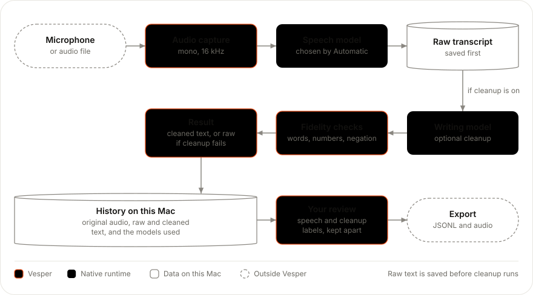
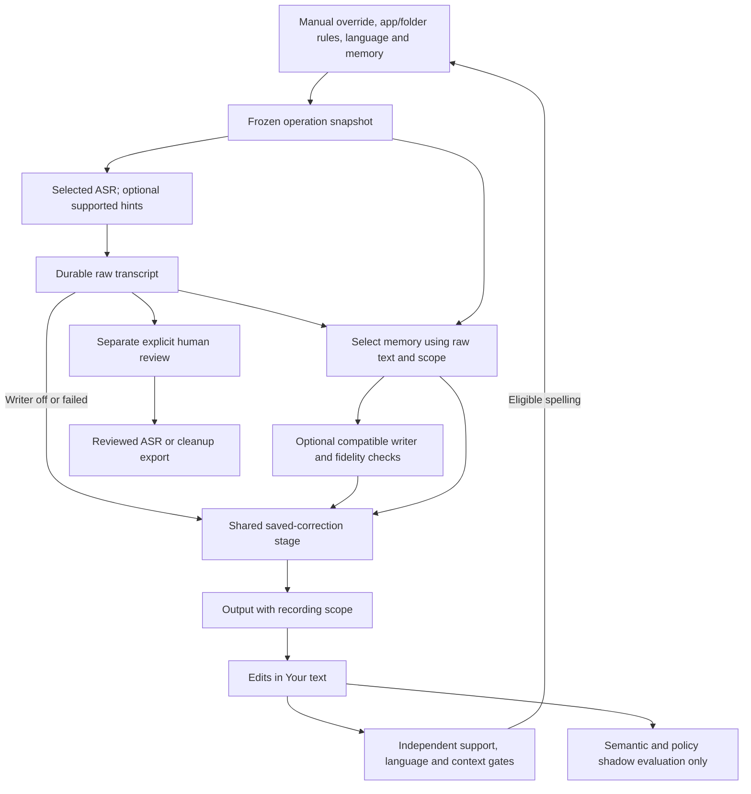

# Architecture

The Tauri application runs native inference from Rust and renders Svelte 5 in the system WebView. The selected speech adapter always runs locally: all current ASR adapters expose recording previews through a common session. Nemotron uses native cache-aware streaming; English/Metal Qwen uses native MLX previews; completed-audio adapters use bounded buffered previews followed by an authoritative full-recording pass. Automatic picks the runtime for each model and Mac (CPU, Apple GPU or Neural Engine). See [live adapters](live-transcription.md). Python is not in the runtime dependency path.

The [backend inference architecture](inference-architecture.md) gives the detailed component diagrams: worker ownership, adapters and backends, live pipeline, audio frontend, writer, diarization, model installation and failure policy. Accepted decisions are indexed in [Architecture Decision Records](adrs/README.md). Exact database, filesystem, settings, model-storage, privacy, and failure semantics live in the canonical [Application internals](internals.md) document.

<picture>
  <source media="(prefers-color-scheme: dark)" srcset="assets/diagrams/architecture-data-flow.dark.svg">
  
</picture>

Diagram source: [architecture-data-flow.mjs](diagrams/architecture-data-flow.mjs)

Collection is configurable. With it disabled, recording and inference run without an audio/session archive. Explicit recording cancellation discards the in-progress capture. Closing the main window hides it and leaves ongoing capture running; reopen it from the menu bar or use the recording shortcut to stop. Quit is blocked until active work finishes or is explicitly cancelled. Force termination or power loss cannot preserve a buffer held in memory.

## Boundaries

| Module                    | Responsibility                                                                                                                                                                                                                       |
| ------------------------- | ------------------------------------------------------------------------------------------------------------------------------------------------------------------------------------------------------------------------------------ |
| `vesper-core`             | Validated configuration and shared model/transcript types                                                                                                                                                                            |
| `vesper-audio`            | CPAL capture on an owning thread; bounded callback ring; native-rate/channel float WAV; Symphonia decoding and filtered resampling                                                                                                   |
| `vesper-models`           | Per-model and selected-pipeline inventories, explicit allow-listed downloads, atomic publication, size/SHA-256 verification, provenance                                                                                              |
| `vesper-nemo`             | Safe recognizer/stream/result ownership over the pinned NeMo-Speech.cpp versioned C ABI; the only crate allowed to contain NeMo C ABI FFI code; `vesper-mlx` and `vesper-desktop-platform` carry their own audited unsafe boundaries |
| `vesper-inference`        | Bounded inference worker; Nemotron, Parakeet/Qwen3-ASR/Cohere through sherpa-onnx, LFM2.5 Audio through llama.cpp/mtmd, and Qwen cleanup; per-request state isolation, cancellation and output guards                                |
| `vesper-mlx`              | Optional (`mlx` feature) safe wrapper over the MLX Swift bridge dylib                                                                                                                                                                |
| `vesper-desktop-platform` | macOS native recorder panel, final-text insertion and project detection bridge                                                                                                                                                       |
| `vesper-data`             | Original audio, SQLite metadata, immutable predictions, append-only human reviews, portable exports                                                                                                                                  |
| `src-tauri/runtime.rs`    | One active job, progress, config snapshot, durable raw output before cleanup, failure handling                                                                                                                                       |
| Svelte frontend           | Main workspace plus the compact quick-capture window; model installation, record/stop/cancel, file transcription, results, settings, review/export                                                                                   |

## Model catalog, installation, and selection

Model availability and the active inference pipeline are related but independent.

`vesper-core` enumerates runnable built-ins; `models/artifacts.json` is the authoritative executable file manifest. `vesper-models` combines them with up to one selected custom profile per role. `list_model_installations` reports every installable entry, while `install_model` accepts only an entry from that catalog and never changes settings. Qwen Q4 and Q8 are separate downloads. `install_models` remains the convenience operation for the complete selected pipeline.

Fast UI status distinguishes artifact presence from runtime readiness. Full hashes are checked during installation and immediately before inference. Browser preview renders catalog metadata but cannot inspect the filesystem or download files; those actions require Tauri.

Dictate and Settings bind to one persisted transcription-language field. The frontend derives its visible choices from the selected model's vendor-declared languages in `models/languages.json` (plus Automatic where declared), then intersects them with the enabled writer's declared languages. Native save and writing guards enforce compatibility too; an incompatible legacy writer preserves raw output with a warning. This is recognition guidance, not a translation stage. Fresh settings use explicit English because Cohere is the current default; Automatic is offered only by compatible configurations and is not proof of code-switching quality. See the [canonical language matrix](language-support-and-recommendations.md).

## Execution and cancellation

Only a Record request starts capture. Device enumeration and app startup do not record. CPAL's callback performs bounded sample conversion/ring writes; its owning worker drains buffers, mixes 20 ms native-rate mono chunks into a bounded 32-item queue, and separately retains native-rate/channel samples for archival. NeMo performs input resampling. Native device errors retain usable complete frames with a warning. If the worker stalls long enough to fill the 2-second ring, the callback skips whole buffers, counts the skipped samples, and keeps recording; the finished recording carries a warning naming the skipped duration. Inference and all channel waits run outside the UI/audio callback.

The application allows one recording, transcription, or model installation at a time. A gate serializes settings changes with the config snapshot and job start. The entire recording uses that saved snapshot. Each recording watcher is bound to its operation identifier, preventing an old watcher from stopping a newer recording.

The Tauri global-shortcut plugin routes press/release events to the native dictation controller. Hold release and Toggle Stop are associated with the same runtime operation, including release during startup. The floating recorder renders retained native state and existing ASR partials; its WebView does not own shortcut capture. On macOS a nonactivating NSPanel hosts the retained capture content view and an opt-in platform adapter delivers final text to a revalidated original field, with Copy fallback. The native controller and main workspace share the same Rust runtime and recorder. Users can hide the strip without disabling shortcut capture. See ADR-0014 for permissions, clipboard preservation, native-view ownership, and platform limitations. The notification plugin reports success or failure only after explicit permission, and notification text never contains the transcript.

There is no recording or import duration quota (ADR-0011). The audio buffer ceiling stops capture even with the window minimized; the native watcher flushes the last partial capture chunk, finishes the selected live session, then uses either the native terminal result or the complete original recording for final processing. Manual Stop remains authoritative; automatic endpointing is not enabled. Qwen3-ASR, Cohere, and LFM process completed audio in bounded, contiguous segments with fresh request-local state for each. The sherpa-onnx adapters additionally require a native completion report. Failed segments do not publish a successful prefix. Imported files exceeding a resource limit are rejected without silent truncation; with collection enabled their originals are already archived. ASR cancellation closes the per-recording stream; generative adapters check at their supported boundaries. Download cancellation is checked between network reads. A stalled network read can delay cancellation until its timeout.

Raw ASR output is persisted and published before cleanup. A cleanup rejection, failure, or cancellation leaves raw text available. Storage failures are surfaced rather than presented as successful archival. Window close hides the workspace without cancelling work. Explicit Quit, including Cmd-Q and Dock quit, requires an idle runtime; the state lock marks shutdown before another operation can begin.

## Models and text fidelity

Nemotron 3.5 uses the official Q8 GGUF and NeMo-Speech.cpp 0.1.0. It is the selectable native-streaming model and maps Automatic and the 28 declared locales in `models/languages.json` to NeMo locale prompts. One bounded Rust worker owns a resident C-ABI recognizer; every microphone recording gets a fresh single-threaded native stream and emits operation-scoped, monotonic partial/final events. Stop flushes all capture audio, calls stream finish, drains results, and only then makes final raw text durable. Imported files use the same resident recognizer's offline API. Original archived microphone audio remains float WAV. Cohere is the fresh-settings default for completed recordings. Parakeet v3 remains an offline CPU fallback through sherpa-onnx 1.13.8 and does not support Hindi. Its Automatic engine runs NVIDIA's one Q8_0 GGUF through the same NeMo-Speech.cpp runtime on CPU, Metal, CUDA or Vulkan, for completed audio with buffered live drafts; there is no user-facing engine choice ([ADR-0024](adrs/0024-unified-gguf-speech-engine.md), [ADR-0026](adrs/0026-automatic-speech-engine.md)).

Qwen3-ASR and Cohere process completed recordings on CPU with strict language mapping and no whole-recording duration cutoff. Qwen-ASR, Parakeet-family and Cohere retain the selected verified recognizer in the bounded worker with observed-file invalidation ([ADR-0017](adrs/0017-resident-cohere-recognizer.md)). Internally, long audio uses contiguous bounded parts with fresh per-part streams, verified completion, and operation-scoped progress ([ADR-0011](adrs/0011-segment-long-generative-asr.md)): 10 s for Qwen-ASR/Cohere, 29 s for Whisper and 30 s for Parakeet-family transducers. A pinned Sherpa source patch reports actual decoder completion and context loss through existing stream options. Incomplete/error results are rejected, and exact digital silence bypasses inference. See [the completion contract and qualification evidence](offline-asr.md).

Whisper Small and Turbo share one architecture adapter and the same resident Sherpa wrapper as Cohere under [ADR-0018](adrs/0018-shared-whisper-adapter.md). Pinned INT8 installation and completed-audio evaluation are implemented; the picker offers both by owner decision (2026-10-07) although the noise/repetition quality gates still fail. Whisper uses fresh, non-overlapping segments of at most 29 seconds and adds confidence/language reporting plus explicit EOS/cap validation. Its live adapter uses buffered provisional decoding and retains the strict completed-audio final pass. This adds no cross-recording KV reuse or new kernel backend.

Qwen3.5-0.8B uses text-only GGUF through llama-cpp-2 0.1.159. The text chat template explicitly closes thinking before generation. The worker retains immutable model weights but creates a fresh context for every final transcript, with deterministic greedy decoding and bounded context/output. Apple Silicon offloads through Metal; CUDA, Vulkan, and ROCm cleanup require their matching compile-time feature. In `Auto`, failed accelerator initialization is retried on CPU; an explicitly requested accelerator remains an error.

Cleanup is one fresh-context pass over the complete final raw transcript after Stop. Minimal (the default) is formatting-only: normalized word sequences must match. Balanced may adjust wording. `fidelity::validate` checks the output against the raw ASR, and the raw text is kept on rejection, failure or cancellation. These checks do not prove semantic equivalence, so raw output stays visible and corrected output needs review. Custom instructions replace the preset instruction but do not disable baseline checks. The earlier guarded technical-tail pass was retired ([ADR-0008](adrs/0008-guarded-technical-tail-correction.md)). The exact implementation and examples are versioned in `vesper-inference`.

`models/artifacts.json` pins revisions, artifact names, byte sizes, hashes, sources, and license descriptions. UI inventory checks existence/size quickly; installation and inference check complete hashes. **Verify files** can repair a damaged file even when its size matches. Valid files are retained. Model files live outside the bundle, in app data by default, or a configured directory; `VESPER_MODEL_DIR` supplies a development default.

## Data and improvement

SQLite uses WAL and full synchronization. Audio is staged, hashed, and moved into its final location before a record is published. Imported files retain exact bytes; captured PCM retains native rate/channels, represented as f32 WAV. Session metadata includes config, raw and cleaned predictions, actual pinned model/runtime provenance, events, and separate human revision history.

Settings are atomically replaced JSON rather than database rows; original audio and model artifacts remain ordinary files; current job status is memory-only. See [Application internals](internals.md) for the exact SQL schema, session fields, paths, limits, transactions, export format, retention gaps, and recovery behavior.

`set_transcripts` stores raw predictions once. `complete_cleanup` can append the first cleanup afterward without replacing raw text. Verbatim human transcripts supervise ASR; edited human wording paired with the raw input supervises cleanup. Model output is never automatically promoted to a label.

Exports contain original audio, metadata, explicit ASR/cleanup targets, and task eligibility. Reviewed export excludes records without an eligible human label. Archive export preserves pending records with null targets. Audio hashes are rechecked, unsafe paths rejected, and nonempty destinations never overwritten.

Continuous model improvement remains a separate train/evaluate/promote milestone. Both configured promotion modes require reviewed examples. Python can be added to that optional training environment without adding it to this app. See [the improvement plan](self-improvement.md).

### Current personalization boundaries

This diagram describes the implemented flow. The operation freezes its project,
language and memory before using them. Projects resolve from an explicit manual
override or bounded app/folder rules. Semantic/policy evaluations do not activate memory
or train models. Detailed contracts live in the [personalization guide](personalization/README.md).

The shared correction stage remains available with writing disabled or failed;
unsupported decoder hints do not disable memory. Ordinary edits are spelling
evidence, not reviewed training targets.
There is no edge from shadow candidates or reviewed exports to a live training
or promotion service because that service is not implemented.

Keep these diagrams in sync using the [Mermaid and Excalidraw review workflow](project-workflow.md#architecture-diagram-workflow).

## Evaluation and model recommendations

`vesper-eval` is a development-only workspace crate. It calls the same audio decoder, `InferenceManager`, native model adapters, and cleanup path as the desktop backend, but writes immutable JSON evidence instead of application sessions. A versioned manifest binds each held-out sample to its source/revision/license, audio SHA-256, transcript, language, duration, scenario, and natural-versus-synthetic status.

The evaluation path is `pinned corpus → deterministic preparation → manifest validation → native adapter → Unicode WER/grapheme scoring → comparable evidence groups → compatibility filter and ranking`. Corpus files, machine-specific environments, and raw reports stay in the gitignored benchmark cache. Capability metadata is checked in, but candidates whose architecture is not executable remain ineligible for recommendation.

Compatibility is a hard gate over language, application mode, actual backend, duration, automatic-language need, code-switching, and singing. Only results with the same evaluation envelope may rank models. Official model claims can identify candidates; they never outrank comparable local measurements or silently change the default. See the [benchmark contract](../benchmarks/asr/README.md).

The application currently uses compatibility metadata to filter language and download choices; it does not consume benchmark evidence to automatically select or install a model. The complete current-versus-planned behavior is documented in [Language support and model recommendations](language-support-and-recommendations.md).

## Remaining validation and features

Live microphone permission/device behavior, global shortcut conflicts, and operating-system notification permission require deliberate manual checks; automated tests use synthetic/public files only. Cross-platform accelerator builds, large/noisy multilingual datasets, memory/latency distributions, cancellation under heavy native load, and release signing need broader validation. Automatic endpointing and model training/promotion are not implemented. The new macOS external-app insertion path still requires qualified real-application tests with Accessibility/event-posting permission; Windows/Linux insertion is not implemented.
