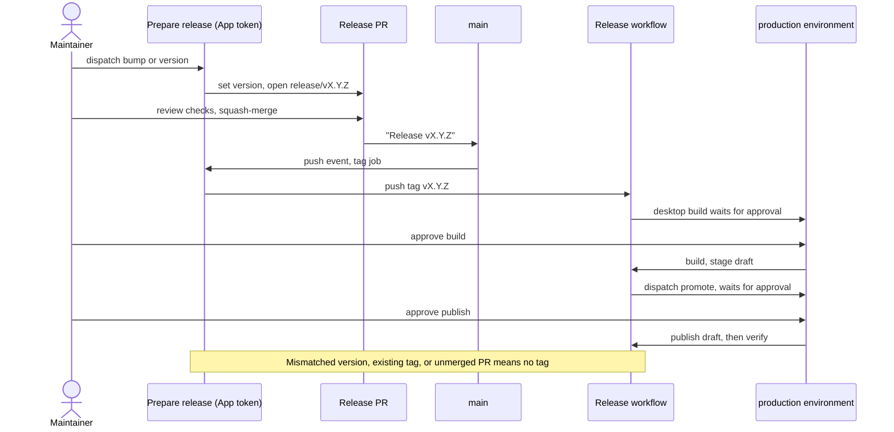

# macOS CI, versions, and releases

The current desktop target is **macOS on Apple silicon**. Tauri bundles the
frontend inside the Mac application. Nginx and Docker belong only to an optional
manual browser preview and are not required to develop, test or release the app.
Ubuntu runners still execute portable frontend/tooling/security checks; that
runner choice does not make Linux a supported desktop product.

## Pull-request checks

Pull requests, merge-queue entries, main pushes, and manual runs execute checks
without accessing installed models, microphones, or user data. Version tags reuse
the same checks before packaging. Stable PR check names are:

1. `Check / Frontend and repository hygiene`
2. `Check / Browser regressions`
3. `Check / Rust (macOS)`
4. `Security / Secrets`
5. `Security / Dependencies`
6. `Security / Python benchmarks (audio-frontend)`
7. `Security / Python benchmarks (vibevoice)`
8. `Security / Python benchmarks (onnx-quantize)`
9. `Security / Python benchmarks (mlx-convert)`

The benchmark names come from the `security.yml` matrix, so adding or removing a
benchmark project adds or removes a check.

The frontend job runs repository hooks, actionlint with ShellCheck, zizmor,
and `make check-portable`: source formatting, ESLint, Ruff, shell linting,
synchronized-version checks, Svelte/TypeScript, all Node tooling tests, all
Python test modules, and the production frontend build. Python test discovery
handles `test-*.py`, `test_*.py`, and `*.test.py` in `scripts/`; every module runs
in an isolated interpreter, and any failure fails the job. These tests use
synthetic data and use the `dev` group in `pyproject.toml`, resolved by the
versioned `uv.lock`. Optional model/inference projects are kept separate.
`make python-lock-check` checks all Python lockfiles and generated benchmark
exports. CI installs uv 0.12.15 through a SHA-pinned action and selects Python
3.12. The frontend job caches downloads under `.cache/uv`, keyed by lockfiles;
only pushes to `main` save that cache. It also restores pre-commit's hook
environments (`~/.cache/pre-commit`, keyed on `.pre-commit-config.yaml` and saved
only from `main`): installing them, including Go builds of gitleaks and
actionlint, took about 2.5 of the job's 3.2 minutes. Security jobs disable cache
reuse.

The `Rust (macOS)` job (the slowest check, about 25 minutes cold) restores a
`Swatinem/rust-cache` of the Cargo registry and dependency builds, saved only from
pushes to `main` so pull requests never churn the shared repository cache (10 GB
limit). It builds with `CARGO_INCREMENTAL=0` and
`CARGO_PROFILE_DEV_DEBUG=line-tables-only` because CI never debugs these
artifacts. The MLX Swift packages (about 8 minutes from scratch) are cached the
same way, in `.tooling/mlx-build`, saved only from `main`. The cache key changes
with the Swift manifest and lockfile, the MLX Audio patches, the build scripts and
the Xcode version, and any of those starts a cold build because the patched
checkouts live in that directory. A change to the bridge sources under
`native/mlx/Sources` restores the previous build, so only VesperMLX recompiles.
The macOS bundle build is not parallelized. Measured effect is recorded in
[issue #228](https://github.com/rahulsharmavishwakarma/vesper/issues/228) and
[issue #298](https://github.com/rahulsharmavishwakarma/vesper/issues/298), not
assumed here.

### Change-based job selection

On pull requests, a small `scope` job in each workflow lists the files the merge
would change (`git diff HEAD^1 HEAD` on the merge commit) and
[`scripts/ci-scope.mjs`](../scripts/ci-scope.mjs) decides which heavy jobs they
need:

| Job | Skipped when every changed file is… |
| --- | --- |
| `Rust (macOS)` | documentation, Markdown, notebooks, the Pages `site/`, Python benchmark projects, or the browser-only frontend (`apps/desktop/src/`, `apps/desktop/tests/`, Playwright/ESLint config) |
| `Browser regressions` | documentation, Markdown, notebooks, `site/`, Python benchmark projects, or Rust/native-only paths (`crates/`, `native/`, `patches/`, `vendor/`, `apps/desktop/src-tauri/`, Cargo and toolchain files) |
| `Python benchmarks (…)` | anything other than a benchmark project, its exported requirements, the root `pyproject.toml`/`uv.lock` or the `Makefile` |
| GLib backport step in `Dependencies` | anything other than `vendor/glib/`, `tests/glib-backport/`, Cargo manifests and lockfile, the toolchain file, `scripts/audit-rust.py`/`test_rust_audit.py` or the `Makefile` |

The rules list what each job can ignore, so a path nobody anticipated still runs
the job. Rust embeds files from `models/` and `benchmarks/`, so those always run
it. Changing a workflow or the scope script runs everything, and so do pushes to
`main`, release tags, merge-queue entries, manual runs, the weekly security
schedule and any pull request whose file list comes back empty. `Frontend and
repository hygiene`, `Dependencies` and `Secrets` always run; inside
`Dependencies` only the GLib backport regression is scoped. That step installs
GLib's development files from the Ubuntu mirror, its only network-bound part:
over 40 runs before scoping it took a median of 0.5 min but 2.5 min at the 90th
percentile, once 6 min 42 s for 4.7 MB and once a 20-minute hang. It now retries
`apt` with 30-second timeouts and is capped at 8 minutes, so a bad mirror fails
fast and can be re-run.

Skipping uses a job-level `if:`, never workflow `paths:` filters: GitHub reports a
job skipped by its condition as successful, so required checks still pass, while
a workflow that never starts would leave them pending forever. The condition is
`!cancelled() && needs.scope.outputs.<job> != 'false'`, so if the scope job itself
fails, the jobs run instead of being skipped as passed.

Native-protocol tests in `scripts/test-vibevoice-bitnet.py` launch synthetic
children through the real resource wrapper. It uses BSD `/usr/bin/time -l` on
macOS and GNU `/usr/bin/time -f` on the Ubuntu portable runner. GNU peak RSS is
reported in KiB and converted to bytes; macOS already reports bytes. The GNU
format is an explicit marker, so parsing does not depend on localized labels or
the caller's `TIME` environment variable. Missing memory evidence stays absent.
See GNU time's [format options](https://www.gnu.org/software/time/manual/html_node/Setting-Format.html)
and [memory fields](https://www.gnu.org/software/time/manual/html_node/Memory-Resources.html).
Using `-l` on Ubuntu exits before the child emits its protocol record and causes
misleading missing-measurement failures. Do not skip those assertions or move the
portable suite to macOS to conceal the failure. The full benchmark's macOS power
sampling remains platform-specific; this wrapper portability does not qualify
Linux inference or change the supported desktop platform.

The portability correction was validated locally on macOS with the complete
`make check-portable` gate, including nine passing protocol/resource tests and
all nine Python suites. Platform-selection and byte-conversion fixtures cover
both BSD and GNU output; the real subprocess test checks memory evidence on the
current host. This is local evidence, not a successful Ubuntu Actions rerun.

The browser job runs the existing `tests/recovery.html` scenarios in Chromium
with mocked Tauri commands through Playwright. It fails on scenario failures,
uncaught browser errors, or missing completion; it does not retry away failures.
On failure it retains only the synthetic test report, screenshot and trace for
seven days. Local commands are `make test-browser` and `make test-python`.

The native job uses the Apple-silicon `macos-15` runner with Rust 1.98.1 from
`rust-toolchain.toml`. It verifies the pinned patched runtime, runs native
completion-report tests, formatting, locked all-target compilation/tests,
separate doctests, strict Clippy and rustdoc with warnings denied,
then builds a debug `.app` and verifies its executable exists. Compiler upgrades
must pass these checks. Model/hardware tests remain explicit opt-in checks.
Linux, Windows and Intel Mac packaging/qualification are outside the current CI
scope. Runner architectures follow
[GitHub's runner reference](https://docs.github.com/en/actions/reference/runners/github-hosted-runners);
app packaging follows [Tauri's macOS bundle documentation](https://v2.tauri.app/distribute/macos-application-bundle/).

### Language coverage

| Source | Formatting | Lint/type/build checks | Tests |
| --- | --- | --- | --- |
| Rust workspace | `cargo fmt --all -- --check` | Locked `cargo check` and Clippy across all targets; Clippy/rustdoc deny warnings; native app build | `cargo test --workspace --all-targets --locked` plus a separate `--doc` run |
| Isolated Rust integrity probe | Its own manifest's rustfmt check | Locked all-target/all-feature check and strict Clippy | Its own all-target/all-feature test harness |
| TypeScript/Svelte | Prettier with the Svelte plugin | ESLint recommended JS/TS/Svelte rules, zero warnings; strict `svelte-check`, including the interaction preview fixture; Vite build | Node helper tests and mocked-native Playwright regressions |
| JavaScript/Node tools | Prettier | ESLint recommended rules, zero warnings | All existing `scripts/*.test.mjs` and frontend helper suites |
| Python tooling | Ruff format | Ruff syntax, Pyflakes, style-error and import-order rules | Every existing Python test naming convention in `scripts/` |
| POSIX shell scripts | shfmt syntax/format check | ShellCheck, including sourced project files | Exercised by native reporting/build/release checks where applicable |
| JSON/YAML/TOML/Actions | Root JSON uses Prettier; generic whitespace hooks | Syntax hooks, actionlint/ShellCheck and zizmor | Workflow checks and version/publication tooling tests |

All targets includes Rust example test harnesses that plain `cargo test` only
compiled. Cargo's `--all-targets` excludes doctests, so the separate `--doc`
command must remain. The isolated integrity probe is not a workspace member and
is checked explicitly. Its `hardware` feature is supported on the Mac runner;
the app's CUDA/Vulkan/ROCm features require other toolchains and are not enabled
together through `--all-features`. The current supported Mac configuration and
all of its deterministic tests are covered. Existing ignored model/hardware
qualification cases stay opt-in; CI does not download weights or open a microphone.
Python inference/benchmark entrypoints are parsed/linted/formatted without
executing their downloads or importing optional model runtimes. Python static
type checking is not claimed; most tooling is unannotated.

Direct development versions are pinned in npm/Python manifests: ESLint 10.12.0,
typescript-eslint 8.71.1, eslint-plugin-svelte 3.23.1, Prettier 3.9.10 with
prettier-plugin-svelte 4.1.1, Ruff 0.17.0, ShellCheck 0.11.0 via shellcheck-py
0.11.0.1, and shfmt 3.14.1 via shfmt-py 4.2.0. Node 24 is used in CI; the lint
toolchain requires at least Node 22.13 in the supported 22.x line. ESLint permits
intentionally unused underscore-prefixed callback arguments; Svelte TypeScript
names are resolved by `svelte-check` instead of ESLint's JavaScript `no-undef`.
No baseline of ignored lint findings is used.

Configuration follows the official [Cargo test reference](https://doc.rust-lang.org/cargo/commands/cargo-test.html),
[Ruff configuration](https://docs.astral.sh/ruff/configuration/),
[typescript-eslint setup](https://typescript-eslint.io/getting-started/),
[Svelte ESLint guide](https://sveltejs.github.io/eslint-plugin-svelte/user-guide/),
and [Prettier configuration](https://prettier.io/docs/configuration).

Workflows grant read-only repository access to pull-request code, disable
persisted checkout credentials, bound job durations, and cancel obsolete check
runs. Every third-party action and remote hook is pinned to a full commit SHA.
The runtime cache is limited to test builds; release packaging does not restore build caches. Two narrow zizmor style annotations
retain `./` local workflow references until actionlint supports GitHub's newer
`$/` spelling; no vulnerability rule is disabled. The guidance follows
[GitHub secure-use practices](https://docs.github.com/en/actions/reference/security/secure-use),
[actionlint](https://github.com/rhysd/actionlint/blob/main/docs/usage.md), and
[zizmor](https://docs.zizmor.sh/integrations/).

The repository is public, and repository rulesets protect `main`: changes arrive
through pull requests, commits must carry verified signatures, and force pushes
and branch deletion are refused. The repository admin and the release bot app
are bypass actors so the bot can tag merged release pull requests.

A separate ruleset, `main required checks`, applies only to the default branch
and blocks merging until these five GitHub Actions checks pass:
`Frontend and repository hygiene`, `Browser regressions`, `Rust (macOS)`,
`Dependencies` and `Secrets` ([issue #281](https://github.com/rahulsharmavishwakarma/vesper/issues/281)).
Branches need not be up to date with `main` first, so a merge does not force
every open pull request to re-run the macOS job. The rule is kept off the
all-branches ruleset because there it would also refuse ordinary pushes to
feature branches. The benchmark matrix checks are not required: their names
follow the `security.yml` matrix, so a newly added project would block every
pull request opened before it. CodeQL and GitGuardian also run but are not
required. The same two bypass actors apply. Release-only jobs never run on pull
requests and must not be required.

(The 2026-09-19 review found the rulesets API returning HTTP 403 while the
repository was private; that no longer applies.) See GitHub's
[ruleset availability](https://docs.github.com/en/repositories/configuring-branches-and-merges-in-your-repository/managing-rulesets/about-rulesets).

CodeQL runs through GitHub's default code-scanning setup (repository Settings →
Code security, not a workflow file). It scans Actions, C/C++, JavaScript/TypeScript,
Python and Rust on pull requests, `main` pushes and weekly. It finds flaws in
this repository's own code, which the dependency, secret and workflow linters do
not cover. It is not a required check. Fix alerts in our code. Alerts in
`vendor/glib` are dismissed with a recorded reason, not edited, because that
directory is gtk-rs `glib` 0.18.5 kept only for the RUSTSEC-2024-0429 backport,
its provenance is verified byte for byte, and only Tauri's Linux GTK/WebKit stack
compiles it, not the macOS app. Dismissals and their reasons are in
[issue #305](https://github.com/rahulsharmavishwakarma/vesper/issues/305). The
directory goes away once that stack moves to `glib` 0.20 or newer.

Job names above are an API contract for the required-checks ruleset: renaming a
required job leaves pull requests waiting for a check that never reports, so
rename only together with the ruleset.

## Local setup and hook scope

After installing the native prerequisites and running `make setup`, use Python
3.12 or newer for contributor checks (the native application still needs no
Python runtime):

```sh
make setup-checks
make hooks
make precommit
make workflows
make check
```

Install [uv](https://docs.astral.sh/uv/getting-started/installation/) first.
`setup-checks` runs `uv sync --locked` to create `.venv` from `pyproject.toml`
and `uv.lock`, then downloads Chromium. Python 3.12+ is required; uv can provision
the interpreter. Old `.tooling/ci-venv` directories are preserved and unused.
On Linux install Chromium system libraries
with `PLAYWRIGHT_BROWSERS_PATH="$PWD/.cache/playwright" npm exec playwright install --with-deps chromium`. Hooks provision their own
isolated environments, including Go-based actionlint, ShellCheck and Gitleaks;
the first installation requires network access. `make hooks` installs both
pre-commit and pre-push. `make precommit` runs the pre-commit stage; `make prepush`
runs lightweight file hygiene and version-consistency checks. The automatic push
hook does not compile Rust, run browser tests or invoke `make check`: Git has
already contacted the remote when it invokes pre-push, so a long build can leave
the SSH connection idle until it disconnects. Run `make check` explicitly before
`git push` for full local validation, without an open push connection. All full
checks remain in the existing PR/main/merge-group CI jobs. SSH keep-alives can
help an unreliable connection, but are not a replacement for this shorter hook.
Existing installed hooks read the updated configuration; reinstalling or using
`--no-verify` is unnecessary. Initial tool provisioning still needs setup and may
take longer than a run with cached tools.

`make check-fast` runs formatting for
Rust/Python/frontend/shell, ESLint/Ruff/ShellCheck, Svelte/TypeScript diagnostics
and Node tests. `make fmt` applies all source formatters; `make fmt-check` checks
without editing. `make lint` runs all language linters. Individual targets use
the `-rust`, `-web`, `-python` and `-shell` suffixes (for example,
`make lint-python fmt-python-check`). `make check` adds Python/browser/native
tests, all Rust target/doctest runs, compilation and documentation checks;
workflow/security scans are separate
commands rather than silently included in that target.

Hooks normally enforce a 1 MiB per-file limit, including already-tracked files.
Exactly three existing public benchmark evidence JSON files listed in
`.pre-commit-config.yaml` have a separately enforced 5 MiB limit. Patch whitespace
is preserved for both native-test and runtime patches. Recordings, model weights,
local database scratch files, release outputs and browser reports remain ignored.

`pre-commit run --all-files` uses Git's tracked-file list. It does **not** validate
an entirely untracked checkout. Before an initial baseline, pass the explicit
`git ls-files --cached --others --exclude-standard` file list to `pre-commit run
--files`; never stage files merely to make validation run. Gitleaks' staged hook
also cannot establish coverage of untracked files; scan an isolated copy of the
eligible source files with `gitleaks dir --redact` separately. Never point a broad
scanner or artifact upload at local private recordings or downloaded models.

Refresh hook revisions periodically with `uv run --locked pre-commit autoupdate --freeze`, review
the changes, and rerun checks. Dependabot manages Actions pins, not these hook
revisions. Python direct and transitive dependencies are locked by uv. Change
contributor dependencies with `uv add --dev` / `uv remove --dev` and include the
manifest and lockfile together. Benchmark projects retain generated requirements
exports for existing consumers; regenerate them using the commands below and
copy each export to its corresponding `benchmarks/asr/` requirements file:

```sh
mkdir -p .cache
uv export --locked --project benchmarks/asr/python/audio-frontend --no-dev --no-emit-project --output-file .cache/audio-frontend-requirements.txt
uv export --locked --project benchmarks/asr/python/vibevoice --no-dev --no-emit-project --output-file .cache/vibevoice-reference-requirements.txt
```

The export commands intentionally match `make python-lock-check`, including the
generated header. Keep hashes and environment markers; do not hand-edit exports.
Dependabot updates the uv manifests/locks; its benchmark PRs need regenerated
exports before the check passes. Historical benchmark results require fresh
qualification before attributing them to changed environments.

Frontend coverage is shared between local hooks and CI:

| Check | Local command | Hook stage |
| --- | --- | --- |
| TypeScript/Svelte/JavaScript formatting (Prettier) | `make fmt-web-check` | pre-commit |
| TypeScript/Svelte/JavaScript lint (ESLint, warnings denied) | `make lint-web` | pre-commit |
| Svelte and TypeScript diagnostics | `make check-web` | pre-commit |
| Frontend helper and repository tests (Node) | `make test-tools` | pre-commit |
| Version consistency | `make version-check` | pre-push |
| Mocked-native UI regressions (Playwright/Chromium) | `make test-browser` | Explicit local check and CI |

`make hooks` installs both stages. CI runs those checks independently of local
hook installation; the portable job also builds frontend assets.

Hook staging follows [pre-commit's stage configuration](https://pre-commit.com/#confining-hooks-to-run-at-certain-stages).
The remote-ref timing is documented in [Git's pre-push hook contract](https://git-scm.com/docs/githooks#_pre_push).

Local verification on 19 September 2026: the actual `make prepush` stage finished
in 0.50 seconds with existing hook environments. A deliberate Tauri version
mismatch failed in 0.47 seconds, and its file was restored afterward. Cargo,
npm, Chromium and CMake were replaced with failing sentinels on the test PATH;
none was invoked. The pre-commit stage, explicit `make check` recipes and hosted
CI jobs are unchanged. These are local warm-tool measurements, not a promise
about first-time setup or network latency.

## Security gates

Gitleaks 8.28.0 runs on pull requests, merge groups, default-branch/tag pushes,
release publication, the weekly schedule, and manual security runs. CI downloads
the pinned Linux executable, verifies its exact SHA-256, and runs the CLI over
all available Git history. This avoids the wrapper action's restricted event
list, which excludes release and merge-group events. When updating the binary,
update the version and checksum together from the official release. Trivy
0.74.0 scans the checked-out tree so a secret remains detectable even when an
unusual merge history hides its introducing commit. The local pre-commit hook
also runs Gitleaks against staged changes and the generic hooks reject private
keys. Never add a broad allowlist to make a finding disappear: verify a false
positive and suppress only its exact fingerprint with a documented reason. The current exact fingerprints cover one existing
runtime digest plus 45 authored `constructed-NNNN` episode IDs and 17 public
source/native-library SHA-256 values. They do not exclude entire files, paths or
rules; a synthetic API-key control was separately confirmed to fail the scanner.

The dependency job installs packages without lifecycle scripts, runs `npm audit`
against production **and development** dependencies, runs `make audit-python`,
and runs the verified-source `make audit-rust` wrapper with cargo-audit 0.22.2 (the
upstream Linux release binary, checked against its SHA-256 in `security.yml`
rather than compiled on every run) against RustSec with
known vulnerabilities and `unsound` advisories denied. Maintenance warnings stay
visible for dependency-upgrade planning without broad ignores. Separate
Apple-silicon macOS matrix jobs audit both isolated Python benchmark graphs;
one failure does not cancel the other job. Dependabot checks
npm, Cargo, GitHub Actions, Docker and the three uv projects weekly, with
routing labels, five open PRs per ecosystem and a seven-day version-update
cooldown. Security-update behavior is governed separately by Dependabot. The
optional manually dispatched container job scans the
final runnable image and fails for high or critical vulnerabilities, including
findings that do not yet have an upstream fix. A temporary exception therefore
requires an explicit, narrow, reviewed policy change rather than being silently
filtered.

`make audit-python` generates an ignored, hashed requirements export of the
locked contributor groups (`dev` and `benchmark`), then runs
`uv run --locked pip-audit --strict --require-hashes
--disable-pip` against it. The audit cannot silently resolve newer transitive
versions. `make audit-python-audio-frontend` and `make audit-python-vibevoice`
use the same auditor against fresh exports of their owning locks. They require
Apple-silicon macOS: running these exports through a Linux auditor would skip
their platform-marked dependencies and could produce an empty, misleading pass.

Advisories published after a lock was written fail these audits on every pull
request until the lock moves, even on unrelated changes. On 20 October 2026 that
happened twice: `pillow` 12.3.0 (eight CVEs, fixed in 13.0.0, VibeVoice lock) and
`certifi` 2026.7.22 (GHSA-6q48-6c7w-9gw2, fixed in 2026.10.19; root, cleanup and
VibeVoice locks). The fix is `uv lock --upgrade-package` for exactly those
packages (the VibeVoice `pyproject.toml` pins both directly), regeneration of
`benchmarks/asr/vibevoice-reference-requirements.txt` with the same
`uv export ... --output-file .cache/vibevoice-reference-requirements.txt` command
`make python-lock-check` compares against (the output path is recorded in the
file's header), and `make audit-python` plus `make audit-python-vibevoice`
([issue #248](https://github.com/rahulsharmavishwakarma/vesper/issues/248)).
The audit jobs install only contributor tools, not model runtimes or weights.
All manifests and lockfiles stay versioned, while `.venv` and `.cache` stay ignored.

### Dependency security status and upstream limits

The 2026-09-19 remediation resolves 12 of the 17 inventoried Dependabot findings
in the local dependency graph. These changes have to reach the default branch
before GitHub can re-evaluate its alerts. No alert was dismissed, dependency
marker removed, or advisory ignored. [Issue #57](https://github.com/rahulsharmavishwakarma/vesper/issues/57)
tracks the remaining work; this is not a claim that the repository is free of
known advisories.

| Optional VibeVoice dependency | Result | Dependabot alerts addressed |
| --- | --- | --- |
| Accelerate 1.10.1 | Removed; the CPU probe does not use its APIs or device dispatch | 17 |
| Torch 2.8.0 | Updated to 2.13.0 | 11, 12, 15 |
| Diffusers 0.35.1 | Updated to 0.38.0, requiring Safetensors 0.8.0 | 9, 10 |
| Transformers 4.51.3 | Updated to 4.57.6, with Tokenizers 0.22.2 | 2–7 |

The earlier compatible-only update still left Transformers 4.57.6 findings and
GLib 0.18.5 / RUSTSEC-2024-0429 in the maintained graphs. The owner approved the
following source-level remediation in [issue #57](https://github.com/rahulsharmavishwakarma/vesper/issues/57).

The isolated VibeVoice environment now uses Transformers 5.10.1 and Hub 1.5.0.
A [pinned compatibility patch](../patches/vibevoice/README.md) adapts the exact
publisher source to tokenizer, loader initialization and tied-weight APIs. It
preserves the existing checkpoint. The probe refuses altered source/patches,
checks every loaded tensor against the checkpoint, and records patch provenance.
The original publisher source requires Transformers <5: this is a maintained
port, not a claim of upstream compatibility. Version 5.10.0 was yanked; 5.10.1
is the candidate validated here. Historical benchmark reports retain their
original runtime versions and measurements.

Tauri 2's Linux GTK3 graph still requires GLib 0.18. The workspace now resolves
it to [maintained GLib 0.18.5 source](../patches/glib/README.md), with the upstream
mutable out-pointer fix. Both original metadata and MIT notices are retained;
the package version is not relabeled. GLib remains absent from the macOS target
graph. The optimized standalone iterator regression runs in the Linux security
job before its audit.

Cargo-audit does not match crates.io advisories against local path packages.
Run `make audit-rust`, which verifies every vendor file hash, the Cargo patch,
lockfile and actual resolved package path **before** applying the owner-approved
exception. Modified, missing, extra, symlinked, registry or duplicate GLib source
fails verification. The wrapper restores only GLib's original crates.io identity
and checksum in a temporary audit-only lockfile, then runs `cargo audit --file
<temporary-lock> --deny unsound --ignore RUSTSEC-2024-0429`. The actual build
lockfile remains untouched. This deliberately preserves matching against every
other present or future GLib advisory; a synthetic second advisory tests that
failure with the real client. Six existing maintenance warnings remain visible;
all other vulnerabilities and unsoundness findings remain fatal. Direct
cargo-audit omits both source verification and GLib registry-advisory coverage
and is not a substitute for this wrapper.

The wrapper also carries owner-approved scoped ignores for the three zip
extraction advisories (RUSTSEC-2026-0367/0368/0369), patched only in zip 9.
They cover exactly two pinned instances the resolver cannot move: zip 2.6.1
as a sherpa-onnx-sys build dependency, and zip 4.6.1 under
tauri-plugin-updater's Windows-only update path. Before auditing, the wrapper
verifies the lockfile still contains only those instances with only those
dependents; any other zip below 9 fails the job. Remove the ignores when both
parents resolve zip 9 or drop it (issue #161).

A third owner-approved scoped ignore (2026-10-21, [issue #248](https://github.com/rahulsharmavishwakarma/vesper/issues/248))
covers RUSTSEC-2026-0381, bundled roots that trust distrusted emSign
intermediates, patched in webpki-roots 1.0.10. The 1.x copy (used by the app's
`reqwest` downloader) and `rustls-webpki` / `webpki-root-certs` were updated in
`Cargo.lock` (0.103.16 and 1.0.10), so they need no exception. The remaining
webpki-roots 0.26.11 is a build-dependency of sherpa-onnx-sys through ureq 2.12.1,
a download helper its build script uses only when no prebuilt runtime directory is
supplied; the app always supplies `SHERPA_ONNX_LIB_DIR`, so it is never compiled
into the application, and `cargo tree -e normal` shows ureq is not a normal
dependency of anything. sherpa-onnx-sys 1.13.8 (2026-09-11) is the newest published
version, so upgrading could not clear it. The wrapper verifies the lockfile still
shows exactly webpki-roots 0.26.11 used only by ureq 2.12.1, itself used only by
sherpa-onnx-sys, and refuses any other webpki-roots below 1.0.10 before auditing.
Remove the ignore and guard when sherpa-onnx-sys moves to ureq 3.

The end-of-file formatter excludes only GLib's upstream `LICENSE` and
`.cargo_vcs_info.json`, preserving their original end-of-file whitespace. Their hashes
remain enforced by the source guard; secret and dependency scans still include
the vendor tree.

The Python audit does not use advisory exceptions. Both package audits must
pass independently of model qualification. The [compatibility validation](validation/dependency-security-compat-2026-09-19.md)
records the security regressions and model checks. See the patch READMEs for update and
removal conditions, and `docs/research-vibevoice.md` for the reference runtime's
scope. Do not replace the checks with `continue-on-error` or a global ignore.

Primary sources: [Microsoft's pinned dependency contract](https://github.com/microsoft/VibeVoice/blob/1541f590c7099820f10ea012f48d2399282df69f/pyproject.toml),
[Transformers 5.10.1](https://github.com/huggingface/transformers/releases/tag/v5.10.1),
[RustSec advisory](https://rustsec.org/advisories/RUSTSEC-2024-0429.html), and
[upstream GLib fix](https://github.com/gtk-rs/gtk-rs-core/commit/05dff0ee696f9bcd8617cd48c4b812d046d440cb).

## Optional browser-preview container

The default development preview and browser tests use Vite directly. The existing
root `Dockerfile` and `.github/container/nginx.conf` provide a separate static
preview for contributors who explicitly want to run a container. Nginx serves
Vite assets on port 8080 with a health endpoint and response headers. It is not
bundled with the Mac app and cannot provide native recording or inference.

The container workflow runs **only through `workflow_dispatch`**. It builds and
scans a local image, never publishes to a registry, and is not a required PR,
merge-queue, main-branch or release check. Optional local use:

```sh
make container-smoke
docker run --rm -p 8080:8080 vesper-browser-preview:local
```

Local and CI preview images use `vesper-browser-preview`; their source label
continues to use the live repository URL until the owner renames the repository.

The container's pinned dependencies remain in Dependabot because the optional
files still exist. There is no automatic GHCR publication, container attestation
or multi-architecture image release in the Mac application workflow.

## Version policy

Application releases use SemVer tags such as `v0.2.0` or `v0.2.0-rc.1`. Runtime,
model, settings-schema, and export-schema versions are separate compatibility
identifiers and do not follow the application version automatically.

The application version must agree in the Cargo workspace, every local package in
`Cargo.lock`, root and desktop npm manifests, `package-lock.json`, and Tauri
configuration. Check or update all declarations with:

```sh
make version-check
make version-set VERSION=0.2.0
make version-check TAG=v0.2.0
```

`make version-set` changes files but never creates a commit, tag, or release.
Review its diff and run `make check` in the version pull request.

The synchronizer discovers version-inheriting packages from the authoritative
`[workspace] members` instead of a hard-coded list: it now covers all ten
members, including `vesper-desktop-platform`, `vesper-eval` and `vesper-mlx`,
which the previous explicit list omitted (at revision `7a596c1` a bump left
those `Cargo.lock` entries behind while the check reported success). Numeric
prerelease identifiers with leading zeroes such as `0.1.1-01` are rejected per
[SemVer item 9](https://semver.org/#spec-item-9). The 14 version and publisher
tests include independent temporary-copy coverage that does not reuse the
production collector. This repair belongs to the existing [release-policy issue #63](https://github.com/rahulsharmavishwakarma/vesper/issues/63).

## DMG installer window

Tauri's DMG settings in `apps/desktop/src-tauri/tauri.macos.conf.json` open the
mounted volume as a 660 × 428 pt window: a 660 × 400 pt background plus Finder's
28 pt title bar, so the whole image shows. `Vesper.app` sits at 180,214 and the
Applications link at 480,214 (icon centres, content coordinates), on either side
of the in-app waveform; the headline, hint and privacy line are part of the image.
Finder draws the icons and their names itself.

The image is generated, not hand-drawn. `scripts/generate-dmg-background.mjs`
writes `apps/desktop/src-tauri/dmg/background.svg` from the Ember bird, the
brand tokens in `apps/desktop/src/tokens.css` and the waveform shape in
`voiceWaveform.ts`. `--render` rasterises it with the bundled Bricolage
Grotesque to `background.png` at 1320 × 800 and tags it 144 dpi so Finder draws
it sharp on Retina displays:

```sh
node scripts/generate-dmg-background.mjs --render
node scripts/generate-dmg-background.mjs --check
node --test scripts/generate-dmg-background.test.mjs
```

`--check` and the tests compare the SVG with its generator and verify the PNG's
size and dpi, and that the Tauri icon positions match the artwork. The PNG
depends on the local Chromium, so it is regenerated and reviewed on request
rather than compared byte for byte. Release, nightly and local DMGs share this
window; filenames, checksums and updater artifacts are unchanged.

**Limitation.** Finder prints icon names in white in dark appearance and black in
light appearance, whatever the background is. The near-black background keeps
names readable in dark appearance but not in light appearance (about 1.1:1).
This was an accepted trade-off for the brand look; a mid-tone background would
read in both and is the fallback if it is reported as a problem (issue #238).
Qualification so far: a DMG built with the Tauri bundler script and a placeholder
app opened at the expected size with both icons at the configured positions. A
full release-build install check with light and dark Finder is still pending.

## Release workflow and download URL

A pushed `vX.Y.Z` or `vX.Y.Z-prerelease` tag runs the reusable test/security gates,
verifies the synchronized application version, builds the optimized macOS
app plus DMG using Tauri's existing bundler, and stages both assets on a
**draft** release without publishing. The collected assets are:

- `vesper-macos-arm64.dmg`, containing `Vesper.app` and an Applications link, shown in a
  branded installer window (see [DMG installer window](#dmg-installer-window));
- `SHA256SUMS`, covering that DMG.

The `production` environment holds the updater signing key and, since
21 October 2026, requires the owner's review (Settings → Environments →
production; admin bypass stays enabled). Two jobs use it, so a release waits for
approval twice: the tag run's `Desktop package (macOS)` job before building, and
the `promote` job before publishing. Before that date the environment had no
protection rules, and `v0.1.1-rc.4` was published by the automatic promote run
with no approval step.

Publication is a separate step: the `promote` job runs only on
workflow dispatch with the tag, requires the `production` environment,
re-verifies tag/version agreement, refuses anything that is not a draft, and
flips that exact draft to published without rebuilding. The draft job requests
that dispatch automatically, so a run waits for approval instead of needing a
manual command. The read-only `verify` job (version agreement, asset presence,
DMG checksum) runs in the same promote run after publication. Publishing a
release through GitHub's UI bypasses the approval gate and no longer starts
`verify`; the supported path is the gated promote run. A `guard` job at the
start of the tag run fails fast when a public release already exists for the
tag (the sign of a UI-created release), before any build time is spent; an
existing draft, for example on a re-run, is allowed. Draft/candidate and
published/stable states stay distinct and observable in the workflow summaries
and the release page.

The `v0.1.0-rc.2` dry run (18 October 2026) surfaced three first-run defects,
all fixed before publication: the desktop job never installed `uv` (now
mirrored from `check.yml`), the MLX bundle step needed an explicit metallib
fallback on Xcode 26.3 (see [issue #165](https://github.com/rahulsharmavishwakarma/vesper/issues/165)),
and the promote state query used a nonexistent
`prerelease` field (it is `isPrerelease`). An unpublished prerelease tag with
no release attached may be moved to a fix commit rather than minting a new
version; the move is recorded on the release-policy issue. Promotion
publishes with `GITHUB_TOKEN`, which suppresses the `release` event, so `verify`
could not listen for it; it now runs inside the promote run
([issue #172](https://github.com/rahulsharmavishwakarma/vesper/issues/172)).
Verification of rc.2 was run manually.

The first `v0.1.0` tag run (19 October 2026) failed at the release link of
`vesper-desktop` with an undefined `___isPlatformVersionAtLeast`, referenced from
ggml's Metal objects. `llama-cpp-sys-2` 0.1.160 stopped emitting the macOS
`clang_rt.osx` link that 0.1.156 had, and ggml's Objective-C `@available` checks
need that compiler-rt builtin. The desktop build script now links it from the
active toolchain ([issue #203](https://github.com/rahulsharmavishwakarma/vesper/issues/203)).
The routine macOS Check builds only the debug bundle and did not exercise this
link, so a release-profile link regression is caught only by a tag run. It
reproduces locally with `MACOSX_DEPLOYMENT_TARGET=14.0 cargo build --release -p
vesper-desktop` (the MLX bundle minimum Tauri applies); a default-target local
build links without the fix.

`v0.1.0` stable was published on 20 October 2026 after three further first-run
defects, each fixed forward and re-verified with a fresh tag run: the desktop
job did not declare the `production` environment, so the updater signing key
resolved empty and signed artifacts were silently skipped
([issue #206](https://github.com/rahulsharmavishwakarma/vesper/issues/206)); the
draft checksum step hashed every file in `release/` while the publish script
requires exactly the DMG line
([issue #216](https://github.com/rahulsharmavishwakarma/vesper/issues/216)); and
the updater manifest CLI rejected multi-line release notes
([issue #218](https://github.com/rahulsharmavishwakarma/vesper/issues/218)).
The published release carries the DMG, its `SHA256SUMS`, the signed updater
archive and signature, and `latest.json`; the checksum and feed were verified
manually (the `verify` job limitation in
[issue #172](https://github.com/rahulsharmavishwakarma/vesper/issues/172) still
applies). Installing the previous build and applying the in-app update remains
the outstanding end-to-end updater proof. The release bot
(`prepare-release.yml`) was merged afterwards: its GitHub App
(`RELEASE_BOT_APP_ID` variable, `RELEASE_BOT_PRIVATE_KEY` secret) was enrolled on
20 October 2026, but it has not run yet. The first dry run on a prerelease is the
validation, so version bumps and tagging stay manual until then.

The version is recorded in the release tag and app bundle. The asset name stays
constant so a website download button can link to:

```text
https://github.com/rahulsharmavishwakarma/vesper/releases/latest/download/vesper-macos-arm64.dmg
```

The app bundle and new release titles use the Vesper display name. Packaging
and the native CI bundle check read `productName` from `tauri.conf.json`, rather
than assuming that the bundle name matches the internal `vesper-desktop` package.
The stable DMG filename, repository URL and application identifier stay unchanged.
The branding change does not publish an installer or alter release authorization.

A specific release has a permanent version URL, for example:

```text
https://github.com/rahulsharmavishwakarma/vesper/releases/download/v0.1.0/vesper-macos-arm64.dmg
```

These endpoints are live: the repository is public and `v0.1.0` is the latest
stable release. (At the 2026-09-19 review the repository was private with no
published releases.) A prerelease does not
replace the latest stable link; use its version-specific URL. See GitHub's
[release-link documentation](https://docs.github.com/en/repositories/releasing-projects-on-github/linking-to-releases).

`scripts/package-release.sh` checks the bundled version/executable, verifies the
exact versioned DMG with `hdiutil`, then copies it to the stable filename.
`scripts/publish-release.mjs` checks the local checksum before contacting GitHub.
With `RELEASE_DRAFT_ONLY=1` (the tag-push draft job) it uploads all assets
while the release is still a draft and stops there, returning `draft-updated`.
Without it, a draft is uploaded and then published. Stable releases are marked
latest; prereleases are explicitly excluded from latest. Publish stable tags in
version order so an old newly published tag does not replace the website's
latest download.

Enrolled (signed) candidates additionally carry `vesper-macos-arm64.app.tar.gz`,
its `.sig`, and the feed manifest (`latest.json` for stable tags, `beta.json`
for prereleases), uploaded to the same draft only while it is still a draft;
unsigned candidates skip the feed. `scripts/package-release.sh` collects the
archive pair and fails closed on a missing signature or ambiguous archives.

For an already-published release, the script only adds missing assets. It never
clobbers existing public downloads. A partial-upload retry requires any existing
asset's server-provided SHA-256 digest to match the corresponding local file;
otherwise it fails and requires a new version. A complete release is a no-op on
rerun. An upload failure leaves a newly created release as a draft. GitHub's UI
can publish an empty release before the build finishes; its download becomes
available only after the workflow successfully attaches the DMG.

Actions build artifacts expire after 14 days, but the DMG is attached separately
as a GitHub Release asset for the public download link. The publish job records
both URLs in the workflow summary. No temporary Actions artifact URL is used by
the website. No container or Linux desktop package is published.

No Developer ID signing or notarization is configured. DMG checksums establish
byte integrity, not publisher identity; the installer is not yet a signed and
notarized public distribution. Signing requires a separately approved setup and
Apple credentials. Intel Mac packaging is also outside the current target.
Tauri's [DMG guidance](https://v2.tauri.app/distribute/dmg/) documents the standard
app/Applications layout and the limits on customized icon positioning in CI.

### Release bot ([issue #199](https://github.com/rahulsharmavishwakarma/vesper/issues/199))

Status: implemented on a branch, **not yet exercised**. It needs the release
GitHub App configured and a prerelease dry run before it replaces the manual
sequence below.

1. Run the **Prepare release** workflow with `bump` (`patch`, `minor`, `major`,
   `prerelease`, or `release` to promote a candidate) or an explicit `version`.
   `scripts/release-plan.mjs` computes the version and a changelog from commit
   subjects since the last tag; `scripts/version.mjs set` updates every pin; the
   bot creates the `release/vX.Y.Z` branch and its commit through the GitHub API
   (so GitHub signs the commit, as the repository's verified-signature rule
   requires; a plain `git commit` on the runner was rejected in the first dry
   run) and opens a pull request titled `Release vX.Y.Z`.
2. Review, run the normal checks and squash-merge it. The commit subject must
   keep the `Release vX.Y.Z` prefix.
3. The `tag` job re-checks versions, refuses an existing tag and pushes
   `vX.Y.Z`, which starts the Release workflow. Approve the `production`
   deployment of its desktop job; it builds and stages the draft.
4. The draft job dispatches `promote`; approve the `production` deployment.
   Verification follows in the same run.

The bot authenticates as a GitHub App (repository variable `RELEASE_BOT_APP_ID`,
secret `RELEASE_BOT_PRIVATE_KEY`) because pushes and pull requests made with
`GITHUB_TOKEN` do not trigger workflows. Tokens are minted per run with only
contents and pull-requests write. Limitations: the bot's tag is lightweight, not
the GPG-signed annotated tag that [issue #62](https://github.com/rahulsharmavishwakarma/vesper/issues/62)
describes; the changelog lists commit subjects, and the published release notes
still come from GitHub's generated notes; nightly builds are out of scope.



### Manual release sequence (fallback)

1. Run `make version-set VERSION=X.Y.Z` on a dedicated branch.
2. Update release notes and canonical documentation.
3. Run `make check`; on a Mac, `CI=true make build` builds the optimized app and DMG.
4. Inspect/install-test the local DMG before approving the source version.
5. Merge the reviewed changes and push the matching `vX.Y.Z` tag. This is a
   maintainer action, not something `make version-set` performs. The tag run
   stages a draft candidate and requests a promote run; it never publishes.
6. Approve the `production` deployment of the tag run's desktop job, wait for
   the Release workflow to pass, and inspect the draft candidate and its
   checksums.
7. Approve the `production` deployment of the requested promote run (or start one
   with `gh workflow run Release --ref main -f tag=vX.Y.Z`), and confirm the
   published assets and download links in the run summary.
8. Use the stable latest link on the launch site, or a version URL for a pinned download.

### First-launch signing ([issue #239](https://github.com/rahulsharmavishwakarma/vesper/issues/239))

The `v0.1.0` app was signed only by the linker on its main executable (ad hoc,
`Info.plist=not bound`, `Sealed Resources=none`), so `codesign --verify --deep
--strict` fails. A quarantined download of such a bundle shows "damaged and can't
be opened" on Apple-silicon Macs instead of the normal unidentified-developer
prompt; `xattr -cr /Applications/Vesper.app` is the workaround for that download.
The base macOS bundle config now sets `signingIdentity` to `-`, so Tauri signs
the whole bundle ad hoc and seals its resources, and two gates fail the build if it
does not: the `Rust (macOS)` job runs `codesign --verify --deep --strict` on the
debug bundle, and `scripts/package-release.sh` runs it on the release app. The bundle must not
carry the hardened runtime (`bundle.macOS.hardenedRuntime` is `false`): it enforces
library validation, so macOS refuses the ad hoc `libVesperMLX.dylib` (`code
signature ... not valid for use in process: mapping process and mapped file
(non-platform) have different Team IDs`) and Parakeet shows "MLX runtime: dlopen
failed" ([issue #245](https://github.com/rahulsharmavishwakarma/vesper/issues/245);
`v0.1.1-rc.2` shipped with it on). Both gates reject a `runtime` flag. Workaround for
an installed rc.2: `codesign --force --sign - /Applications/Vesper.app` (no `--deep`,
no `--options runtime`). Revisit when Developer ID signing and notarization make the
hardened runtime necessary. Ad hoc
signing needs no Apple account but is not notarization: macOS still warns, and
Open Anyway applies. Developer ID signing and notarization remain
[issue #64](https://github.com/rahulsharmavishwakarma/vesper/issues/64). Verified
on a copy of the published app: after `codesign --force --deep --sign -` the
signature is valid and `spctl` reports `rejected`, the expected unidentified-developer
state. A clean second-Mac download test of the next candidate is still required.

### Nightly builds ([issue #205](https://github.com/rahulsharmavishwakarma/vesper/issues/205))

Status: running. The first scheduled build published on 21 October 2026. The
publisher then failed under immutable releases (below) and was reworked
([issue #254](https://github.com/rahulsharmavishwakarma/vesper/issues/254)). The owner reversed the earlier "nightly is an
expiring artifact only" policy (2026-10-20) and chose download-only first.

- `nightly.yml` runs daily (02:17 UTC) and on dispatch. It builds the default
  branch only when it changed since the last nightly (the short commit id in the
  newest `nightly-*` release tag) and only when that commit's own `Check` run succeeded; a
  forced dispatch skips the first rule.
- The build is unsigned and uses the release desktop steps. Before building,
  `scripts/nightly.mjs apply` rewrites the runner's checkout (never committed):
  version `X.Y.Z-nightly.YYYYMMDD` (next patch after a stable release, the
  candidate's own version after an rc), product name `Vesper Nightly`, and
  identifier `com.vesper.desktop.nightly`. Tauri derives the data and config
  directories from the identifier and the legacy-store fallback only applies to
  `com.vesper.desktop`, so a nightly keeps separate settings and models and
  installs beside stable.
- **Immutable releases.** The repository has immutable releases enabled
  (`immutable: true` on every published release): a published release cannot be
  edited, and its tag name is never reusable, even after the release is deleted.
  A rolling `nightly` tag that is deleted and recreated is therefore impossible,
  and the first design deleted the old release before creating the new one, which
  left no nightly after the failed run. Each nightly now gets its own tag,
  `nightly-YYYYMMDD-<short sha>`, which does not match the `v*` release trigger;
  the new prerelease (DMG named `vesper-nightly-macos-arm64.dmg`, plus
  `SHA256SUMS`) is created first, and older `nightly-*` releases are deleted only
  afterwards. Deleting an immutable release is allowed but its tag stays, so one
  tag accumulates per nightly that builds. It never creates or moves a `vX.Y.Z`
  tag, never becomes `latest`, and never touches `latest.json`, `beta.json` or the
  website default.
- The branded DMG window (#240) needs the `.DS_Store` file that Tauri writes by
  running AppleScript against Finder, a step it skips whenever `CI` is set, so CI
  DMGs contained the background image but opened as a plain window
  ([issue #252](https://github.com/rahulsharmavishwakarma/vesper/issues/252)).
  `TAURI_BUNDLER_DMG_IGNORE_CI` runs it anyway. A forced nightly built with it in
  23 minutes without hanging, and the DMG carried a 10 KB `.DS_Store` and
  `.background/background.png`. The nightly and release desktop jobs now set it,
  and `scripts/package-release.sh` mounts the DMG and fails the build if either
  file is missing.
- **In-app nightly updates** ([issue #262](https://github.com/rahulsharmavishwakarma/vesper/issues/262)).
  The Tauri updater needs one fixed address, and immutable releases give every
  nightly its own tag, so the feed lives on GitHub Pages at
  `https://rahulsharmavishwakarma.github.io/vesper/nightly.json` (Pages is enabled
  with the GitHub Actions source). Nightly builds trust a **separate nightly
  updater key pair**: the public key is `NIGHTLY_PUBKEY` in `scripts/nightly.mjs`
  and is applied only to the runner's checkout, the private key and its password
  are secrets of the `nightly` environment, whose deployment policy allows only
  `main`, so pull-request branches cannot read them. Stable builds keep the stable
  key, so a stable app never trusts a nightly signature and a nightly never trusts
  a stable one. The nightly desktop job signs `Vesper Nightly.app.tar.gz`; the
  publish job attaches `vesper-nightly-macos-arm64.app.tar.gz`, its `.sig` and a
  `nightly.json` (built by `scripts/compose-updater-manifest.mjs`, version
  `X.Y.Z-nightly.YYYYMMDD`, a URL into that release) to the release, then
  dispatches `pages.yml`, which republishes the site plus the newest nightly feed.
  A build without the key skips the archive and the feed instead of failing. A
  nightly built before this change carries the stable key and the dead feed
  address, so it cannot update: install the first signed nightly by hand once.
  Rotate by replacing `NIGHTLY_PUBKEY` and both environment secrets together; the
  private key and password are backed up offline in `~/.tauri` (not in the
  repository, and never in production).
- **GitHub Pages** (`pages.yml`): `site/` holds a bare placeholder root page; the
  landing, download and versions pages are deferred
  ([issue #67](https://github.com/rahulsharmavishwakarma/vesper/issues/67)). The
  workflow assembles `site/` plus the newest nightly feed, validates every JSON
  feed, and deploys with GitHub's `upload-pages-artifact` and `deploy-pages`
  actions (no branch push, no ruleset bypass). The stable and beta feeds are
  unchanged: stable apps still read `releases/latest/download/latest.json`.
- Limitations: nightly is unsigned, so macOS asks you to allow it under System Settings → Privacy & Security → Open Anyway;
  only the latest nightly release is kept (its tag stays reserved); a nightly can lag main by a day, and a
  failed or running `Check` on the newest commit skips that night.

Roll back by shipping a higher patch version; never move or overwrite old
`vX.Y.Z` tag assets, and the promote job refuses non-draft releases. The
immutable-release rule applies to nightlies too: each has a unique tag. Beta releases use SemVer prerelease tags and stay out of the stable
`latest` pointer.

Release workflows never download or bundle ASR/cleanup model weights. Model and
runtime downloads retain their own pinned versions, licenses, sizes and hashes.
`make build-debug` explicitly builds only the `.app`, keeping DMG creation out of
routine debug/native PR checks.

## About information and updater readiness

The [release roadmap #62](https://github.com/rahulsharmavishwakarma/vesper/issues/62)
separates policy, Apple signing, updater delivery and UI. The About/update UI
below is a proposal based on the 2026-09-19 review, not implemented behavior;
the updater backend itself is tracked in
[issue #65](https://github.com/rahulsharmavishwakarma/vesper/issues/65).

### Existing app information and proposed placement

`get_app_info` returns app name, compiled Cargo package version, build type and
target OS/architecture without reading settings or inspecting models. The
browser preview reads the desktop npm manifest and identifies itself as a
preview. Both currently report `0.1.0`. The selected A03 About sheet is available
from the final row in Settings and native About menus. Build revision and release
channel are not supplied by this metadata contract; a release build is not
proof of stable-channel publication. The About page itself shows only the logo,
the installed version and the update control; build type and platform are still
returned by `get_app_info` but not displayed in this macOS-only app, and there is
no copy control (issue #181).

The remaining About/update proposal builds on that sheet:

- Installed version. Any future build type or channel label must come from
  explicit build metadata for Development, Beta and Stable; a version without
  a prerelease suffix does not establish that a local build is a stable release,
  and the app follows the stable feed only, so it does not claim a Beta channel.
  The earlier proposals for platform details and a **Copy app info** control were
  dropped by the owner (issue #181).
- Release notes and support links only when their destinations are accessible
  to the intended user. Keep model selection on Models and resource readings
  in Application status.
- Once qualified distribution exists, show **Check for updates**, last check,
  concise release notes, download progress and **Install and restart**. An
  optional automatic-check setting may check quietly after startup; download
  and installation remain explicit actions. Do not show a working-looking
  update button before its service exists.

The macOS application menu should expose the same About/update actions.
[Apple's menu guidance](https://developer.apple.com/design/human-interface-guidelines/the-menu-bar)
is the platform reference; [VS Code's FAQ](https://code.visualstudio.com/docs/supporting/faq)
documents version information in About and a preference for automatic updates.
These are interaction references, not a visual template.
The information-only section can precede the updater work in
[issue #66](https://github.com/rahulsharmavishwakarma/vesper/issues/66).

### Updater contract and missing release gates

The updater and process plugins are initialized, and the base `tauri.conf.json`
enrolls the updater public key and the stable feed endpoint
(`releases/latest/download/latest.json`). Feed manifests are published only by
signed tag-run candidates. `v0.1.0` (stable, 20 October 2026) carries the first
`latest.json`, but no higher version exists yet, so an update check finds nothing
to install.
The shared launcher disables updater artifacts for default, unenrolled macOS
builds without `TAURI_SIGNING_PRIVATE_KEY`, allowing app/DMG candidates to finish
successfully.
Supplying the key retains updater archive/signature creation and Tauri's signing
checks. An explicit CLI `--config` keeps that configuration's artifact policy;
an enrolled public key also retains the signing requirement. Requesting updater
artifacts without a key fails. This build selection does not configure or bypass
Apple distribution signing or notarization.
Protected promotion and Apple signing/notarization remain separate prerequisites.

### Updater key ownership, enrollment and rotation

One updater keypair exists per release history. The owner generates it once on a
trusted machine and never commits the private key:

```sh
npm exec tauri -- signer generate -w ~/.tauri/vesper.key
```

- Store the private key and its password as `production`-environment secrets
  (`TAURI_SIGNING_PRIVATE_KEY`, `TAURI_SIGNING_PRIVATE_KEY_PASSWORD`) and in an
  owner-controlled offline recovery location. The build signs
  `.app.tar.gz` → `.sig` only when the key is present; default builds without
  it produce app/DMG candidates without an updater archive or manifest.
- The `plugins.updater` block in the base `tauri.conf.json` carries the enrolled
  public key and the stable HTTPS endpoint. Prerelease tags are routed to a
  separate feed by the manifest name (`beta.json`) chosen in the release
  workflow. A stable build reads that feed only when the user turns on
  **Include beta and pre-release builds** in About
  ([issue #277](https://github.com/rahulsharmavishwakarma/vesper/issues/277)):
  `releases/latest/download/latest.json` never names a pre-release, so
  `pages.yml` publishes the newest published pre-release's `beta.json` at
  `https://rahulsharmavishwakarma.github.io/vesper/beta.json` (the promote job
  requests that deploy after publishing), and a small main-window-only Rust command,
  `check_prerelease_update`, builds the same updater against it and registers the
  result as the plugin does, so the plugin's own download, signature check and
  install apply unchanged. Pre-release builds are signed with the stable updater
  key, so this adds no new trust. With the switch on the app checks both feeds and
  offers the higher version newer than the installed one; either feed failing never
  hides the other's answer. Installed builds cannot gain the switch: it first ships
  in the next build.
- Keep `allow_downgrades` off and do not enable a custom version comparator
  ([issue #65](https://github.com/rahulsharmavishwakarma/vesper/issues/65)).
  Rotation is one transition release that accepts the new public key before
  later releases switch signing keys.
- Only the `main` window holds `updater:default` and `process:default`
  (`capabilities/updater.json`); the quick-capture window has no updater
  authority.

[Tauri's updater guide](https://v2.tauri.app/plugin/updater/) specifies signed
macOS `.app.tar.gz` packages and platform manifests; the DMG serves manual
installation. Updater signatures and [Apple distribution signing](https://v2.tauri.app/distribute/sign/macos/)
have different purposes. Publish both formats from the same qualified app.
Use immutable version-specific archive URLs, an HTTPS feed, and separate stable
and beta routes. Do not enable automatic checks before a trusted release exists.
The About switches (issues #195, #277) store three device-local preferences,
`autoCheck` (default on: startup and first-About-view checks), `autoInstall`
(default off, requires `autoCheck`) and `includePrereleases` (default off: stable
only), under the `vesper.updatePreferences`
`localStorage` key; they are not part of the settings file. Automatic install calls
the same download-verify-install path and never relaunches the app.

The official updater **v2.11.0** source establishes these API limits; they were
not re-verified against the pinned 2.13.3 plugin. This is upstream source
evidence, not a tested project integration or a dependency choice:

| Planned behavior | Verified limit and design consequence |
| --- | --- |
| Cancel a download | The [JS API](https://github.com/tauri-apps/plugins-workspace/blob/updater-v2.11.0/plugins/updater/guest-js/index.ts) has no cancellation/AbortSignal. Resource `close()` does not cancel the cloned native transfer. True cancellation needs separately scoped implementation; do not label dismissal as cancellation. |
| Show download size in advance | Standard check metadata lacks size. Publish optional per-platform size metadata or obtain asset metadata separately; otherwise omit the estimate. During download, total length may be absent, requiring indeterminate progress. |
| Show ready after transfer | The [native download implementation](https://github.com/tauri-apps/plugins-workspace/blob/updater-v2.11.0/plugins/updater/src/updater.rs) emits transfer completion before signature verification. Await successful `download()` resolution before offering installation. |
| Install later | macOS `install()` replaces the app bundle immediately; restarting is separate. Guard installation and restart together against active recording, transcription, model operations and unsaved changes. |
| Keep a downloaded update after quitting | [JS-backed downloads](https://github.com/tauri-apps/plugins-workspace/blob/updater-v2.11.0/plugins/updater/src/commands.rs) live in an in-memory resource. Session-only deferral is available; persistent caching/resume requires additional design. |

Private release assets require authorized access according to
[GitHub's asset API](https://docs.github.com/en/rest/releases/assets#get-a-release-asset).
A static URL is insufficient for anonymous users. Choose public distribution
hosting or explicitly design authenticated delivery; never embed a maintainer
token in the app. Changing source-repository visibility is not required by the
public-distribution option.

Before implementation, approve the delivery location, signing-key ownership,
release/channel policy and exact update interaction scope in #62–#66. Validate
the selected dependency versions with an older signed app updating on a clean
supported Mac: wrong signatures, offline/missing feed, unknown size, interrupted
download, busy-state races, install permissions, preserved settings/history/models
and the actual version after restart. Windows and Linux require their own
packaging and qualification before advertising update support there.

## Public-source exclusions

`.gitignore` excludes local screenshots in `screenshots/`, `docs/screenshots/`,
raster captures under `docs/validation/`, exploratory studies under `docs/design/`,
and generated `artifacts/` output. These files are preserved locally. Required
application icons/fonts, synthetic decoder fixtures, benchmark protocols/results,
model provenance, and canonical Markdown/JSON validation evidence remain eligible
for source control. Do not use a global `*.png` rule: the native application
needs its bundled icons. Screenshot references in public docs describe the
written validation without linking to ignored local files.

Ignored files already tracked by Git stay tracked; ignore rules do not rewrite
history or remove files from the index. The exclusions were established before
the initial project baseline, so local captures never need to enter that history.
Contributors may attach synthetic screenshots to PRs when useful, keeping those
captures outside the source tree's public history.

Design-tool caches such as `.hallmark/` are excluded from both Git and Docker
build contexts. Do not publish session metadata or self-assessment stamps in
generated assets or frontend source comments. This exclusion does not remove
legitimate project instructions, test previews, model manifests, third-party
provenance, or tool names in dated validation evidence. The metadata cleanup
removes the current tracked cache; the earlier committed copy remains in Git
history. No history rewrite is needed for this non-secret cache.

`make check-fast` includes the source-hygiene checks in
`scripts/evidence-hygiene.test.mjs`: they reject tracked local caches and
frontend critique stamps, and verify the design-cache ignore rules. Brand
tests also check the banner generator so regeneration cannot restore its
removed stamps. Existing generated icons, canonical SVGs and required browser
fixtures remain versioned and tested.

## Activation and open-source readiness

Historical: at the 2026-09-19 review GitHub listed no workflows. Workflows now
run on GitHub (the rc.2 dry run and the v0.1.0 tag run are described above);
`v0.1.0` is published as a stable release. Configuring files, installing local
hooks and recording local commits does not by itself activate hosted CI.
The owner has authorized small local commits with issue references; see the
[commit convention](project-workflow.md#local-commit-convention). A push still
requires separate authorization. No hosted run, optional container execution,
package publication or release is claimed by local validation. Linux builds are
outside the current desktop scope. Run each workflow
once and confirm the displayed job names before configuring required checks.

GitHub's workflow token defaults were verified as read-only, with PR approval
disabled. Keep those defaults, enable available dependency/security alerts, require
approval for external contributors' workflow runs, and enable private vulnerability
reporting when available. Code scanning/dependency review, mandatory branch
protection and private GitHub attestations depend on visibility and plan; workflow
files cannot enable an unavailable entitlement. Do not change visibility merely
to make a security feature available.

`CODEOWNERS`, contribution/support/conduct/security guidance and bug/feature/task
issue templates establish the contributor workflow. A CODEOWNERS file requests
review; it does not enforce it without branch rules. The project is licensed under
Apache-2.0 (see [LICENSE](../LICENSE) and
[licenses and model terms](licenses-and-model-terms.md)). Do not redistribute
third-party model/runtime assets under that license by assumption, and preserve
each dependency's own license/notices.

## Local verification baseline

The final local run on macOS passed `make check`: 228 Rust tests, 84 Node tests,
42 Python tests across nine modules, the mocked-native Chromium regression page,
native reporting checks, strict Clippy, formatting, frontend diagnostics and the
production frontend build. Twenty-two opt-in Rust cases remained ignored. The
locked desktop executable also linked, and repeating `make setup-checks` succeeded.
The local interpreter was Python 3.14; hosted Python jobs select 3.12.

Actionlint/ShellCheck, zizmor, generic source hooks, documentation links, npm audit,
pip-audit and both Gitleaks/Trivy source-secret scans passed. Gitleaks' synthetic
secret control failed as expected. RustSec reported no known vulnerability and
retained the seven warnings described above. Generic hooks normalized whitespace
or final newlines in five existing source/documentation assets. The local Git
index remained empty; hosted runs and Docker execution were not performed.

The macOS debug `.app` build passed locally. Its executable is resolved from
`CFBundleExecutable` in `Contents/Info.plist` and verified as executable, avoiding
an assumption that the Cargo binary name matches the application display name.
Workflow lint/security checks and explicit platform/trigger checks validate the
macOS-only native jobs and manual-only container workflow. Release collection
rejects non-macOS hosts. Hosted execution and optional container runs remain
unverified.

DMG/source-hygiene verification: an optimized Apple-silicon DMG was built locally,
verified with `hdiutil`, mounted read-only to check the versioned executable and
Applications link, and ejected. The stable-name copy and SHA256SUMS pass checksum
verification. All 60 existing local visual files were preserved byte-for-byte;
ignored captures/design experiments are excluded while required assets/evidence
remain eligible. Public documentation links were checked against ignore rules.
The tooling suite passes 94 Node tests, including ten release-publication cases
using a mocked GitHub client; no real release or visibility change was performed.

The subsequent language-check expansion passed 261 Rust tests (33 additional
example tests now executed by `--all-targets`), 94 Node tests, all 42 Python tests
across nine modules, the browser regression page and native reporting checks.
Twenty-two model/hardware cases remain explicitly ignored; doctest and isolated
probe harnesses currently contain no runnable cases. Rust all-target compilation,
strict Clippy/rustdoc, frontend build, Svelte/TypeScript including the interaction
preview, ESLint, Ruff, ShellCheck and all four formatters pass. Workflow lint,
generic source hooks and npm/Python dependency audits also pass. Rust local HTTP
fixtures and Python process checks required an unrestricted local run because
the execution sandbox denies loopback binding and `ps`; those reruns passed.

Existing Python/frontend/shell source was normalized once for the new formatters.
Lint fixes remove unused imports, retain caught error causes, explicitly mark
reactive dependency reads, add list keys and complete synthetic preview types.
The preview stays synthetic and no model/hardware validation is implied by these
changes. Required assets and ignored local visuals remain preserved. Hosted CI
still requires the owner's later commit/push; no files were staged or committed.

## Optional MLX bundle qualification

Normal Apple Silicon CI/release builds now use the shared desktop launcher to prepare the pinned MLX runtime and merge its configuration. Native prerequisite checks include Swift and the Metal compiler; bundle validation checks the library, kernels and tokenizer tool. Intel/universal and other targets keep the portable path. See [accelerators](accelerators.md#building-the-apple-silicon-application) and [ADR-0021](adrs/0021-automatic-accelerator-artifacts.md). Local validation does not establish a successful hosted CI run or a published, signed/notarized release. Distribution signing must bind the final signed native binary identities before shipping; no signing identity or publication is changed by this integration.

The macOS jobs select `Xcode_26.3.app` explicitly: the [official macOS15 ARM64 image inventory](https://github.com/actions/runner-images/blob/main/images/macos/macos-15-arm64-Readme.md#xcode) lists it while defaulting to Xcode16.4, whose Swift version is too old for this package. Prerequisites execute the Metal compiler and, if missing, use Apple's documented `xcodebuild -downloadComponent metalToolchain` command before checking it again ([component installation](https://developer.apple.com/documentation/xcode/downloading-and-installing-additional-xcode-components)). Logs record Xcode, Swift and Metal versions; this pins the selected Xcode path, not the mutable hosted image or downloaded component bytes.
