# Backend inference architecture

This page describes Vesper's custom on-device inference backend, as implemented
on `main` in October 2026. It starts with the whole backend and then gives one
section per component. Each diagram is a versioned Mermaid source, and each
label names real code. Paths that are proposed, experimental or not adopted are
labelled as such. Product behavior lives in [live transcription](live-transcription.md),
[offline ASR](offline-asr.md) and the [user guide](user-guide.md). Measurements
live in [inference performance](inference-performance.md). Decisions are recorded
in [ADRs](adrs/README.md).

Visual review: no Excalidraw MCP server was connected when these diagrams were
written ([#189](https://github.com/rahulsharmavishwakarma/vesper/issues/189)).
The Mermaid sources were rendered and checked with `@mermaid-js/mermaid-cli`
11.4.2. Excalidraw versions should be generated from these sources with the
official Mermaid-to-Excalidraw converter, and kept in sync with them.

## 1. High-level backend

One Tauri 2 desktop process owns capture, orchestration and persistence. All
model work runs on one inference worker thread, owned by `InferenceManager`.
Native runtimes are linked libraries, not services, so nothing leaves the
device after the models are installed.

<picture>
  <source media="(prefers-color-scheme: dark)" srcset="assets/diagrams/inference-high-level.dark.svg">
  
</picture>

Diagram source: [inference-high-level.mmd](diagrams/inference-high-level.mmd)

| Crate                        | Responsibility                                                                                                               |
| ---------------------------- | ---------------------------------------------------------------------------------------------------------------------------- |
| `vesper-core`                | Config, model ids, adapter registry (`AdapterKind`, `AdapterCapabilities`), personalization types; no workspace dependencies |
| `vesper-audio`               | Capture, WAV storage, decoding, `ChannelMixer`, resampling, completed-audio segmentation                                     |
| `vesper-models`              | Pinned artifact catalog, install, SHA-256 verification, speech/backend selection                                             |
| `vesper-inference`           | Single worker, adapters, audio frontend, live previews, writer, diarization adapter                                          |
| `vesper-nemo` / `vesper-mlx` | Safe wrappers over the NeMo-Speech.cpp C ABI and the MLX Swift bridge                                                        |
| `vesper-data`                | Local SQLite sessions, transcripts, labels, learning (no inference)                                                          |
| `vesper-desktop`             | Tauri app: commands, orchestration, paste, diagnostics                                                                       |

## 2. Recording lifecycle

This sequence covers one dictation using the default buffered model (Cohere) with
the desktop's managed audio frontend. Native streams (Nemotron) skip the mailbox
and produce their final inside the stream.

<picture>
  <source media="(prefers-color-scheme: dark)" srcset="assets/diagrams/inference-recording-lifecycle.dark.svg">
  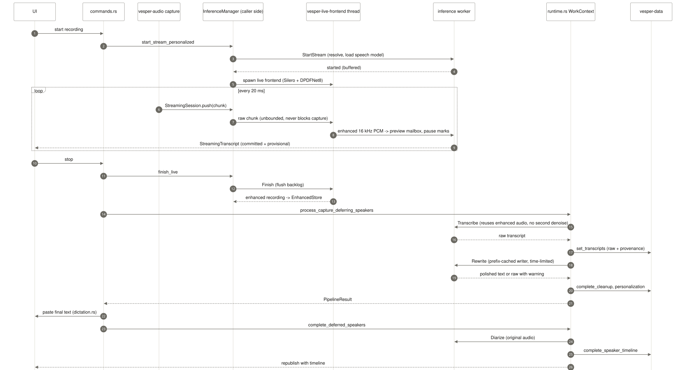
</picture>

Diagram source: [inference-recording-lifecycle.mmd](diagrams/inference-recording-lifecycle.mmd)

## 3. Inference manager and worker

`InferenceManager` is the only owner of native model handles. Callers send
`Command` values over a bounded channel (capacity 2), and a single
`vesper-inference` thread executes them serially. That thread owns
`WorkerState`. Cancellation flags are checked around every native call, and
native decodes themselves cannot be interrupted mid-call.

<picture>
  <source media="(prefers-color-scheme: dark)" srcset="assets/diagrams/inference-worker.dark.svg">
  
</picture>

Diagram source: [inference-worker.mmd](diagrams/inference-worker.mmd)

- **Residency:** `ensure_speech` reloads only when the `SpeechKey` changes or a
  model is marked unhealthy. It re-checks the key after load, in case files
  changed while loading. The writer is cached by `qwen::key`.
- **Failure isolation:** a native or identity failure drops that handle, and the
  next request reloads it with full verification.
- **Memory pressure** (`resources.rs`) means available memory is below
  max(5% of RAM, 256 MiB). Under pressure the idle writer is released before
  recording (recorded as `writerReleasedForMemory` in the operation's
  evidence), and buffered previews back off by 0.5–5 s. The writer then reloads
  when the final transcript is polished, which adds its load time before paste.
- **Zero-sample shortcut:** an exactly silent recording on MLX, Cohere, Whisper
  or Qwen-ASR returns empty text after verification, without loading weights.

## 4. Speech adapter registry and runtimes

The registry in `vesper-core/src/adapters.rs` maps each built-in model to an
`AdapterKind` with declared capabilities. `vesper-inference/src/adapters.rs`
turns a selection into a loaded `SpeechModel`. Backend selection lives in
`vesper-models/src/selection.rs` and `vesper-inference/src/backend.rs`.

<picture>
  <source media="(prefers-color-scheme: dark)" srcset="assets/diagrams/inference-adapter-registry.dark.svg">
  
</picture>

Diagram source: [inference-adapter-registry.mmd](diagrams/inference-adapter-registry.mmd)

<picture>
  <source media="(prefers-color-scheme: dark)" srcset="assets/diagrams/inference-engine-selection.dark.svg">
  
</picture>

Diagram source: [inference-engine-selection.mmd](diagrams/inference-engine-selection.mmd)

The llama.cpp paths (LFM and the writer) choose the GPU with the most free
memory, or CPU. Only under Auto do they retry a failed GPU initialization on
CPU. Nemotron, and Parakeet v3 under the Automatic engine, pick Metal on Apple
Silicon under Auto, CUDA when an NVIDIA GPU is visible, and CPU otherwise; both
also retry on CPU, with the same GGUF file
([ADR-0024](adrs/0024-unified-gguf-speech-engine.md)). The Neural Engine
engine has one execution path, Automatic or Metal, with no CPU fallback
([ADR-0025](adrs/0025-neural-engine-speech-engine.md)). Cancellation,
verification and decode errors never trigger a fallback.

## 5. Live pipeline

All live models share one `StreamingSession`. Nemotron, and MLX Qwen with the
Metal backend, run native streams on the worker. Every other model uses
buffered previews (ADR-0023). The completed-audio final stays authoritative.

<picture>
  <source media="(prefers-color-scheme: dark)" srcset="assets/diagrams/inference-live-pipeline.dark.svg">
  
</picture>

Diagram source: [inference-live-pipeline.mmd](diagrams/inference-live-pipeline.mmd)

Not adopted: decoding only the tail at Stop, reusing committed segments
(Phase B). It failed the WER parity gate; see ADR-0023 and #155.

## 6. Audio frontend

Desktop recordings always enable Silero v6.2 voice activity detection and
DPDFNet8 denoising (`settings.rs` `managed_audio`). VAD is advisory. It chooses
live commit boundaries and records evidence, and it never deletes audio.

<picture>
  <source media="(prefers-color-scheme: dark)" srcset="assets/diagrams/inference-audio-frontend.dark.svg">
  
</picture>

Diagram source: [inference-audio-frontend.mmd](diagrams/inference-audio-frontend.mmd)

- **Ownership:** the worker's `FrontendCache` serves imports and fallbacks, and
  the live frontend thread owns a per-recording copy. While a buffered
  recording runs, the worker releases its copy.
- **Reuse rule:** the final reuses the live-enhanced recording only for the
  same operation id, the same frontend settings and a length within 50 ms. A
  failed live session means the final uses the original audio with a warning,
  and the frontend is not run again.

## 7. Writer (Qwen3.5-0.8B)

The writer runs after the final ASR transcript, through llama.cpp. Weights stay
resident, and every pass gets a fresh context.

<picture>
  <source media="(prefers-color-scheme: dark)" srcset="assets/diagrams/inference-writer.dark.svg">
  
</picture>

Diagram source: [inference-writer.mmd](diagrams/inference-writer.mmd)

The prompt is always split at the prefix boundary, whether or not the cache is
used, so cached and uncached greedy outputs are identical. Measured on 52 public
transcripts: median CPU rewrite 412 → 201 ms. Not adopted: prompt-lookup
speculative decoding with llama.cpp recurrent rollback, which was slower end to
end (#141, `inference-performance.md`).

## 8. Speaker diarization

Diarization uses Nemotron-3-Diarization through a namespaced NeMo-Speech.cpp
runtime that ships in the app bundle. Live recordings run it after the text is
delivered. Imported files run it before the result is shown.

<picture>
  <source media="(prefers-color-scheme: dark)" srcset="assets/diagrams/inference-diarization.dark.svg">
  
</picture>

Diagram source: [inference-diarization.mmd](diagrams/inference-diarization.mmd)

## 9. Model installation and verification

<picture>
  <source media="(prefers-color-scheme: dark)" srcset="assets/diagrams/inference-model-installation.dark.svg">
  
</picture>

Diagram source: [inference-model-installation.mmd](diagrams/inference-model-installation.mmd)

The MLX runtime (`libVesperMLX.dylib`, `mlx.metallib`, tokenizer tool) is never
downloaded. It ships inside the app bundle, and its build provenance hashes are
checked at build time. Resident reuse checks file identity, meaning metadata
plus the recorded hash, and every new load re-verifies the full hash.

## 10. Threads, memory and failure policy

| Thread                   | Work                                     | Native threads                                                                                  |
| ------------------------ | ---------------------------------------- | ----------------------------------------------------------------------------------------------- |
| CPAL callback            | Lock-free ring write only                | —                                                                                               |
| `vesper-live-audio`      | Forwards capture chunks to the session   | —                                                                                               |
| `vesper-live-frontend`   | Silero + DPDFNet8 per buffered recording | ONNX Runtime 1 each                                                                             |
| `vesper-inference`       | All model work, serially                 | sherpa-onnx and llama.cpp up to clamp(cores − 2, 1, 8); NeMo and MLX use their runtime defaults |
| Caller and Tauri threads | Orchestration, persistence, paste        | —                                                                                               |

<picture>
  <source media="(prefers-color-scheme: dark)" srcset="assets/diagrams/inference-threads-failure.dark.svg">
  
</picture>

Diagram source: [inference-threads-failure.mmd](diagrams/inference-threads-failure.mmd)

Not yet qualified: a shared thread budget across runtimes, an Apple Neural
Engine path (proposal #143, not approved), and CUDA, Vulkan and ROCm on
non-Apple hardware beyond the documented smoke checks.
