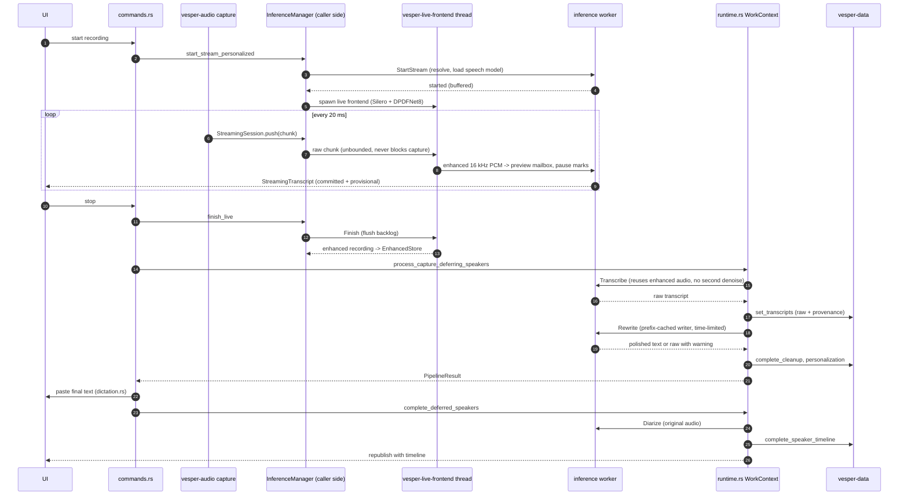
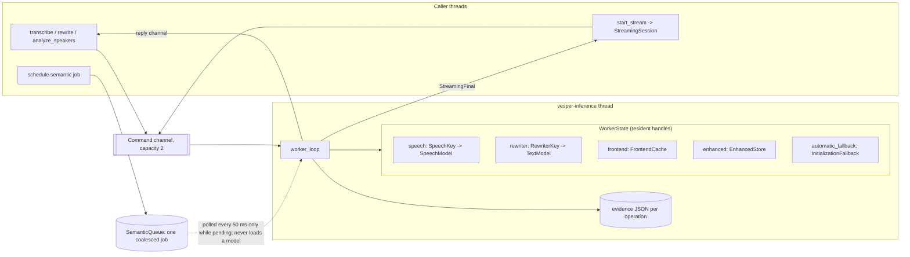
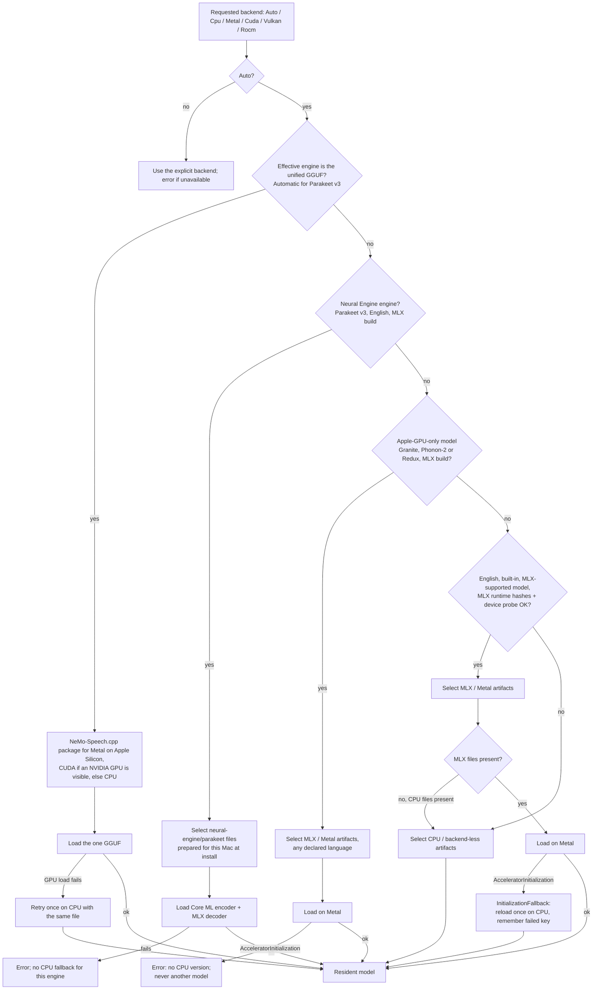
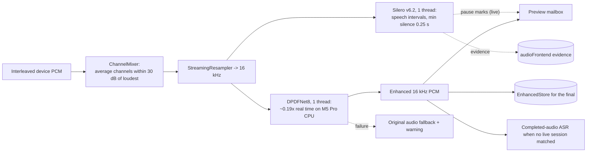
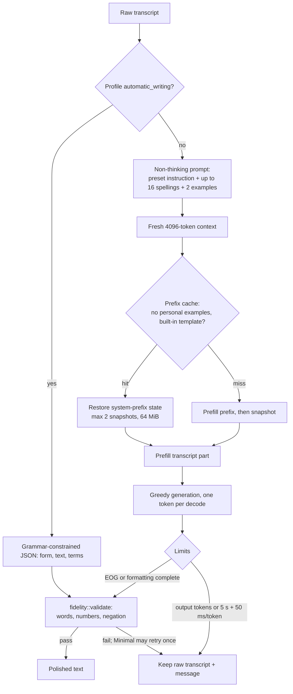
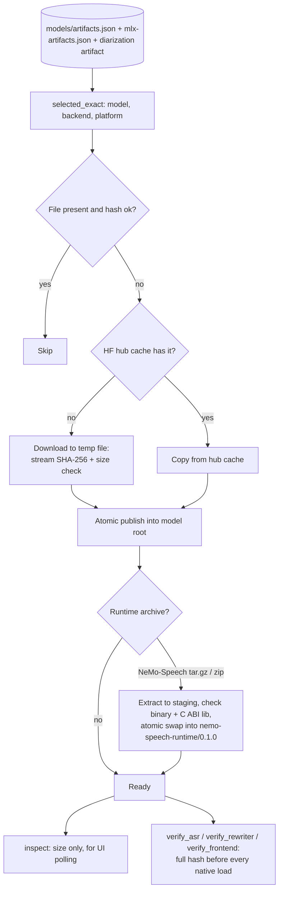

# Backend inference architecture

This page describes Vesper's custom on-device inference backend, as implemented
on `main` in October 2026. It starts with the whole backend and then gives one
section per component. Each diagram is a versioned Mermaid source, and each
label names real code. Paths that are proposed, experimental or not adopted are
labelled as such. Product behavior lives in [live transcription](live-transcription.md),
[offline ASR](offline-asr.md) and the [user guide](user-guide.md). Measurements
live in [inference performance](inference-performance.md). Decisions are recorded
in [ADRs](adrs/README.md).

The overview in section 1 is a hand-laid-out SVG
([source](diagrams/inference-high-level.mjs)); the detailed diagrams are Mermaid.
No Excalidraw MCP server was connected when they were written
([#189](https://github.com/rahulsharmavishwakarma/vesper/issues/189)).

## 1. High-level backend

One Tauri 2 desktop process owns capture, orchestration and persistence. All
model work runs on one inference worker thread, owned by `InferenceManager`.
Native runtimes are linked libraries, not services, so nothing leaves the
device after the models are installed.

<picture>
  <source media="(prefers-color-scheme: dark)" srcset="assets/diagrams/inference-high-level.dark.svg">
  
</picture>

Diagram source: [inference-high-level.mjs](diagrams/inference-high-level.mjs)

| Crate                        | Responsibility                                                                                                               |
| ---------------------------- | ---------------------------------------------------------------------------------------------------------------------------- |
| `vesper-core`                | Config, model ids, adapter registry (`AdapterKind`, `AdapterCapabilities`), personalization types; no workspace dependencies |
| `vesper-audio`               | Capture, WAV storage, decoding, `ChannelMixer`, resampling, completed-audio segmentation                                     |
| `vesper-models`              | Pinned artifact catalog, install, SHA-256 verification, speech/backend selection                                             |
| `vesper-inference`           | Single worker, adapters, audio frontend, live previews, writer, diarization adapter                                          |
| `vesper-nemo` / `vesper-mlx` | Safe wrappers over the NeMo-Speech.cpp C ABI and the MLX Swift bridge                                                        |
| `vesper-data`                | Local SQLite sessions, transcripts, labels, learning (no inference)                                                          |
| `vesper-desktop`             | Tauri app: commands, orchestration, paste, diagnostics                                                                       |

## 2. Recording lifecycle

This sequence covers one dictation using the default buffered model (Cohere) with
the desktop's managed audio frontend. Native streams (Nemotron) skip the mailbox
and produce their final inside the stream.

## 3. Inference manager and worker

`InferenceManager` is the only owner of native model handles. Callers send
`Command` values over a bounded channel (capacity 2), and a single
`vesper-inference` thread executes them serially. That thread owns
`WorkerState`. Cancellation flags are checked around every native call, and
native decodes themselves cannot be interrupted mid-call.

- **Residency:** `ensure_speech` reloads only when the `SpeechKey` changes or a
  model is marked unhealthy. It re-checks the key after load, in case files
  changed while loading. The writer is cached by `qwen::key`.
- **Failure isolation:** a native or identity failure drops that handle, and the
  next request reloads it with full verification.
- **Memory pressure** (`resources.rs`) means available memory is below
  max(5% of RAM, 256 MiB). Under pressure the idle writer is released before
  recording (recorded as `writerReleasedForMemory` in the operation's
  evidence), and buffered previews back off by 0.5–5 s. The writer then reloads
  when the final transcript is polished, which adds its load time before paste.
- **Zero-sample shortcut:** an exactly silent recording on MLX, Cohere, Whisper
  or Qwen-ASR returns empty text after verification, without loading weights.

## 4. Speech adapter registry and runtimes

The registry in `vesper-core/src/adapters.rs` maps each built-in model to an
`AdapterKind` with declared capabilities. `vesper-inference/src/adapters.rs`
turns a selection into a loaded `SpeechModel`. Backend selection lives in
`vesper-models/src/selection.rs` and `vesper-inference/src/backend.rs`.

| Model                          | Adapter kind                                                                                             | Runtime                                                    |
| ------------------------------ | -------------------------------------------------------------------------------------------------------- | ---------------------------------------------------------- |
| Nemotron 3.5 streaming         | `NemoRnnt`: native streaming, phrase hints                                                               | NeMo-Speech.cpp                                            |
| Parakeet TDT v3                | `NeuralEngineTdt` under Automatic for English on Apple silicon: 15 s parts, buffered live                | Core ML encoder on the Neural Engine, MLX decoder on Metal |
|                                | `NemoTdt` under Automatic for other languages or without a Neural Engine: completed audio, buffered live | NeMo-Speech.cpp                                            |
|                                | `SherpaTransducer`, and an MLX registration                                                              | sherpa-onnx; MLX Swift                                     |
| Custom NeMo transducer profile | `SherpaTransducer`                                                                                       | sherpa-onnx                                                |
| Qwen3-ASR 0.6B                 | `QwenAsr`, and an MLX registration with native live preview                                              | sherpa-onnx; MLX Swift                                     |
| Cohere Transcribe (default)    | `CohereAsr`                                                                                              | sherpa-onnx                                                |
| Whisper Small / Turbo          | `Whisper`; Whisper Small also has an MLX registration                                                    | sherpa-onnx; MLX Swift                                     |
| Moonshine Base                 | `MoonshineAsr`                                                                                           | sherpa-onnx                                                |
| Granite Speech 5.0 TurboCTC    | `GraniteCtc`, Apple GPU only                                                                             | MLX Swift                                                  |
| Phonon-2                       | `PackedTdt`, Apple GPU only                                                                              | MLX Swift                                                  |
| Parakeet Redux                 | `TernaryTdt`, Apple GPU only                                                                             | MLX Swift                                                  |
| LFM2.5 Audio                   | `LfmAudio`                                                                                               | llama.cpp mtmd                                             |

sherpa-onnx runs on the CPU only. NeMo-Speech.cpp runs on CPU, Metal, CUDA or
Vulkan, MLX Swift on Metal (English, except for Granite's and Redux's declared
languages), and llama.cpp mtmd on CPU or GPU. Automatic picks the engine and
backend like this:

The llama.cpp paths (LFM and the writer) choose the GPU with the most free
memory, or CPU. Only under Auto do they retry a failed GPU initialization on
CPU. Nemotron, and Parakeet v3 under the Automatic engine, pick Metal on Apple
Silicon under Auto, CUDA when an NVIDIA GPU is visible, and CPU otherwise; both
also retry on CPU, with the same GGUF file
([ADR-0024](adrs/0024-unified-gguf-speech-engine.md)). The Neural Engine
engine has one execution path, Automatic or Metal, with no CPU fallback
([ADR-0025](adrs/0025-neural-engine-speech-engine.md)). Cancellation,
verification and decode errors never trigger a fallback.

## 5. Live pipeline

All live models share one `StreamingSession`. Nemotron, and MLX Qwen with the
Metal backend, run native streams on the worker. Every other model uses
buffered previews (ADR-0023). The completed-audio final stays authoritative.

Native streams run a frontend session inline on the worker and push audio
straight into the model: Nemotron's stream final is the transcript, and MLX Qwen
keeps its enhanced audio in `EnhancedStore` for the final. Buffered models get
audio from the `vesper-live-frontend` thread, which runs its own Silero and
DPDFNet8 session, feeds the preview mailbox, marks pauses and keeps the whole
enhanced recording. The completed-audio final reuses that audio only when the
operation, settings and length (within 50 ms) match. The
[live transcription guide](live-transcription.md#recording-and-final-results)
shows how drafts and the final relate.

Not adopted: decoding only the tail at Stop, reusing committed segments
(Phase B). It failed the WER parity gate; see ADR-0023 and #155.

## 6. Audio frontend

Desktop recordings always enable Silero v6.2 voice activity detection and
DPDFNet8 denoising (`settings.rs` `managed_audio`). VAD is advisory. It chooses
live commit boundaries and records evidence, and it never deletes audio.

- **Ownership:** the worker's `FrontendCache` serves imports and fallbacks, and
  the live frontend thread owns a per-recording copy. While a buffered
  recording runs, the worker releases its copy.
- **Reuse rule:** the final reuses the live-enhanced recording only for the
  same operation id, the same frontend settings and a length within 50 ms. A
  failed live session means the final uses the original audio with a warning,
  and the frontend is not run again.

## 7. Writer (Qwen3.5-0.8B)

The writer runs after the final ASR transcript, through llama.cpp. Weights stay
resident, and every pass gets a fresh context.

The prompt is always split at the prefix boundary, whether or not the cache is
used, so cached and uncached greedy outputs are identical. Measured on 52 public
transcripts: median CPU rewrite 412 → 201 ms. Not adopted: prompt-lookup
speculative decoding with llama.cpp recurrent rollback, which was slower end to
end (#141, `inference-performance.md`).

## 8. Speaker diarization

Diarization uses Nemotron-3-Diarization through a namespaced NeMo-Speech.cpp
runtime that ships in the app bundle. Live recordings run it after the text is
delivered. Imported files run it before the result is shown.

- The app bundle carries the runtime in `Resources/diarization-runtime/<rev>`. A
  non-fatal startup check installs it into the model root as
  `nemotron-diarization-runtime/<rev>`.
- Before each load, Vesper checks the full SHA-256 of the q8_0 GGUF (107 MB) and
  the seven dylibs, which takes about 38 ms. It then loads with
  `dlopen(RTLD_LOCAL)` on Metal; Auto retries on CPU.
- The diarizer runs on the original 16 kHz audio, about 0.56 s per 45 s of audio
  on Metal, and stores a `SpeakerTimeline` with `complete_speaker_timeline`.
- By design it loads per recording (about 14–55 ms, plus about 7 s for the first
  Metal shader compile) and is not kept resident.

## 9. Model installation and verification

The MLX runtime (`libVesperMLX.dylib`, `mlx.metallib`, tokenizer tool) is never
downloaded. It ships inside the app bundle, and its build provenance hashes are
checked at build time. Resident reuse checks file identity, meaning metadata
plus the recorded hash, and every new load re-verifies the full hash.

## 10. Threads, memory and failure policy

| Thread                   | Work                                     | Native threads                                                                                  |
| ------------------------ | ---------------------------------------- | ----------------------------------------------------------------------------------------------- |
| CPAL callback            | Lock-free ring write only                | —                                                                                               |
| `vesper-live-audio`      | Forwards capture chunks to the session   | —                                                                                               |
| `vesper-live-frontend`   | Silero + DPDFNet8 per buffered recording | ONNX Runtime 1 each                                                                             |
| `vesper-inference`       | All model work, serially                 | sherpa-onnx and llama.cpp up to clamp(cores − 2, 1, 8); NeMo and MLX use their runtime defaults |
| Caller and Tauri threads | Orchestration, persistence, paste        | —                                                                                               |

| Event                                               | What happens                                                                   |
| --------------------------------------------------- | ------------------------------------------------------------------------------ |
| Native error                                        | The resident handle is dropped; the next request verifies and reloads in full  |
| Cancellation                                        | The flag is checked before and after native calls; partial output is discarded |
| Memory pressure                                     | The idle writer is released before recording, and previews back off            |
| Audio frontend failure                              | The original audio is used, with a warning                                     |
| Writer failure, time limit or failed fidelity check | The raw transcript is kept, with a message                                     |
| Diarization failure                                 | The transcript is kept, with a warning                                         |

Not yet qualified: a shared thread budget across runtimes, an Apple Neural
Engine path (proposal #143, not approved), and CUDA, Vulkan and ROCm on
non-Apple hardware beyond the documented smoke checks.
