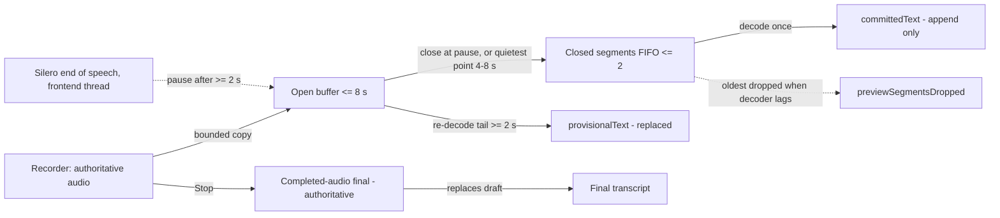
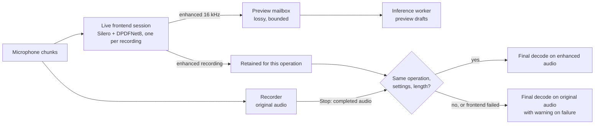

# Live transcription adapters

Every current speech adapter participates in the same recording interface. Model,
language and backend compatibility still comes from the existing catalog; this
does not make arbitrary downloaded architectures executable or expose withheld
Whisper choices in the desktop picker. See [the support table](model-presets.md#live-transcription-support)
and [research evidence](research-streaming-inference-papers.md#native-live-input-feasibility-by-adapter).

## Recording and final results

The inference owner resolves and loads the selected model before capture becomes
ready. Each recording gets isolated live state. The shared transport accepts
ordered audio and publishes replacement transcript snapshots with the existing
operation ID and monotonic sequence. A pending native poll is not completion.
Late drafts cannot change a newer recording or an already finalized result.

Nemotron retains its cache-aware native stream and verified terminal transcript.
The English/Metal Qwen path uses the pinned MLX runtime's live-input session:
incremental mel features, cached acoustic windows and repeated decoding of the
pending window. Its native drafts remain provisional because the upstream live
decoder does not establish the application's final EOS/completeness contract.
Stop cancels and joins that session before the ordinary completed-audio pass.
The Qwen preview session starts decoding only after nonzero input arrives: exact
leading digital silence is accounted for in event positions but not sent to its
preview decoder, which otherwise hallucinated words from all-zero PCM in testing.
This has no amplitude threshold and does not remove samples from final audio.

CPU Qwen, Cohere, Parakeet-family profiles, Whisper and LFM, plus other qualified
MLX paths, use buffered previews around their existing decoder
([ADR-0023](adrs/0023-causal-committed-live-segments.md)). The recorder retains
the authoritative audio independently. Preview input is converted to 16 kHz and
accumulates in one open buffer. At eight seconds the buffer is closed at the
quietest 100 ms point between four seconds and the received end (later point on
ties), using only audio already received; energy chooses the boundary and removes
nothing. When the live audio frontend runs (the desktop default), Silero's
end-of-speech points close the buffer earlier: once it holds at least two
seconds, a detected pause closes it 100 ms into the silence (#139). Intervals cut
by Silero's periodic bookkeeping flush are ignored. The eight-second energy cut
remains the fallback for continuous speech. VAD still never deletes audio and
never affects the completed-audio final. Each closed segment is decoded exactly once and appended to the
committed draft, which only grows. The open tail, once at least two seconds long,
is re-decoded as the provisional draft. At most two closed segments wait for
decoding; if the decoder falls behind, the oldest is dropped from the draft
(the final still includes its audio). Retained preview PCM is bounded to three
eight-second buffers (about 1.5 MiB; frontend/model allocations are separate).
No overlap-string deduplication removes intentional repeated words.



Preview scheduling allows one running decode, bounded pending audio and coalesced
wakeups. Closed segments are decoded as soon as the decoder is free. The interval
after a tail pass is half its measured processing time, clamped to 0.5–5 seconds.
These are conservative scheduling heuristics, not latency guarantees. Under low available-memory headroom, previews defer and the recording
continues. The previous visible draft can therefore lag current speech.

For buffered adapters and native Qwen previews, `StreamingFinal::CompletedAudioRequired`
is a normal terminal outcome. The desktop and evaluator then use the existing
completed-recording pipeline on all original audio. The final transcript replaces
the draft, and only that final enters writing cleanup, storage, learning and
external insertion. This preserves the selected decoder's existing final behavior
and completion checks; it does not guarantee error-free recognition. Finalization
still takes the ordinary offline decode time. Sherpa
duration-limited output from an unfinished window may appear as a provisional
draft; it still fails completed-result validation. An unfinished window that stops
early (token, context or repetition limit, or text ending in detected silence)
skips that draft only: the previous draft stays visible, the resident model stays
healthy, and the next pass over more audio replaces the window. Evidence counts
these as `previewIncompleteDrafts`. Missing reports, context loss and unknown
errors still invalidate the owner; the preview loop reloads it once per recording
(`previewReloads`) and continues drafting, and further failures leave drafts
paused until Stop. A preview failure is recorded and cannot turn a partial prefix
into a successful final transcript; the completed-audio final keeps its strict checks.

Live drafts are never polished; the writing model runs only on the final
transcript after Stop. How other dictation apps handle live rewriting, and the
options for Vesper, are in [live rewriting research](research-live-rewrite.md).

## Ownership, cancellation and preprocessing

The same worker owns native models throughout use and teardown. CPU Qwen and
Parakeet/custom transducers now reuse verified recognizers, as Cohere and Whisper
already do. Their identity includes artifact observations, runtime/build, language,
backend, thread settings and custom profile. Every decode gets fresh request state.
No preview creates a second copy of the selected model. Failed native/identity
checks prevent unsafe owner reuse.

Stop and cancellation bypass a full preview wakeup queue. Cancellation suppresses
an in-flight result; synchronous Sherpa calls can finish before cancellation takes
effect. The native MLX patch adds an awaitable cancellation operation, bounds event
buffering, and exposes queued acoustic-window count. When more than two windows
are queued, the bridge skips the incoming packet instead of ending the session:
memory stays bounded, the provisional draft can miss that audio, and the recorder
still retains it for the completed-audio final. Live evidence reports the skipped
input as `droppedInputSeconds`. The bridge joins the collector/native tasks before
releasing a model. Only the Qwen bridge uses that patched cancellation contract.

Every live recording runs the audio frontend once, continuously
([#141](https://github.com/rahulsharmavishwakarma/vesper/issues/141)). Native
streams process it inline on the inference worker. Buffered recordings process it
on a per-recording `vesper-live-frontend` thread that owns its own Silero/DPDFNet
handles; the worker releases its copy while that thread runs. The enhanced
16 kHz PCM feeds the preview mailbox, and the whole enhanced recording is retained.
When a final needs completed audio (buffered models and MLX Qwen), it reuses that
retained recording instead of denoising the original again. Only the frontend
backlog not yet processed at Stop remains on the Stop path.

The final uses the retained recording only for the same operation, the same
frontend settings and a length within 50 ms of the completed recording; a later
lookup for that operation finds nothing. A frontend that fails during recording
makes the final use the original recording with a warning, as for native streams,
rather than re-running the frontend. If the live session cannot start, previews
use original audio and the final runs the completed-audio frontend as before.
Cancellation discards the retained audio. VAD remains advisory: this implementation adds no silence deletion
or automatic endpointing. The recorder still retains the original audio.



### Live frontend reuse evidence

Local measurement, 17 October 2026: Apple M5 Pro, macOS 27.0.1, release build,
CPU ASR, Silero v6.2 + DPDFNet8. Public FLEURS en-US clips (6 clean, 6 mixed
with noise at 0 dB, plus concatenated 63 s and 108 s recordings) were
upsampled to 48 kHz and paced in real time in 20 ms packets, like a microphone
(`installed_live_frontend_final_parity`). "Before" is the previous path: the
same recording decoded through a completed-audio frontend pass.

| Model (CPU) | Final text identical | Stop→final, 4.6 s clip | 23.6 s clip | 108 s recording |
| --- | ---: | ---: | ---: | ---: |
| Cohere Transcribe | 14/14 | 1.23 s → 0.29 s | 5.76 s → 1.45 s | 26.4 s → 6.2 s |
| Qwen3-ASR 0.6B | 14/14 | 1.23 s → 0.29 s | 5.75 s → 1.20 s | 27.3 s → 7.2 s |
| Parakeet TDT v3 | 14/14 | 1.04 s → 0.11 s | 5.21 s → 0.47 s | 23.3 s → 2.7 s |

Every final came from the live session. Normalized final words matched the
previous path in all 42 recordings, so this change does not alter WER on this
set. The desktop test `live_capture_reuses_frontend_and_defers_speakers` runs
the same paced capture through the app's capture pipeline. Warm, its Stop to
text took 0.31–0.35 s for a 4.6 s clip and 2.5 s for a 45 s meeting clip. The
deferred speaker timeline then took 0.11–0.13 s and 0.63–0.69 s on Metal. The
first run after a new build took 7.1 s once (cold start). Not covered: a
physical microphone, 44.1 kHz devices, other languages, slower Macs and MLX
builds.

### Pause-closed segment evidence

Local measurement, 19 October 2026 (Apple M5 Pro, CPU Cohere, Silero v6.2 +
DPDFNet8, public audio upsampled to 48 kHz and streamed in real time, single runs;
`installed_live_commit_timing`). Main without pause commits is compared with
pause-closed segments.

| Recording | First committed text | Mean committed words over time | Committed words at Stop | Segments (pause-closed) |
| --- | ---: | ---: | ---: | ---: |
| FLEURS clean, 63 s | 11.1 → 7.8 s | 60.0 → 65.8 | 142 → 150 | 10 → 12 (12) |
| FLEURS 0 dB noise, 108 s | 8.9 → 5.2 s | 102.5 → 112.2 | 206 → 213 | 17 → 21 (14) |
| AMI meeting, 45 s | 9.2 → 2.8 s | 35.8 → 44.2 | 83 → 97 | 7 → 10 (8) |

Committed text appears sooner and breaks at speech pauses. The completed-audio
final is unchanged. Physical microphones, other languages and slower Macs are not
yet measured.

## Device and memory behavior

The current accelerator scope is Apple Silicon MLX/Metal with CPU support.
NVIDIA CUDA and AMD/Intel Vulkan/ROCm qualification is explicitly deferred to
[the GPU roadmap issue](https://github.com/rahulsharmavishwakarma/vesper/issues/76).
Those backend paths remain available where already implemented; their unverified
hardware coverage does not block the current Apple scope. The Apple model/language
restrictions and remaining application-validation limits below still apply.

The existing selection policy chooses only supported model/runtime/artifact and
language combinations. Apple paths use qualified MLX/Metal variants, NeMo uses
its packaged backends, and llama.cpp uses compiled/detected devices. Sherpa CPU
does not gain CUDA merely because the machine has an NVIDIA GPU. Explicit backend
errors and Automatic same-model initialization fallback retain their existing
semantics. Backend selection happens at model admission, not on every audio packet.

The current application routes are adapter-specific:

| Adapter | GPU route | Automatic behavior and limits |
| --- | --- | --- |
| Qwen3-ASR 0.6B, Parakeet v3, Whisper Small | MLX on Apple Silicon/Metal for the qualified English variants | Uses the compatible MLX build and artifacts; CPU fallback requires the same model's verified CPU export. Other languages retain their catalog restrictions. |
| Cohere and the remaining Sherpa-only profiles | CPU in the current application | GPU detection does not enable an ONNX GPU provider. |
| Nemotron ASR | Packaged Metal, CUDA or Vulkan runtime | Automatic chooses Metal on Apple Silicon, detected CUDA on Linux/Windows, otherwise CPU. Vulkan requires an explicit selection; the ROCm profile maps speech to Vulkan. Initialization can retry CPU within the installed runtime. |
| LFM audio and Qwen writing | llama.cpp Metal, or compiled CUDA/Vulkan/ROCm | Selects a detected supported device and requests GPU offload; Automatic retries CPU on load/context initialization failure. Explicit GPU requests retain errors. |

Nemotron's Automatic CUDA probe respects `CUDA_VISIBLE_DEVICES` and requires a
successful `nvidia-smi` query. This differs from llama.cpp's device enumeration;
there is no single hardware probe that guarantees every adapter can use a GPU.
The memory-headroom choice below applies to llama.cpp. Nemotron currently requests
device zero, and MLX uses the default Metal device. The application does not
dynamically search partial layer-offload configurations to fit a model into VRAM.

The llama.cpp selector refreshes device free memory when loading and chooses the
device with most headroom within the selected backend. CPU inference reserves
two logical execution slots where possible and caps native threads at eight.
Shared system/available memory and process RSS come from the same pinned `sysinfo`
version already used by the desktop. Buffered sessions sample pressure every five
seconds; available memory below the larger of 256 MiB and 5% of physical memory
defers previews. Missing telemetry remains unknown.

MLX recycled cache is capped at the smaller of 256 MiB and one sixteenth of Metal's
recommended working set. Its allocator limit is three quarters of that working
set, with a 256 MiB floor. This leaves headroom but is not a hard process limit.
Apple CPU/GPU allocations share one memory pool. No system wired-memory setting
changes. Idle writer ownership can be released under pressure; the existing loader
recreates it when required. The current NeMo C ABI exposes no uniform memory or
CPU-thread budget setting.

## Verification and evidence

Execution evidence distinguishes `native`, `native-mlx-preview` and `buffered`,
and records the expected finalization path, effective backend selection and startup
time. Buffered evidence includes the preview policy, committed segments and their
failures, provisional passes, dropped segments, decoded preview audio seconds,
preview failures, retained input, decode time and memory observations. MLX completed-audio reports include allocator
active/cache values and limits. These have different scopes from whole-process RSS
and must not be added together as independent memory pools.

The evaluator's `firstPartialMs` includes live startup. `liveStartup.milliseconds`
separately measures readiness preparation; subtract it to estimate first draft
after input becomes ready. Buffered paths initialize the frontend on the first
preview, whereas native paths initialize it during startup. `stopToFinalMs` includes the authoritative final pass
where required. Neither metric alone measures microphone-to-render latency.

Use the same public held-out manifests for paired completed/live runs, retaining
errors in aggregates. Cover short tails, window boundaries, repetition, quiet/noisy
speech, supported languages, cancellation/restart and queue pressure. The current
qualification and exact results are tracked in [issue #3](https://github.com/rahulsharmavishwakarma/vesper/issues/3).
Apple/CPU results do not qualify CUDA/Vulkan/ROCm hardware or sustained thermals.

The GPU routing recheck on 26 September passed the `backend` and `automatic`
unit-test filters for `vesper-inference` and `vesper-models` with `--features mlx`.
These cover device choice, unavailable/explicit backends, initialization fallback,
CUDA visibility, and missing/corrupt CPU fallback artifacts. Installed-model tests
remain separate from those unit filters. Existing public-audio logs confirm Metal
execution: LFM reports 17/17 backbone layers offloaded, and Nemotron reports the
MTL0 GPU backend. This does not establish that every operator runs on GPU or
provide NVIDIA/AMD hardware qualification.

### Reproducing lifecycle checks

Build the pinned native runtime with `node scripts/mlx-runtime.mjs`, then load the
normal contributor environment. Use a verified public 16 kHz WAV with at least
four seconds of speech; no microphone or private application profile is used:

```sh
. ./scripts/dev-env.sh
VESPER_MODEL_DIR=/path/to/verified/models \
VESPER_LIVE_FIXTURE=/path/to/public-speech.wav \
  cargo test -p vesper-inference --features mlx --lib \
  installed_live_adapters_cancel_restart_and_final_parity -- --ignored --nocapture
```

This installed-model fixture checks exact digital silence, explicit cancellation,
Drop cancellation, restart events, final transcript parity and operation/sequence
isolation with Cohere/Qwen/Parakeet CPU plus Qwen/Parakeet MLX. It uses the same
resident owner and session interface as the desktop. Other unit tests cover
bounded producer memory, repeated words, packet boundaries, full wakeup queues,
strict final completion and device/memory policy. The desktop capture fixture
`new_offline_asr_pipeline_preserves_audio_and_provenance` additionally exercises
the completed-audio live handoff, full original audio, storage/provenance and the
absence of an error-fallback warning. Browser suites exercise the production UI
with mocked native events; neither test substitutes for a physical microphone
and rendering-latency measurement.

### Public-audio smoke results — 26 September 2026

The initial matrix contains 84 completed/live executions across 14 model/backend
paths. Two affected paths were rerun after fixes, adding 12 executions. Failures
and zero-draft baselines remain in the local evidence; the table below uses the
confirmation results for Cohere and Qwen MLX and the original runs for other paths.
All 42 selected live cases produced a nonempty provisional event before Stop.
All 39 cases that use a completed-audio final matched their offline pair exactly.

This reused public fixture pack is a diagnostic smoke test, not a new independent
accuracy holdout or a broad accent/language recommendation. It contains FLEURS
English test clips `16355757648693617724` (7.92 s) and
`13297690853135603331` (7.68 s), from revision
`70bb2e84b976b7e960aa89f1c648e09c59f894dd`, CC-BY-4.0, attributed to Google
FLEURS/FLoRes. The existing [frontend manifest](../benchmarks/asr/manifests/frontend-integration-2026-09-18/streaming.json)
owns their source provenance. A third diagnostic repeats the second waveform
three times (23.04 s), crossing 8/16-second boundaries with intentional repeated
words. Its WAV SHA-256 is
`40df559dc7c280d8264e69b49185cd5e779679e2b5458cefb22517309ce7322f`.
The generated three-case manifest hash is
`d8df88f4a66cf77efee43f7f4a0c9521125b91baa054418d328a00741fb0a586`.

Environment: Apple M5 Pro, 18 logical CPUs, 64 GiB unified memory, macOS 27.0
(26A428), system Metal driver, debug Rust evaluator. AC power was reported; power
mode and sustained thermals were not qualified. Runs were sequential on a shared
host. Explicit English, 20 ms wall-clock-paced packets, Silero plus DPDFNet8, gain
off, writing off, default endpoint behavior. Sherpa and LFM used eight native
threads; NeMo reports four graph threads. MLX internal thread scheduling is not
measured. The input environment's nominal four-thread label on Metal rows is
not an override: execution evidence is authoritative (including eight for LFM
Metal). Precision and artifact/runtime hashes come from each report's selected
manifest: INT8 ONNX, Qwen MLX 8-bit, Parakeet MLX float32 weights/native BF16 default,
Whisper MLX float16, LFM Q4_0 and Nemotron Q8. No CUDA result is inferred.

Timing excludes writing, speaker annotation, persistence and rendering.
“First draft” means the first nonempty provisional event after readiness, which
can be a fragment or an incorrect revisable hypothesis. In particular, Qwen's
sub-second event time is **not** an established correct-word latency. No aligned
word-emission or acoustic-endpoint measurement was made. Stop is explicit.

| Path | Drafts before Stop | Mean first draft after ready (ms) | Mean Stop-to-final, short / repeated (ms) | Final parity | Live process peak RSS (GiB) |
| --- | --- | --- | --- | --- | --- |
| cohere | 3/3 | 2563 | 1892 / 5391 | 3/3 | 4.21 |
| fastconformer-en-de-es-fr | 3/3 | 2423 | 1575 / 4438 | 3/3 | 0.88 |
| lfm-cpu | 3/3 | 2508 | 1774 / 5054 | 3/3 | 1.73 |
| lfm-metal | 3/3 | 2498 | 1679 / 4693 | 3/3 | 1.15 |
| nemotron-metal | 3/3 | 1352 | 54 / 51 | 2/3 | 1.08 |
| parakeet-cpu | 3/3 | 2440 | 1622 / 4620 | 3/3 | 1.19 |
| parakeet-mlx | 3/3 | 2484 | 1551 / 4361 | 3/3 | 2.49 |
| parakeet-tdt-0.6b-v2-int8 | 3/3 | 2454 | 1657 / 4718 | 3/3 | 1.18 |
| parakeet-unified-en-0.6b-int8 | 3/3 | 2442 | 1657 / 4630 | 3/3 | 1.36 |
| qwen-cpu | 3/3 | 2542 | 1865 / 5307 | 3/3 | 1.87 |
| qwen-mlx | 3/3 | 92 | 1627 / 4596 | 3/3 | 1.20 |
| whisper-small-cpu | 3/3 | 2584 | 2346 / 5783 | 3/3 | 1.28 |
| whisper-small-mlx | 3/3 | 2507 | 1765 / 4866 | 3/3 | 0.67 |
| whisper-turbo-cpu | 3/3 | 2924 | 2495 / 6134 | 3/3 | 2.40 |

Cohere initially returned no live drafts because its first short window reached
a duration-token limit. Provisional-only acceptance fixed that case without
relaxing final validation. Confirmation retained one recognizer across all three
recordings and 22 preview/final requests; no preview failures were reported.
Cold readiness was 2739 ms and the two resident readiness checks were about
1.1 ms. Qwen MLX readiness was 771 ms cold and about 1.4–1.5 ms resident. These
are fresh-process measurements with previously used filesystem/shader caches.

The separate installed-model lifecycle test exposed Qwen MLX hallucinations on
all-zero input. After the exact-zero preview guard, silence, explicit cancellation,
Drop cancellation and restart passed on all five tested CPU/MLX paths. The native
Qwen bridge joined its tasks before the final pass; final parity also passed after
each cancellation. The desktop public-PCM fixture passed for Qwen/Cohere CPU,
including original-audio preservation, final storage/provenance, partial
invalidation and the newer raw-transcript display during postprocessing.

Native Nemotron differed on one short clip: four word errors live versus six
offline, against 26 reference words; the other two transcripts matched exactly.
The two paths therefore do not have universal text parity. This one improvement
is not evidence of a general quality gain. All repeated-recording finals retained
the three repetitions. Preview edit-distance sums remain in the raw reports;
for example, Cohere's three values were 19/11/39 and Qwen MLX's 81/37/126. This
counts all successive word edits, including normal additions and token fragments;
it is not a rollback-only stability score or a comparison of correct-word accuracy.

No preview-window skip, pressure deferral or decoder failure was reported in the
selected buffered runs. This does not measure native capture queue drops. Unit
fixtures cover a stalled producer/consumer and full wakeup queues; the wall-clock
replay does not replace capture-overflow injection or a long thermal soak.
French, Hindi, code switching, singing, wider accent/noise populations, physical
microphone-to-render latency and non-Mac accelerators remain unqualified by this
smoke test. Existing model restrictions and default selections remain unchanged.

The wide-run evaluator was built from application `6f90343` plus the approved
implementation; its SHA-256 was
`05c5626ae422a9061466ff069b34ba0e68d2cf45bf3e569252256f342517eb29`.
The corrected two-path evaluator hash was
`def039bdd1acd4cdf5a846bd33d2d38356a6648bf3091957cc79d531adbfb93a`.
Subsequent desktop tests include the raw-preview merge at `0f168fd`. Runtime
revisions are pinned in [the research map](research-streaming-inference-papers.md#native-live-input-feasibility-by-adapter);
reports include artifact hashes and runtime evidence. The timed reports' older
`includesModelAndFrontendLoading` label was unconditional; buffered frontend
initialization actually belongs to the first preview. Current diagnostics state
that distinction explicitly; the recorded milliseconds and calculations above
are unaffected. Detailed JSON/audio, process logs, source snapshots and build
identities are preserved under the ignored local directory
`.cache/benchmarks/results/live-adapters-2026-09-26/`. See issue #3 for commit and
validation status.
