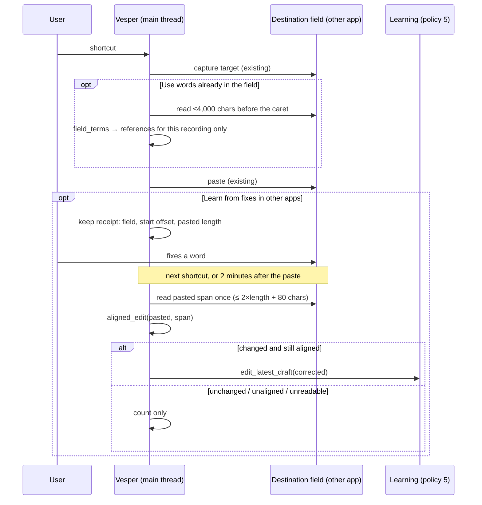

# Learning from the app you dictate into

Status: implemented on the local branch `feature/self-improving-dictation`; owner-approved on 27 October 2026; not published. Both features are **off by default**. Real-app coverage is not yet measured; the per-app counts below are how it will be.

Most corrections happen in the app that received the dictation, not in Vesper. Without these features, ordinary use gives the [learning loop](self-improving-system.md) no input: in the first 17 real dictations with the new build, Vesper knew 0 terms and made 0 corrections. Two opt-in features in **Writing → Workspaces** use that app's text, under the same rules as in-app learning.

## Use words already in the field

When you dictate into a text field, Vesper reads up to 4,000 characters before the caret of the field it already captured for paste. `vesper_core::field_terms` keeps at most 24 spellings:

- identifiers (`sherpa_onnx`, `AsrModel`, `gemma3`)
- capitalized acronyms of 2–8 letters (`NVIDIA`)
- names: capitalized words that are not dictionary words, or that are capitalized mid-sentence (`Kubernetes`, the `Vesper` runner)
- lowercase non-words, only when they appear at least twice, so one typo never becomes a spelling

They join that recording's references, so the [correction gate](correction-gate.md) may repair a misheard non-word one edit away (`cubernetes` → `Kubernetes`). Ordinary words are never rewritten. Nothing read is stored. Secure fields, spreadsheet cells and fields Vesper could not capture are never read.

## Learn from fixes in other apps

After an automatic paste, the native layer keeps one receipt: the field, where the paste began and its length. At the next shortcut, or 120 seconds after the paste, Vesper reads that span once (at most twice its length plus 80 characters, capped at 32,768) and drops the receipt.

`vesper_core::aligned_edit` aligns the pasted words to the start of that span with a word-level edit distance. It accepts the alignment only within a third of the pasted word count, so text typed afterwards is ignored and rewritten or moved text is rejected. A changed, aligned span is passed to `edit_latest_draft` as an edit of that dictation's draft. It then teaches exactly as an in-app edit does:

- policy 5 promotion
- one-strike suspension
- the policy breaker
- reverts of gate changes

The corrected span becomes that result's draft in History; nothing else from the field is stored. If the draft changed in Vesper meanwhile, nothing is learned.

## Per-app counts

The `app_learning_coverage` table keeps, per bundle identifier:

- read-backs, split into unchanged, edited, unaligned, cleared (the span is empty: the text was sent or removed) and unreadable
- field reads, unreadable field reads, and the number of spellings taken

It stores no text, holds at most 64 apps, and is deleted when both features are off. These counts are the measure of where each feature works.

Separately, `paste_coverage` counts every automatic paste per app by outcome and keeps the latest no-field diagnostic (Accessibility role names and flags only), so apps where paste fails can be identified from ordinary use ([storage and privacy](storage-and-privacy.md)).

## Validation

- Unit tests cover `field_terms` (names, identifiers, acronyms, repeated lowercase non-words; prose, addresses and single typos excluded; bound of 24) and `aligned_edit` (fixed word with text typed after, identical text, rewritten, empty and joined-word cases).
- `field_words_become_references_that_repair_a_near_miss` checks the gate repairs from field words only.
- `a_fix_made_in_another_app_teaches_through_the_draft_edit_path` drives two read-back fixes through `edit_latest_draft` and the next dictation applies `kubectl`.
- `counts_per_app_and_clear_when_both_features_turn_off` checks the counts and their removal.

**Unmeasured:** which apps expose readable field text or a stable insertion offset. Electron editors, web editors and terminals may not; those show as unreadable or unaligned counts.

## Limitations

- Chat and prompt boxes send their text on Return and empty the field, so a read-back finds nothing to learn from (`cleared`). Fixes are only observed where the text stays, such as documents, notes and email drafts.
- First real use (28 October 2026, VS Code and Brave): 5 of 5 pastes sent; field words read nothing because an empty field (caret at position 0) was treated as unreadable, which is fixed; both read-backs were unaligned, before `cleared` was counted separately.

- An app that rewrites pasted text (autocorrect, smart quotes) can look like a user edit. Only word changes that pass the promotion rules teach.
- The read-back sees only the latest paste. A fix made after a later paste in another field is not observed.
- The insertion offset is the caret position at capture; apps that move text or reflow it may read as unaligned.
