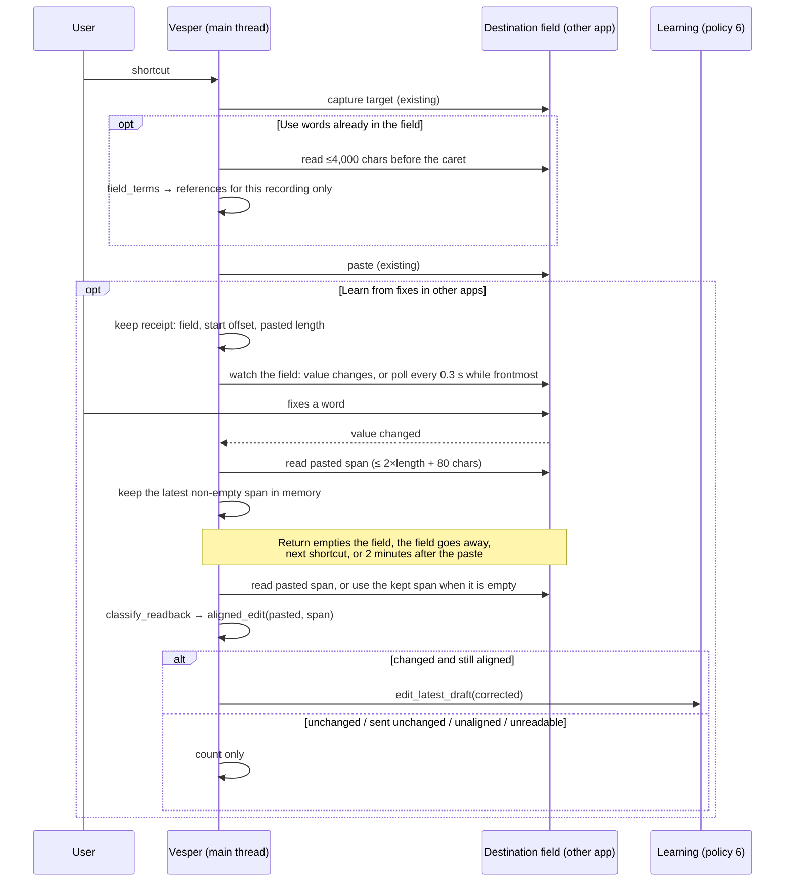

# Learning from the app you dictate into

Status: implemented, tracked in [#357](https://github.com/rahulsharmavishwakarma/vesper/issues/357); owner-approved on 27 October 2026; shipped in 0.1.2. Watching the field until it is sent ([#410](https://github.com/rahulsharmavishwakarma/vesper/issues/410)) is not yet in a release. Both features are **off by default**. The per-app counts below measure real-app coverage.

Most corrections happen in the app that received the dictation, not in Vesper. Without these features, ordinary use gives the [learning loop](self-improving-system.md) no input: in the first 17 real dictations with the new build, Vesper knew 0 terms and made 0 corrections. Two opt-in features in **Vocabulary → Learning** use that app's text, under the same rules as in-app learning.

## Use words already in the field

When you dictate into a text field, Vesper reads up to 4,000 characters before the caret of the field it already captured for paste. `vesper_core::field_terms` keeps at most 24 spellings:

- identifiers (`sherpa_onnx`, `AsrModel`, `gemma3`)
- capitalized acronyms of 2–8 letters (`NVIDIA`)
- names: capitalized words that are not dictionary words, or that are capitalized mid-sentence (`Kubernetes`, the `Vesper` runner)
- lowercase non-words, only when they appear at least twice, so one typo never becomes a spelling

They join that recording's references, so the [correction gate](correction-gate.md) may repair a misheard non-word one edit away (`cubernetes` → `Kubernetes`). Ordinary words are never rewritten. Nothing read is stored. Secure fields, spreadsheet cells and fields Vesper could not capture are never read.

## Learn from fixes in other apps

After an automatic paste, the native layer keeps one receipt: the field, where the paste began and its length. It reads that span (at most twice its length plus 80 characters, capped at 32,768) when the receipt ends: at the next shortcut, 120 seconds after the paste, or as soon as the field empties.

### Watching the field until it is sent

Chat and prompt boxes empty when you press Return, so a single later read finds nothing. While a receipt is pending, the native layer therefore watches that one field (issue #410, owner-approved on 10 November 2026):

- It registers an `AXObserver` on the field for `kAXValueChangedNotification` and `kAXUIElementDestroyedNotification`. On each change it reads the span and keeps the latest non-empty text, in memory only.
- For apps that send no notifications it polls the span every 0.3 seconds, only while that app is frontmost, and stops polling at the first notification. A read slower than 0.1 seconds stops polling for that paste, so a hung app cannot stall Vesper.
- When the span reads empty (the field is shorter than where the paste began, or blank there) or the field goes away, the watch stops and Rust reads the receipt at once. The read-back then uses the kept text, marked as from before sending.
- The watch also ends at the next shortcut, after 120 seconds, when the feature is turned off, or on a secure field. A field that is merely unreadable at read-back stays unreadable; the kept text is used only when the pasted text is gone.

`vesper_data::classify_readback` decides the outcome. Text kept from before sending that aligns and differs from the paste is offered as a fix (`sent_edited`). Text that equals the paste, or no longer lines up (for example, backspaced away), counts as `cleared` and teaches nothing. Discarding a message with select-all and delete looks the same as sending it, so a fix made before that still counts once; the promotion rules still need the same fix three times.

`vesper_core::aligned_edit` aligns the pasted words to the start of that span with a word-level edit distance. It accepts the alignment only within a third of the pasted word count, so text typed afterwards is ignored and rewritten or moved text is rejected. A changed, aligned span is passed to `edit_latest_draft` as an edit of that dictation's draft. It then teaches exactly as an in-app edit does:

- policy 6 promotion
- one-strike suspension
- the policy breaker
- reverts of gate changes

The corrected span becomes that result's draft in History; nothing else from the field is stored. If the draft changed in Vesper meanwhile, nothing is learned.

## Per-app counts

The `app_learning_coverage` table keeps, per bundle identifier:

- read-backs, split into unchanged, edited, unaligned, cleared (the span is empty: the text was sent or removed, with no fix kept), sent_edited (a fix kept from before the field was sent) and unreadable
- how the field was watched: `watch_notified` (the app sent value-change notifications) and `watch_polled` (only polling saw changes); a read-back with neither saw no change
- field reads, unreadable field reads, and the number of spellings taken

It stores no text, holds at most 64 apps, and is deleted when both features are off. These counts are the measure of where each feature works.

Separately, `paste_coverage` counts every automatic paste per app by outcome and keeps the latest no-field diagnostic (Accessibility role names and flags only), so apps where paste fails can be identified from ordinary use ([storage and privacy](storage-and-privacy.md)).

## Validation

- Unit tests cover `field_terms` (names, identifiers, acronyms, repeated lowercase non-words; prose, addresses and single typos excluded; bound of 24) and `aligned_edit` (fixed word with text typed after, identical text, rewritten, empty and joined-word cases).
- `field_words_become_references_that_repair_a_near_miss` checks the gate repairs from field words only.
- `a_fix_made_in_another_app_teaches_through_the_draft_edit_path` drives two read-back fixes through `edit_latest_draft` and the next dictation applies `kubectl`.
- `a_fix_kept_before_a_chat_box_was_sent_teaches_through_the_draft_edit_path` does the same with text kept before sending, and checks that sending unchanged teaches nothing.
- `a_fix_kept_before_send_teaches_and_a_plain_send_does_not` covers `classify_readback`, and `older_tables_gain_the_watch_counts_in_place` the column migration.
- **Not yet qualified in real apps.** The `AXObserver` watch and polling run only in the native app; which apps send value-change notifications, and whether a fix made just before Return is kept, is measured by the per-app counts in a nightly build.
- `counts_per_app_and_clear_when_both_features_turn_off` checks the counts and their removal.

**Unmeasured:** which apps expose readable field text or a stable insertion offset. Electron editors, web editors and terminals may not; those show as unreadable or unaligned counts.

## Limitations

- Before the watch (issue #410), chat and prompt boxes lost every fix: the field was empty by the read-back. In the owner's use, 99 of 109 VS Code read-backs were `cleared` and none in any app was `edited`.
- With polling, a fix made in the last ~0.3 seconds before Return can be missed.
- First real use (28 October 2026, VS Code and Brave): 5 of 5 pastes sent; field words read nothing because an empty field (caret at position 0) was treated as unreadable, which is fixed; both read-backs were unaligned, before `cleared` was counted separately.

- An app that rewrites pasted text (autocorrect, smart quotes) can look like a user edit. Only word changes that pass the promotion rules teach.
- The read-back sees only the latest paste. A fix made after a later paste in another field is not observed.
- The insertion offset is the caret position at capture; apps that move text or reflow it may read as unaligned.
