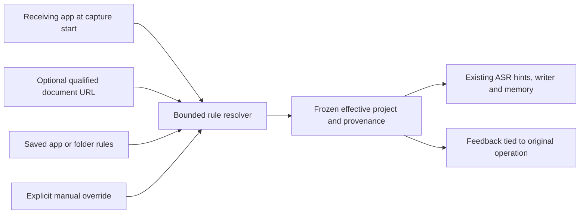

# Context selection and in-context learning

Implementation: [profile phrase selection](../../crates/vesper-core/src/personalization.rs), [memory application](../../crates/vesper-core/src/memory.rs), and [cleanup prompt construction](../../crates/vesper-inference/src/personalization.rs).

One operation freezes one profile and its compact automatic-learning evidence in one SQLite read transaction, after the existing desktop enable migration. A correction learned while another operation is already running applies only to later operations. Context includes a frozen project selection, requested language, available transcript and explicit output settings. Shortcut dictation can resolve the receiving application and, for TextEdit folder rules, its exposed document URL. It does not read document text, clipboard history or the screen to infer a project.

Projects remain names in the existing local profile, not separate databases.
**Project selection → Choose manually** preserves existing behavior. **Use
application rules** resolves the app at shortcut capture start. A nonempty
**Project override** wins over every rule. Otherwise the unique most-specific
matching folder wins, then a unique application rule, then shared vocabulary.
Equal-specificity conflicts and unavailable required document context abstain.
An app with folder rules cannot fall back to its broad app rule when the document
URL is missing. File imports and recordings started in the main window use the
explicit project name, because they have no receiving application.

The profile accepts at most 32 rules. Application identifiers are read from the
app selected with the existing native file picker; users do not enter bundle IDs.
Folder paths are explicitly selected roots. Only TextEdit currently has a document
context adapter. It reads the focused window's file URL with bounded AX calls,
checks both application and window identity again, and discards the URL after
resolution. Other apps use application rules or manual scope. No editor-title
heuristic or directory/content scanning is performed.

Blank-scoped vocabulary/examples are shared; nonblank entries match the selected
project case-insensitively after trimming whitespace. A blank selection uses shared
entries only. Results and History retain the effective name, selection reason and
rule ID; they do not retain the observed document URL. Remembering an older example
or reviewing its corrections uses that recording's project. Rule edits and focus
changes affect later recordings only. Old profiles migrate to manual selection.

## Before recognition

Vocabulary, reviewed examples and automatic evidence belong to the application,
not a checkpoint. Model IDs on evidence are provenance; independent edits across
different models can support the same candidate. Reprocessing identical audio
does not add independent support. Decoder hints are an optional adapter capability:
the saved request is editable regardless of the current model, and unsupported
adapters ignore it. Post-recognition memory still applies with writing disabled,
unavailable or incompatible. Completion regression coverage exercises all seven
built-in ASR selections with writing disabled, missing writer weights, and an
incompatible writer language;
it uses synthetic transcripts and is not native ASR accuracy or latency evidence.

Native phrase hints can use only context available before ASR. Enabled entries must match the requested language and selected project; a nonempty lexical context must also match the project text at this stage. Selection prioritizes project-specific entries, then observed usage, reviewed-source count and stable ID. Canonical spellings are case-insensitively deduplicated.

The existing limit is **32 phrases / 2,048 bytes**, with opt-in uniform boost 2. Only canonical spellings are boosted. The pinned Nemotron adapter accepts these public speech-context hints; the selected Cohere adapter does not. A shared profile does not create unsupported decoder functionality. No runtime or weight revision changes in phase A.

## After recognition, before cleanup

The desktop first calls the shared `DictationPersonalizationSnapshot::post_asr_profile` selector with the raw hypothesis. Automatically sourced vocabulary needs an active, matching candidate, an unquoted alias/canonical occurrence, explicit matching language/project and at least one shared [teaching cue](automatic-dictionary.md#context-required-for-post-recognition-use). Missing/legacy context disables that word only in the operation's copied profile; stored enabled flags and manual entries are preserved. Cleanup and final replacement use this same selected profile. This prevents model-generated context from admitting an otherwise ineligible learned word; it cannot prevent every error a language model might independently generate.

Cleanup retrieval can now use the raw transcript as additional context. An enabled vocabulary entry needs language/project compatibility, lexical-context compatibility, and a relevant canonical term, alias or context-word match. The ranking prefers project-specific entries, then usage count and stable ID. At most **16 vocabulary entries** are passed as reference spellings; each phrase is already bounded to 128 bytes by profile validation.

Reviewed cleanup examples are a separate collection. They must match language, project, cleanup preset and selected/effective intent. At least two informative terms must overlap. Jaccard similarity ranks matches; stable ID breaks ties. At most **two examples** are selected, with **2,048 bytes total for their input and output text**. This example budget does not include vocabulary text or the surrounding instruction template.

The prompt serializes spellings and examples as JSON data and explicitly forbids following instructions inside them, inserting absent names or copying unrelated content. The selected cleanup preset and raw-transcript fidelity guards still take precedence. Retrieving an example changes the request context; it does not train the model. Empty/irrelevant memory adds no personal examples. Automatic ordinary edits currently produce vocabulary evidence, not automatic cleanup examples or free-text preference rules.

## After optional cleanup

The model-independent memory stage applies exact aliases, including with cleanup disabled or failed. It respects language/project/lexical context, protected quotes and punctuation, overlap/ambiguity handling and non-cascading replacement. Existing limits remain 400,000 text bytes, 8,192 tokens, 512 candidate matches and 64 accepted edits. Resource overflow preserves the full original input.

The additional automatic-context selector has the narrower 8,192-byte raw-hypothesis budget of ordinary learning. Above that size, automatic entries are withheld from post-ASR use; manual memory follows its existing larger bounds. This is a conservative limit, not evidence that long recordings improve. Pre-ASR hints were already selected from the original frozen profile and remain a separate opt-in path; withholding a post-ASR entry does not undo acoustic hint effects.

Usage ranking chooses which existing memory fits a bounded prompt or hint list; it does not increase replacement authority or bypass meaning guards. Local learning runs automatically. Alias application, recognition hints and example-based output intent retain separate settings. Disabling final alias application does not change an independently enabled recognition-hint setting.

Pinned artifacts and exact native API sources are recorded in [ADR-0015](../adrs/0015-model-independent-local-memory.md#evidence-and-boundaries). The new feature changes application records and selection order, not inference ownership, decoder internals or model weights.

## Automatic project routing boundary

The staged extension in [#34](https://github.com/rahulsharmavishwakarma/transcribe/issues/34)
was approved for implementation. Routing reuses the existing profile and operation
snapshot; it does not change inference ownership or require model-specific memory.
The resolver/storage regressions and five authored TextEdit native cases pass;
the observed native metadata reads were 0.228–0.407 ms on the documented Mac.
Those component timings exclude snapshot loading, recording startup and rendering.
See [the exact native envelope](native-qualification.md#automatic-projects-and-external-correction-component-check--27-september-2026).
Natural-use routing accuracy and end-to-end capture latency remain unqualified.

Apple's [frontmost application](https://developer.apple.com/documentation/appkit/nsworkspace/frontmostapplication)
and [bundle identifier](https://developer.apple.com/documentation/appkit/nsrunningapplication/bundleidentifier)
identify an app, not a repository. Two projects in the same editor require a
qualified document-context adapter or manual selection. Apple's optional
[accessibility document URL](https://developer.apple.com/documentation/appkit/nsaccessibility-c.protocol/accessibilitydocument)
can support folder matching only where the editor exposes it reliably. Match
against user-selected roots; avoid title heuristics, file scanning and document
contents. Keep observed URLs transient and persist only the effective scope and
rule identity with a result. Unavailable URL context must be visible when
folder rules cannot resolve the project.

The interaction follows the app-association pattern in [Superwhisper's activation rules](https://superwhisper.com/docs/modes/modes),
within existing project controls. The result displays the effective project and
fallback reason. Shadow learning validates the exact server-authored operation
context against its retained raw-observation receipt and current learning epoch;
it no longer compares the operation to the mutable global project. Exact job
reservations still protect completion after Undo/Forget or superseding edits.
The receipt carries identifiers and scope, not transcript text; expiry or missing
evidence makes the analyzer abstain. Ordinary edits remain outside reviewed
training targets.
