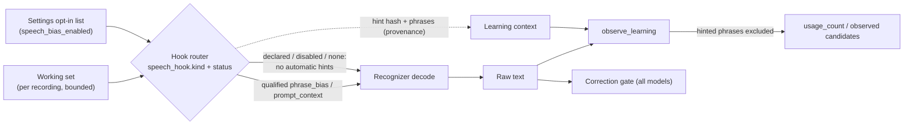
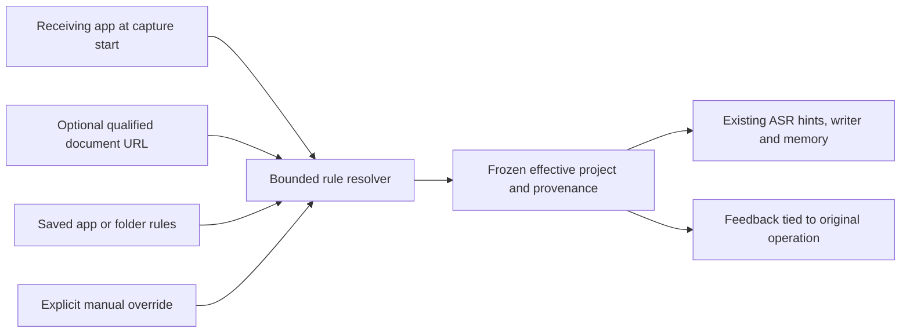
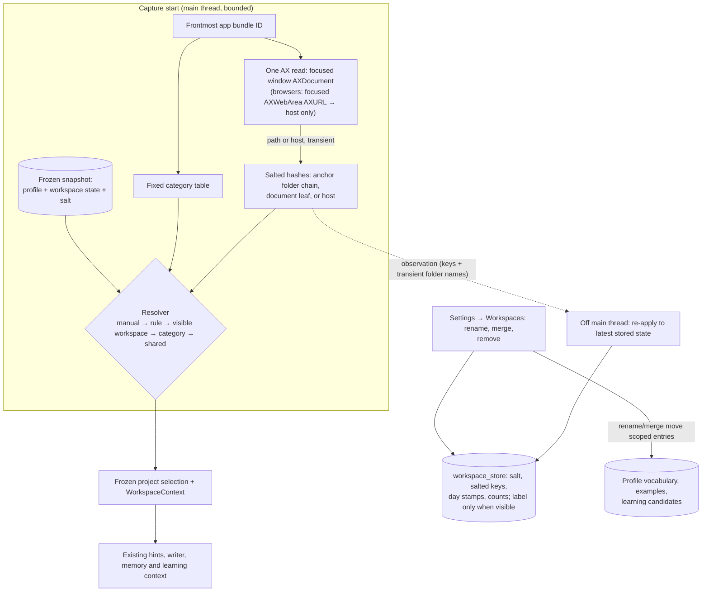

# Context selection and in-context learning

Implementation: [profile phrase selection](../../crates/vesper-core/src/personalization.rs), [memory application](../../crates/vesper-core/src/memory.rs), and [cleanup prompt construction](../../crates/vesper-inference/src/personalization.rs).

One operation freezes one profile and its compact automatic-learning evidence in one SQLite read transaction, after the existing desktop enable migration. A correction learned while another operation is already running applies only to later operations. Context includes a frozen project selection, requested language, available transcript and explicit output settings. Shortcut dictation can resolve the receiving application and its focused window's exposed document location (see [automatic workspaces](#automatic-workspaces)). It does not read document text, window titles, clipboard history or the screen to infer a project.

Projects remain names in the existing local profile, not separate databases.
**Project selection → Choose manually** preserves existing behavior. **Use
application rules** resolves the app at shortcut capture start. A nonempty
**Project override** wins over every rule. Otherwise the unique most-specific
matching folder wins, then a unique application rule, then shared vocabulary.
Equal-specificity conflicts and unavailable required document context abstain.
An app with folder rules cannot fall back to its broad app rule when the document
URL is missing. File imports and recordings started in the main window use the
explicit project name, because they have no receiving application.

The profile accepts at most 32 rules. Application identifiers are read from the
app selected with the existing native file picker; users do not enter bundle IDs.
Folder paths are explicitly selected roots. Folder rules match the same generic
document reader that automatic workspaces use: the focused window's file URL for
any app, read with bounded AX calls, with application and window identity checked
again and the path discarded after resolution. The path is read lexically: no
symlink resolution or path standardization, both of which consult the filesystem;
only the fixed `/tmp`, `/var` and `/etc` links are mapped to `/private/…`. No
editor-title heuristic or directory/content scanning is performed.

Blank-scoped vocabulary/examples are shared; nonblank entries match the selected
project case-insensitively after trimming whitespace. A blank selection uses shared
entries only. Results and History retain the effective name, selection reason and
rule ID; they do not retain the observed document URL. Remembering an older example
or reviewing its corrections uses that recording's project. Rule edits and focus
changes affect later recordings only. Old profiles migrate to manual selection.

## Before recognition

Vocabulary, reviewed examples and automatic evidence belong to the application,
not a checkpoint. Model IDs on evidence are provenance; independent edits across
different models can support the same candidate. Reprocessing identical audio
does not add independent support. Decoder hints are an optional adapter capability:
the saved request is editable regardless of the current model, and unsupported
adapters ignore it. Post-recognition memory still applies with writing disabled,
unavailable or incompatible. Completion regression coverage exercises all seven
built-in ASR selections with writing disabled, missing writer weights, and an
incompatible writer language;
it uses synthetic transcripts and is not native ASR accuracy or latency evidence.

Native phrase hints can use only context available before ASR. Enabled entries must match the requested language and selected project; a nonempty lexical context must also match the project text at this stage. Selection prioritizes project-specific entries, then observed usage, reviewed-source count and stable ID. Canonical spellings are case-insensitively deduplicated.

The existing limit is **32 phrases / 2,048 bytes**, with opt-in uniform boost 2. Only canonical spellings are boosted. A shared profile does not create unsupported decoder functionality. No runtime or weight revision changes.

### Typed recognizer hooks

Each speech adapter declares one typed vocabulary hook (`AdapterCapabilities.speech_hook` in [`adapters.rs`](../../crates/vesper-core/src/adapters.rs), selection in [`hooks.rs`](../../crates/vesper-core/src/hooks.rs)) instead of the former `contextual_phrases` flag:

| Field | Values |
| --- | --- |
| Kind | `none`, `phrase_bias` (decode-time boosting), `prompt_context` (text in the model prompt) |
| Status | `declared` (code path exists), `qualified` (passed the [term evaluator](term-evaluation.md)), `disabled` (measured harmful or unusable) |
| Limits | maximum phrases and bytes the hook accepts |
| Confidence | `none`, `token_logprob`, `ctc_posterior`, `constant` (reported but unusable, such as Nemotron's 1.0) |

| Adapter (runtime) | Hook | Limits | Status |
| --- | --- | --- | --- |
| Nemotron 3.5 streaming (NeMo-Speech.cpp) | `phrase_bias`, boost 2.0 | 32 phrases / 2,048 B (FFI limit) | `disabled`: inserted hint terms into ordinary speech ([evidence](term-evaluation.md#hook-decisions)) |
| Qwen3-ASR 0.6B (sherpa-onnx) | `prompt_context`: per-stream `hotwords` | 32 phrases / 512 B | `disabled`: capitalized ordinary words as terms and sometimes emitted the list ([evidence](term-evaluation.md#hook-decisions)) |
| Every other adapter, including Cohere, Parakeet (GGUF, sherpa, Neural Engine) and Qwen3-ASR on MLX | `none` | — | text-level [correction gate](correction-gate.md) only |

Only a `qualified` hook receives automatic working-set hints; no hook is qualified today, so vocabulary currently reaches every model through the text-level [correction gate](correction-gate.md). The explicit Settings opt-in list (`speech_bias_enabled`, usage-ranked as above) keeps its previous behavior on a `phrase_bias` hook whatever the qualification status, because it is the user's own choice; the term evaluation measured the same mechanism as harmful with 30 workspace phrases, so treat that switch with care. Once a per-recording working set exists and a hook is qualified, the working set replaces that list. Every list is re-bounded by the hook's own limits, deduplicated case-insensitively and stripped of unsafe phrases (and of commas for prompt hooks). Automatic hints also drop any surface whose every word is an ordinary English word in the gate's CMUdict-derived lexicon (`ordinary_language`, for example Calico, Envoy, Cedar Point and common first names): such words are not hard for a recognizer, and biasing toward them capitalized ordinary speech as terms. The correction gate's references and normalizations keep them, and the explicit opt-in list is not filtered. A phrase-bias hook carries its uniform boost (`boost_milli`, 2.0 for Nemotron); the evaluator can override it to measure lower boosts. The development evaluator can send hints to an unqualified (`declared` or `disabled`) hook to measure it; the application never does.

Qwen3-ASR context words use the pinned sherpa-onnx contract: `set_option("hotwords", "a,b,c")` on each fresh segment stream. The native code splits on ASCII commas, trims, joins with single spaces and places the text in the chat template's system turn (`offline-recognizer-qwen3-asr-impl.cc`, `Qwen3FormatHotwordsForPrompt` lines 55–59, `BuildSourceIds` lines 459–465 and the per-stream override at lines 817–821 of upstream revision `11afbd0`; Vesper's decode-report patch shifts the override to lines 839–843). The prompt counts against the 512-token context; overflow truncates audio, which the completion report then rejects, so the 512-byte hint limit leaves room for a 10-second segment and its output.

**Bias provenance.** The exact phrases a decode received and their hash (`fnv1a64:…`) are recorded in the result's learning context (`hintHash`, `hintedPhrases`) and the execution evidence (`speechHook`, `hintSource`, `hintCount`, `hintHash`; never the phrases). A phrase in that decode's hint list never increments `usage_count` and never enters the observed-candidate pool from that decode, because it may appear only because it was boosted. Before this change a boosted Nemotron phrase raised its own usage rank and so kept itself in the boost list.



## After recognition, before cleanup

The desktop first calls the shared `DictationPersonalizationSnapshot::post_asr_profile` selector with the raw hypothesis. Automatically sourced vocabulary needs an active, matching candidate, an unquoted alias/canonical occurrence, explicit matching language/project and at least one shared [teaching cue](automatic-dictionary.md#context-required-for-post-recognition-use). Missing/legacy context disables that word only in the operation's copied profile; stored enabled flags and manual entries are preserved. Cleanup and final replacement use this same selected profile. This prevents model-generated context from admitting an otherwise ineligible learned word; it cannot prevent every error a language model might independently generate.

Cleanup retrieval can now use the raw transcript as additional context. An enabled vocabulary entry needs language/project compatibility, lexical-context compatibility, and a relevant canonical term, alias or context-word match. The ranking prefers project-specific entries, then usage count and stable ID. At most **16 vocabulary entries** are passed as reference spellings; each phrase is already bounded to 128 bytes by profile validation.

Reviewed cleanup examples are a separate collection. They must match language, project, cleanup preset and selected/effective intent. At least two informative terms must overlap. Jaccard similarity ranks matches; stable ID breaks ties. At most **two examples** are selected, with **2,048 bytes total for their input and output text**. This example budget does not include vocabulary text or the surrounding instruction template.

The prompt serializes spellings and examples as JSON data and explicitly forbids following instructions inside them, inserting absent names or copying unrelated content. The selected cleanup preset and raw-transcript fidelity guards still take precedence. Retrieving an example changes the request context; it does not train the model. Empty/irrelevant memory adds no personal examples. Automatic ordinary edits currently produce vocabulary evidence, not automatic cleanup examples or free-text preference rules.

## After optional cleanup

The model-independent memory stage applies exact aliases, including with cleanup disabled or failed. It respects language/project/lexical context, protected quotes and punctuation, overlap/ambiguity handling and non-cascading replacement. Existing limits remain 400,000 text bytes, 8,192 tokens, 512 candidate matches and 64 accepted edits. Resource overflow preserves the full original input.

The additional automatic-context selector has the narrower 8,192-byte raw-hypothesis budget of ordinary learning. Above that size, automatic entries are withheld from post-ASR use; manual memory follows its existing larger bounds. This is a conservative limit, not evidence that long recordings improve. Pre-ASR hints were already selected from the original frozen profile and remain a separate opt-in path; withholding a post-ASR entry does not undo acoustic hint effects.

Usage ranking chooses which existing memory fits a bounded prompt or hint list; it does not increase replacement authority or bypass meaning guards, and a biased decode never adds to the usage of its own hints. Local learning runs automatically. Alias application, recognition hints and example-based output intent retain separate settings. Disabling final alias application does not change an independently enabled recognition-hint setting.

Pinned artifacts and exact native API sources are recorded in [ADR-0015](../adrs/0015-model-independent-local-memory.md#evidence-and-boundaries). The new feature changes application records and selection order, not inference ownership, decoder internals or model weights.

## Automatic project routing boundary

The staged extension in [#34](https://github.com/rahulsharmavishwakarma/vesper/issues/34)
was approved for implementation. Routing reuses the existing profile and operation
snapshot; it does not change inference ownership or require model-specific memory.
The resolver/storage regressions and five authored TextEdit native cases pass;
the observed native metadata reads were 0.228–0.407 ms on the documented Mac.
Those component timings exclude snapshot loading, recording startup and rendering.
See [the exact native envelope](native-qualification.md#automatic-projects-and-external-correction-component-check--27-september-2026).
Natural-use routing accuracy and end-to-end capture latency remain unqualified.



Apple's [frontmost application](https://developer.apple.com/documentation/appkit/nsworkspace/frontmostapplication)
and [bundle identifier](https://developer.apple.com/documentation/appkit/nsrunningapplication/bundleidentifier)
identify an app, not a repository. Two projects in the same editor require a
qualified document-context adapter or manual selection. Apple's optional
[accessibility document URL](https://developer.apple.com/documentation/appkit/nsaccessibility-c.protocol/accessibilitydocument)
can support folder matching only where the editor exposes it reliably. Match
against user-selected roots; avoid title heuristics, file scanning and document
contents. Keep observed URLs transient and persist only the effective scope and
rule identity with a result. Unavailable URL context must be visible when
folder rules cannot resolve the project.

The interaction follows the app-association pattern in [Superwhisper's activation rules](https://superwhisper.com/docs/modes/modes),
within existing project controls. The result displays the effective project and
fallback reason. Shadow learning validates the exact server-authored operation
context against its retained raw-observation receipt and current learning epoch;
it no longer compares the operation to the mutable global project. Exact job
reservations still protect completion after Undo/Forget or superseding edits.
The receipt carries identifiers and scope, not transcript text; expiry or missing
evidence makes the analyzer abstain. Ordinary edits remain outside reviewed
training targets.

## Automatic workspaces

Status: implemented on `feature/automatic-workspaces`; resolver, storage and
settings are covered by unit, store and mocked-browser tests and a synthetic
replay. Per-app accessibility coverage is measured only from real dictations
while the user has detection switched on ([coverage](#coverage-from-real-dictations));
an app is not described as supported until those counts show it.

Vesper detects which workspace a shortcut dictation goes into without rules:
a code repository, a document folder, a website, or only an app category.
It is **off by default** (`automaticWorkspaces` in the profile; **Detect workspaces
automatically** in Writing → Workspaces): it reads the frontmost app's open
document location, so the user opts in. A profile without the field reads as
off. When on, it applies when no project name is
entered, whether project selection is manual or rule-based.

### Precedence

At shortcut capture start, on the main thread, the resolver applies, in order:

1. a nonempty manual project or project override;
2. an existing application or folder rule (rule mode only);
3. a **visible** automatic workspace;
4. the app category (vocabulary scope stays shared; see below);
5. shared.

Main-window recordings and file imports never resolve a workspace. The result's
`projectSelection.source` is `workspace` or `category` for the new cases, and the
operation snapshot carries a `WorkspaceContext` (application ID, category,
workspace key and label) for later stages such as the working-set selector.



Failure paths: missing Accessibility trust, a focus or window change during the
read, a secure (password) field, a non-file URL or a path with `.`/`..`
components all yield no document; the dictation then resolves by category or
shared scope. Persisting the observation is best effort and never delays
recording.

### Reading the document

`project_context` in `vesper-desktop-platform` replaces the TextEdit-only reader.
For any frontmost app (never Vesper itself) it reads the focused window's
`AXDocument` with a 150 ms timeout on the app-level reads (an app's first
request after a pause took 30–50 ms in Brave and VS Code), 30 ms per element
beyond that and a 200 ms overall budget, then
rechecks the focused window and frontmost process. A file URL becomes `File`;
a trailing-slash URL (Terminal's working directory) becomes `Folder`. Only for
browsers in the fixed table does it walk at most 48 parents from the focused
element to the enclosing `AXWebArea` and read `AXURL` (or an `http(s)` window
document); it returns the lowercase **host only**. No Apple Events, window
titles, screen capture or text are used. Sources: Apple's
[`kAXDocumentAttribute`](https://developer.apple.com/documentation/applicationservices/kaxdocumentattribute)
and [`kAXURLAttribute`](https://developer.apple.com/documentation/applicationservices/kaxurlattribute);
VS Code sets the window's represented filename to the active file
(`microsoft/vscode` `src/vs/workbench/electron-browser/window.ts`); Chromium
(`ax_platform_node_cocoa.mm`) and WebKit (`WebAccessibilityObjectWrapperMac.mm`)
expose `AXURL` on the web area. These are official capability statements, not
local qualification of any app.

### Workspace roots

Pure logic lives in `crates/vesper-core/src/workspace.rs`; it never touches the
filesystem (no `stat`, no walk), so it cannot trigger macOS privacy prompts.

- Paths are split lexically and lowercased (APFS is case-insensitive by default)
  before hashing. Each key is `SHA-256(salt ‖ domain ‖ value)` truncated to 128
  bits; document leaves use 64 bits. The salt is a random per-install secret in
  the local store.
- Excluded as roots: `/`, the home folder (and any `/Users/<name>`), Desktop,
  Documents, Downloads, the iCloud Drive root and app iCloud containers (and their
  Desktop/Documents), `/tmp` and `/Volumes/<name>`. Nothing under `~/Library`
  (other than iCloud), `/System`, `/Applications`, `/Library`, `/usr`, `/var` or
  `/private/var` is used.
- Descending stops at the first project-structure folder (`src`, `lib`, `tests`,
  `docs`, `crates`, `packages`, `apps`, `cmd`, `internal`, `node_modules`, hidden
  folders and similar), so `repo/src/x.rs` and `repo/crates/a/src/y.rs` both anchor
  at `repo`. A Terminal directory inside the repo anchors there too, so editor and
  terminal dictations share one workspace.
- Root rule: the anchor folder becomes a (latent) workspace root once at least
  **2 distinct documents** anchor there on at least **2 days**, or once a single
  document has **5 dictations** there over at least **2 days** (people often dictate
  into a chat or terminal with the same file focused). One day never forms a
  root. The deepest registered root on a document's chain owns it.
- Lifecycle: a root stays **latent** (no name stored) until it has **5 dictations
  over at least 2 days**; it then becomes visible, named after its folder's last
  component (deduplicated with a numeric suffix). A latent subfolder root defers to
  a visible ancestor root until it becomes visible itself.
- Web hosts (lowercase, `www.` removed) are their own workspaces with the same
  lifecycle; the host is the label.
- Bounds: at most 384 anchor nodes (4 document hashes and 8 day stamps each,
  least recently seen evicted) and 64 workspaces (only latent rows are evicted).

### Project names and scoping (decision)

Vocabulary, examples and learning candidates are scoped by project **name**
(`project_matches`). The automatic workspace's project string is its **label**,
which is unique among visible workspaces and stable: it is set once at visibility
and changes only when the user renames it. A label that equals a manually typed
project name deliberately shares that project's entries. Rename and merge move
every vocabulary entry, reviewed example and learning candidate scoped to the old
name (case-insensitively) to the new one in the same transaction, raising the
profile revision only when something moved. Learning events and History keep the
scope they were recorded with, so an edit to a recording made before a rename
teaches the old name. Remove (suppress) keeps scoped entries, unused, until the
user removes them, and the folder or site is never detected again.

Categories do not partition vocabulary: with one user's small evidence, splitting
words by category would hide them from other apps. The category is carried in
`WorkspaceContext` as a ranking signal only.

### Folder opt-in (removed)

Until 28 October 2026 a visible folder workspace offered **Learn words from this
folder…**, which stored a `miningRoot` path as consent for the inventory file
miner. It was removed because people do not pick folders. Stored paths are
erased the next time the workspace store is opened (`parse_state` drops the
field), and the worker drops words mined from those folders on its next run.
Detection itself never reads any folder.

### Measurements

Synthetic replay (`cargo run --release -p vesper-data --example workspace_replay -- 20`):
an invented week of 2,749 dictations over 20 seeds across three repositories,
one document folder, two websites, Mail, Slack and one-off files, with 10% of
document reads returning nothing. It exercises the real snapshot, resolver and
store; it is **not** evidence of live accessibility coverage.

| Measure (local measurement, synthetic input) | Result |
|---|---|
| Precision (assigned dictations whose workspace's majority truth matches) | 1,349 / 1,349 |
| Recall over all workspace dictations (includes the latent period) | 1,349 / 2,259 (59.7%) |
| Recall after each workspace first became visible (mean over seeds) | 90.1% |
| Mail, Slack and one-off files assigned a workspace | 0 / 490 |
| Median time to visibility (repos, document folder, hosts) | day 2–3.5, 5.5–8.5 dictations |
| Visible within the week (seeds) | vesper 20/20, billing-api 19/20, Acme 19/20, github.com 18/20, docs.rs 12/18, notes-site 7/19 (as `posts`) |
| A repo split into two workspaces (a non-structure subfolder such as `benchmarks/asr`) | 9 / 20 seeds |
| Static-site repo (`content/posts`, `layouts`) visible under its own name | 0 / 19 seeds (it surfaces as `posts`, recall 8.6%) |
| `resolve_context` (main thread), release build | p50 0.003 ms, p95 0.005 ms |
| Whole personalization snapshot load incl. workspace state | p50 0.015 ms, p95 0.019 ms |
| Observation persistence (off main thread) | p50 0.044 ms, p95 0.059 ms |

These were measured on an M5 Pro while other builds ran; they exclude the native
AX read, whose per-app latency and coverage are unmeasured.

### Coverage from real dictations

While detection is on, each shortcut dictation adds one count for its frontmost
app to the `workspace_detection` table: the bundle identifier, whether the
bounded read found a file, folder, web host or nothing, and a read-latency
bucket (under 1, 5 or 30 ms, or slower). No path, host, title or text is
stored, at most 64 apps are kept, and turning detection off deletes the table's
rows. The read is the one dictation already performs, timed around
`project_context`; nothing is sampled between dictations. To summarize:

```sh
cargo run --release -p vesper-data --example workspace_detection_report -- DATASET_DIR
```

### Limitations

- Per-app `AXDocument`/`AXURL` coverage comes only from the user's own
  dictations with detection on; apps without counts are unmeasured. Earlier
  passive frontmost-app sampling (27 October 2026) is **not valid evidence**:
  the command-line sampler never ran its run loop, so `NSWorkspace` kept
  reporting the app that was frontmost when it started, and its per-app
  attribution (including the earlier Safari figures) is unreliable. It was
  stopped at the owner's request and its data deleted.
- User-triggered checks that call the unchanged `td_project_context` (27
  October 2026): VS Code returned its open file (first read 32–38 ms, then
  0.2 ms); Brave returned nothing. The first three real dictations with
  detection on (iTerm2, Safari, Brave, one each) all recorded no document.
  A first read above 30 ms means some apps need longer than one messaging
  timeout on their first request.
- Structure detection uses folder names only. Projects without conventional
  structure folders can split into subfolder workspaces; Merge fixes this, and a
  merged folder keeps resolving to its target.
- Remote, SSH and untitled documents, terminals without the working-directory
  hook, and apps without a document give category scope only.
- Private browsing windows cannot be detected through Accessibility; a host seen
  there counts like any other, though it surfaces only after 5 dictations on 2 days.
- Unicode normalization differences between apps (NFC/NFD) produce different keys.
- Natural-use routing accuracy has not been measured.
