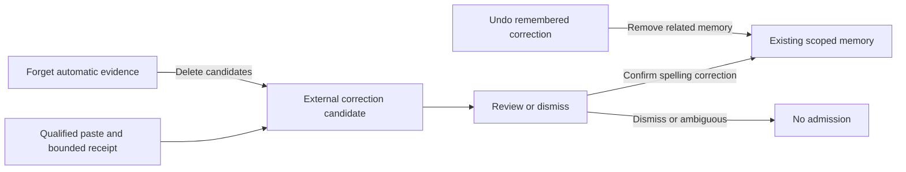

# TextEdit correction evaluation

The optional **Review corrections in TextEdit** setting enables a bounded local observer after automatic paste. It defaults off and is separate from automatic in-app spelling learning. Enabling it does not approve training labels or activate a dictionary entry. Eligible candidates appear in **Settings → Writing → Corrections from TextEdit**; each spelling requires an explicit Remember action. The September 19 design was approved in [#61](https://github.com/rahulsharmavishwakarma/transcribe/issues/61#issuecomment-5742682788).

## Supported boundary

The first adapter requires macOS, TextEdit, an editable text area, a direct keyboard layout and an English Format menu whose enabled conversion command is **Make Rich Text**. Missing, localized or contradictory menu state rejects observation. A TextEdit bundle ID, `.txt` filename or text-area role alone is insufficient. The adapter never reads document URLs or window titles. The opt-in native test harness checks its own temporary document URL before touching its fixture; that check is not part of production observation.

This is a conservative adapter, not an authoritative general AX plain-text flag. Apple's [TextEdit conversion guide](https://support.apple.com/en-ph/guide/textedit/txtee6663a0e/mac) describes the Format commands. English menu-state eligibility is an application inference that requires qualification on each supported TextEdit/OS version. Input methods are excluded because accessibility notifications do not reliably identify marked-text composition. Unicode text itself is supported; UTF-16 offsets never become UTF-8 byte offsets.

## One bounded receipt

Immediately before dispatch, native code retains one receipt separate from the consumed paste target. It contains an operation token, process and AX field/window identities, selection offset, emitted text (at most 8,192 UTF-16 units), and up to 32 units on each side. It uses only `AXStringForRange` for text reads, bounded to 8,256 units including guards. It never falls back to whole `AXValue` reads or searches a document for a lost span.

For up to two seconds, the observer checks the original insertion range, both guards, expected total length and collapsed selection. A matching snapshot acknowledges the expected text; it cannot prove which actor inserted it. After acknowledgement, notifications coalesce for 50 ms; a changed candidate must settle for 300 ms. At most one candidate is emitted within the 60-second receipt lifetime. There is no polling after acknowledgement; an expiry callback releases the receipt.

Repeated or overlapping boundary matches reject attribution. Empty guards are permitted only at original document boundaries. Lost guards, oversized/empty replacements, selection outside the span, focus/window changes, destruction, unsupported APIs, input-method changes, secure input or lost permission abort. A new recording, settings change, Forget or shutdown cancels observation. Returning to the document does not resume it.

Bounded reads can include adjacent, unrelated text, including after concurrent shifts. Matching AX identities and stable boundaries do not establish author, meaning or causal attribution. This is why the result remains an external shadow candidate. Guard text stays native and transient; it is never sent to a model or persisted.

## Storage and deletion

`external_shadow` stores schema/versioned receipts and explicitly labelled `external_textedit_shadow` candidates: operation context, inserted text, optional changed text, and creation time. It stores at most 256 records for 30 days, pruning on store access, including when audio collection is off. A new receipt replaces unfinished receipts. Pending receipts are never replayed after restart.

Completion can only update its exact pending reservation and current learning epoch and exact app-owned operation context. Undo removes related evidence; saved-result Undo uses session identity. Forget deletes all external shadow records and advances the learning epoch, preventing stale callbacks from restoring them. Disabling the setting stops observation; previously stored candidates remain until Forget or expiry. Unconfirmed candidates do not enter sessions, reviewed export labels, automatic spelling support or policy feedback. A confirmed spelling is a manual entry in the existing vocabulary with the original recording project/language. Remember consumes its receipt and saves the entry in one transaction. Dismiss deletes the candidate. Removing the vocabulary entry undoes a remembered spelling; Forget retains these explicitly remembered words.

## Validation and reproduction

The native pure matcher and transition tests cover UTF-16 boundaries, emoji/combining marks/Hindi, repeated guards, size limits, insertion acknowledgement, selection bounds and timeout/focus gates. Data tests cover exact-once completion, receipt replacement, Undo, Forget and unchanged active memory. Frontend tests check default-off migration, explicit Save, reset and the existing checkbox interaction.

Build the opt-in fixture runner on macOS:

```sh
clang -fobjc-arc -fblocks -framework AppKit -framework ApplicationServices \
  -framework Carbon crates/vesper-desktop-platform/examples/textedit_probe.m \
  -o /tmp/vesper-textedit-probe
/tmp/vesper-textedit-probe --fixture
```

It checks permissions without prompting, opens a newly authored temporary plain-text document, verifies that exact fixture, runs actual Command-V and an AX-driven Unicode replacement, and reports acknowledgement/candidate/read bounds. It returns 77 when permissions are unavailable. This is native component qualification, not a microphone-to-editor end-to-end latency test. Never treat a successful fixture as qualification of other editors, IME, rich text, natural authorship or longitudinal learning benefit.

Primary API evidence: [bounded range reads](https://developer.apple.com/documentation/applicationservices/kaxstringforrangeparameterizedattribute), [observer registration](https://developer.apple.com/documentation/applicationservices/1462089-axobserveraddnotification), and [value-change notification](https://developer.apple.com/documentation/appkit/nsaccessibility-swift.struct/notification/valuechanged). Notification availability is distinct from reliable correction attribution.

### Current measured status

The September 19 [qualification record](evaluation.md#policy-shadow-and-textedit-component-checks--19-september-2026) separates successful AX-driven TextEdit component tests from actual Command-V runs that stopped on identity notifications. Those failures remain historical evidence. The September 27 authored Command-V component rerun passed correction, redundant notifications, outside-span rejection, cancellation and switching to a separate authored document; app-wide natural-use qualification remains open. The harness's `--ax-fixture` mode injects only into its verified authored document; `outside` and `cancel` as an additional argument exercise rejection. This mode does not measure keyboard dispatch. `--fixture` opens visible TextEdit windows; run it only during an intentional GUI test session, and close the authored documents afterward. Ordinary unit/browser tests never launch TextEdit.

## Explicit spelling admission

The reviewed-admission extension in [#61](https://github.com/rahulsharmavishwakarma/transcribe/issues/61)
was approved. The native observer now revalidates the retained field, focused
window and frontmost process synchronously on focus notifications. Same-identity
notifications can continue; actual changes, destruction, permission loss and
unknown identity still abort. Delayed reads are keyed to receipt generations.
The native fixture waits for acknowledgement within the existing two-second
budget, rather than failing after a fixed half-second delay.



The review shows the inserted/changed span and eligible spelling pairs. A Remember
action confirms one pair and consumes that receipt; other changes in its span are
not admitted. Up to 16 recent eligible candidates are shown. The store rechecks
its exact receipt, epoch, authoritative operation context, saved-session Undo
state, suggested pair and current profile revision. It writes to the existing
vocabulary, never a reviewed full transcript, verbatim ASR target or cleanup label.
Retain existing expiry, quotas, source deduplication and Undo/Forget semantics;
Forget invalidates pending candidates without deleting manually remembered
words. No separate dictionary or inference adapter is needed.

Passive automatic admission remains a separate evidence gate. AX notifications
and matching boundaries do not distinguish the user from spellcheck or another
automation. Repeated unreviewed machine edits cannot certify their own truth.
Test actual Command-V, adjacent edits, app-generated substitutions, undo/redo,
document reuse, delayed events, unsupported input methods and scope changes.
Measure native read bounds, capture/stop-to-insert overhead and idle activity.
Only expand to another editor after its metadata and attribution behavior pass
the same tests; general screen/document monitoring is outside this design.

The notification behavior follows Apple's [focused-element notification](https://developer.apple.com/documentation/applicationservices/kaxfocuseduielementchangednotification),
[focused-window attribute](https://developer.apple.com/documentation/applicationservices/kaxfocusedwindowattribute),
and [per-object messaging timeout](https://developer.apple.com/documentation/applicationservices/1459345-axuielementsetmessagingtimeout)
contracts. Synchronous equality checks are application safeguards, not proof of
who authored an edit. The optional project router reads a TextEdit document URL
separately at capture start; this observer still reads no URL or window title.
