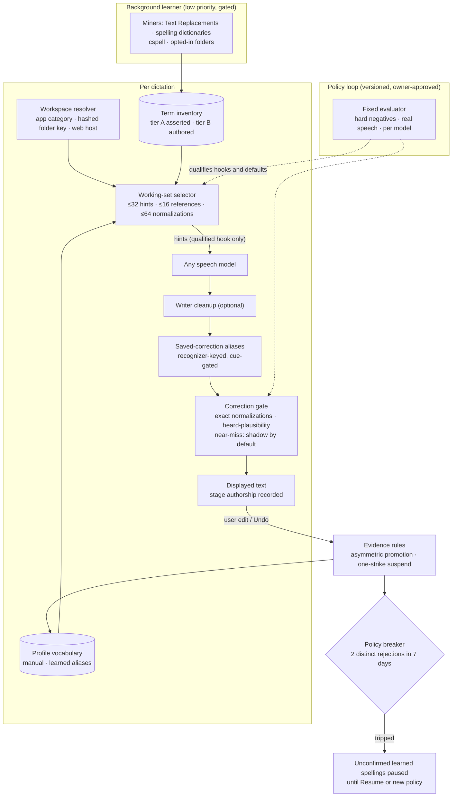

# Self-improving dictation system

Status: implemented on the local branch `feature/self-improving-dictation`. It is not published, and its tracking issue is pending the owner's approval to publish. This page describes the design, what each part does today and the measured results.

Vesper learns as a **system**, not as a model. Speech models are swappable, so what Vesper learns lives in an application-owned term memory. A small working set is handed to whichever recognizer is loaded, through that recognizer's own hook when the hook is qualified. Every model passes through the same text-level safety layer afterwards.

## Two loops

- **Memory loop (automatic).**
  - Terms, aliases and workspace links update continuously under fixed rules.
  - Sources are things the user wrote or asserted. Machine output (recognizer, writer, rules, recurrence) is never a spelling source and never positive evidence.
- **Policy loop (offline, approved).**
  - Thresholds, priors, list sizes and the near-miss mode change only through a versioned code change.
  - That change must pass the fixed [term evaluation](term-evaluation.md), which the learner can neither read nor modify.

## Architecture

## Status and measured results (27 October 2026)

All results are **local measurements**. The positives are synthetic TTS, and the real-speech controls are small (92 FLEURS clips, 271 LibriSpeech utterances). Details and denominators are in the [term evaluation](term-evaluation.md).

| Component | Status in the app | Evidence |
| --- | --- | --- |
| Correction gate, exact normalizations | **On** for every model (English) | Cohere, at 32 workspace terms: positive recall 32.7% → 42.3%. Parakeet: 27.4% → 39.3%. 0 harmful edits. 0 added false alarms across 350 rendered and 2,595 text hard negatives and 92 real FLEURS clips. Replay over 725 real local transcripts: 0 changes after two rule fixes; before the fixes it made 5 wrong `ASR models` → `ASR_MODELS` style changes. |
| Near-miss repair | **Shadow**: proposals recorded, text unchanged | Adds about 5 points of recall on top (Cohere 42.3% → 47.6%, Parakeet 39.3% → 44.6%). Real local history: 18 repairs, all judged correct (`GEMA` → Gemma, `collab` → Colab, `vasper` → Vesper, `Envidia` → NVIDIA, `DRization` → diarization). That history was also the development set. Held-out FLEURS: 1 harmful change in 92 clips under a wrong-workspace list (upper bound 5.1%). Not enough evidence to apply by default. |
| Recognizer hooks: Nemotron phrase bias, Qwen3-ASR prompt hotwords | **Disabled** for automatic hints | Both raise recall: Nemotron 25% → 60%, Qwen3-ASR 29% → 67%. Nemotron inserts hint terms into ordinary speech on 16–22% of hard negatives and 21–34% of FLEURS clips. Qwen3-ASR exceeds the 3% false-alarm gate at 32 hints (upper bound 4.1%), mostly by capitalizing ordinary words that are also term names. Each decode still records its hint provenance. |
| Policy 5 learning from edits | **On** | Stricter than policy 4. On the authored episode replay it gave fewer fixes than policy 4 (word errors 15 against 7, raw 16), with 0 harm in both. Local history holds 0 in-app edits, so this path has had no real input. |
| Automatic workspaces | **On** (folder/host keys) | Synthetic week, 20 seeds: precision 1,349/1,349, recall 59.7% (90.1% once a workspace is visible), median visibility after day 2–3. Live per-app document reading is **unmeasured**: running it means opening apps, which needs the owner's approval. |
| Term inventory and background miner | **On** (tier A from user lists; tier B only for opted-in folders) | Tier A yields 0 terms on the development Mac. Tier B, Vesper repo: 1,571 terms in 0.33 s CPU and 47 MB RSS; about 1 in 5 sampled terms is ASR-hard and project-specific. In-app worker cost, QoS effects and energy are unmeasured. |
| DPDFNet8, forced on | Unchanged (owner decision) | Lowered term recall in all six model and noise lanes (1.8–6.6 points case-insensitive) and raised non-target WER in five of six. Consistent direction, small samples. |

What did **not** work:
- Recognizer hints, as configured, failed the pre-declared false-alarm gates for both hookable models.
- The writer model neither fixed nor inserted terms.
- Learning from edits had no real input, because the local history has no edits.

## Safety invariants

1. **Only user-authored evidence counts.** That means edits to displayed text, Undo, words the user added, and the user's own dictionaries and files. Recurrence of a term in recognizer output, unedited results, copied text and writer output are never positive evidence ([automatic dictionary](automatic-dictionary.md#independence-and-self-reinforcement)).
2. **Ordinary speech is not rewritten.** The [correction gate](correction-gate.md) refuses to change a span made of ordinary English words into a different word. A single lowercase ordinary word is never promoted to an automatic alias ([activation table](automatic-dictionary.md#automatic-activation)).
3. **One rejection suspends a rule. Two distinct rejections in a week pause all unconfirmed learned spellings** ([policy breaker](automatic-dictionary.md#policy-breaker)).
4. **Learned confusions are tied to the recognizer that produced them.** Vocabulary is model-independent ([recognizer-keyed aliases](automatic-dictionary.md#recognizer-keyed-aliases)).
5. **Hints are small and scoped.** A recognizer receives at most 32 workspace-relevant terms, and only through a hook that passed qualification for that model.
6. **Bias provenance.** Each decode records the hash of its hint list, so a term that appears *because* it was boosted cannot reinforce its own ranking.

## Related pages

- [Correction gate](correction-gate.md)
- [Automatic dictionary (policy 5)](automatic-dictionary.md)
- [Context selection and workspaces](context-selection.md)
- [Term inventory and background learner](term-inventory.md)
- [Term evaluation](term-evaluation.md)
- [Storage and privacy](storage-and-privacy.md)
