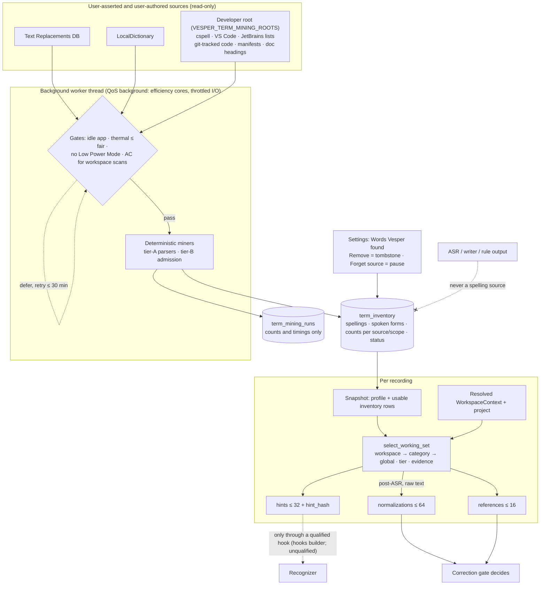

# Term inventory and working-set selection

Vesper keeps a local **term inventory**: spellings that you asserted (spelling lists, text replacements) or authored (identifiers, package names and documentation headings in a folder root a developer configured with `VESPER_TERM_MINING_ROOTS`; none in normal use). It is separate from the 128-entry profile vocabulary. For each recording a pure **selector** picks a small, relevant **working set** from the inventory plus the profile vocabulary and hands it to whichever recognizer and correction step run.

Machine output is never a spelling source. ASR text, writer output, recurrence and rule output do not create or confirm inventory rows (see `crates/vesper-core/src/terms.rs`).

## Working-set selection

`vesper_core::select_working_set(terms, context, raw)` is deterministic and allocation-bounded. Its input is every usable inventory row plus `profile_terms(profile)` (manual words and confirmed corrections from the profile; unticked automatic entries contribute a spelling but no alias). The context is the resolved `WorkspaceContext`, the resolved project name, the dictation language and a clock.

Ranking, in order:

1. **Scope.** Rows scoped to the current workspace key or project come first. Global rows whose sources suit the receiving app's category come next: identifiers, manifests and project dictionaries suit code and terminal apps; documentation also suits documents and notes. Other global rows follow. Rows scoped only to _another_ workspace are never offered, because the right term in the wrong scope is a hard negative.
2. **Tier.** Asserted (tier A) before authored (tier B).
3. **Evidence.** `ln(1 + independent evidence) × 0.5^(age / 30 days)`, where age counts from the last time mining saw the evidence grow. The profile's `usage_count` is deliberately not used: it counts raw ASR, including biased decodes.
4. Spelling, then ID, as a stable tie-break. Duplicate spellings (any case) collapse to the best-ranked row.

Outputs and caps (from `terms.rs`):

| Field            | Cap                     | Contents                                                                                                                                                                                                                                                                                                                                                                                                                                                                                                                                                                                                                                                                                                            |
| ---------------- | ----------------------- | ------------------------------------------------------------------------------------------------------------------------------------------------------------------------------------------------------------------------------------------------------------------------------------------------------------------------------------------------------------------------------------------------------------------------------------------------------------------------------------------------------------------------------------------------------------------------------------------------------------------------------------------------------------------------------------------------------------------- |
| `hints`          | 32 phrases, 2,048 bytes | Top-ranked spellings for a qualified recognizer hook                                                                                                                                                                                                                                                                                                                                                                                                                                                                                                                                                                                                                                                                |
| `hint_hash`      | —                       | `fnv1a64:<hex>` over the ordered hints; empty when there are no hints                                                                                                                                                                                                                                                                                                                                                                                                                                                                                                                                                                                                                                               |
| `references`     | 16                      | Single-token spellings of at least four letters: names and acronyms first (`Vesper`, `NVIDIA`, `Qwen`), then identifiers, each in hint order. A reference is either not an ordinary English word, or a capitalized name or acronym whose lowercase form is in the lexicon; a lowercase ordinary word never is. The gate's near-miss repair uses them. Three-letter acronyms are excluded because their one-edit neighbours are mostly other acronyms (`NPU` → `GPU`). After ASR, spellings within the gate's near-miss bound (one edit, two from eight letters) of a heard non-word of four or more letters come first, whatever their rank: `vasper` → `Vesper`, `Envidia` → `NVIDIA`, `DRization` → `diarization` |
| `normalizations` | 64                      | Post-ASR only: `(spoken form, spelling, term ID, tier)` for every spoken form that occurs as a whole-word n-gram (n ≤ 6) in the raw text                                                                                                                                                                                                                                                                                                                                                                                                                                                                                                                                                                            |

Spoken forms come from `identifier_spoken_form`: camelCase, snake_case, kebab-case and dotted names split into lowercase words (`fooBarBaz` → `foo bar baz`, `HTTPServer` → `http server`, `vesper_core::terms` → `vesper core terms`). Digits stay attached (`k8s`, `utf8`), and forms longer than six words are dropped. Acronym letter forms are not generated. The selector only proposes normalizations; the [correction gate](correction-gate.md) decides whether each may apply.

## Sources and trust tiers

| Tier        | Source (`TermSource`)                     | Where it is read                                                                                                                                                                                                                                                                                                                                         | Scope               |
| ----------- | ----------------------------------------- | -------------------------------------------------------------------------------------------------------------------------------------------------------------------------------------------------------------------------------------------------------------------------------------------------------------------------------------------------------- | ------------------- |
| A, asserted | `text_replacement`                        | `~/Library/KeyboardServices/TextReplacements.db`, opened read-only; live rows of `ZTEXTREPLACEMENTENTRY` (`ZPHRASE`). The typed shortcut is not a spoken form and is dropped                                                                                                                                                                             | Global              |
| A           | `spelling_dictionary`                     | `~/Library/Spelling/LocalDictionary` (one learned word per line)                                                                                                                                                                                                                                                                                         | Global              |
| A           | `project_dictionary`                      | Inside a developer-configured root only: `cspell.json`, `.cspell.json`, `cspell.config.{json,yaml,yml}`, `cspell.{yaml,yml}`, `.vscode/cspell.json`, `package.json#cspell` (`words` plus `dictionaryDefinitions[].path` word lists inside the root), `.vscode/settings.json` `cSpell.words`/`cSpell.userWords`, `.idea/dictionaries/*.xml` `<w>` entries | That workspace      |
| A           | `vocabulary`, `correction`                | The profile vocabulary, merged at selection time rather than copied into the inventory. Manual and confirmed entries contribute their taught aliases as spoken forms                                                                                                                                                                                     | The entry's project |
| B, authored | `identifier`, `manifest`, `documentation` | Git-tracked text files under a developer-configured root                                                                                                                                                                                                                                                                                                 | That workspace      |

Asserted values must look like a term: at most four words and 64 bytes, at least two letters, no `@`, no `://`, and no trailing sentence punctuation. That excludes "On my way!", addresses and URLs. cspell `flagWords` are errors, not spellings, and are ignored. JSONC comments and trailing commas are accepted. YAML is read only for the top-level `words` list and `dictionaryDefinitions` paths. Code-based cspell configurations (`cspell.config.js` and similar) are not executed or read.

### Tier-B admission (deterministic: no model, embedding or LLM)

The scanner lists files with `git ls-files` using a real git binary: Command Line Tools, Xcode or Homebrew. It never uses the `/usr/bin/git` shim, which can open an install dialog. A folder that is not a repository is skipped; there is no directory walk. It skips:

- vendor, build and generated folders (`node_modules`, `vendor`, `target`, `dist`, `build`, `.venv`, `site-packages`, `third_party` and similar)
- lockfiles and `*.min.*` files
- files over 512 KB, binary files, and files whose first 64 KB contain a line over 2,000 characters
- extensions outside a code, documentation (`md`, `rst`, `txt`, …) or configuration (`toml`, `yaml`) allowlist
- symlinks that resolve outside the root

Per file it collects candidate tokens. URLs are removed first, so hosts and user names in links are never mined.

- **Code:** every identifier-like token. Any token after a definition keyword (`fn`, `struct`, `class`, `def`, `function`, `interface`, `type`, …) is marked _defined_. The file stem is also marked defined.
- **Documentation:** all tokens, plus backticked spans with hyphens kept. Real headings (`#`–`######` followed by a space, outside fenced code blocks) are marked _heading_.
- **Manifests:** package and dependency names from `Cargo.toml`, `package.json` and `pyproject.toml` are marked _manifest_.

A token is a candidate only if it has one of these shapes:

| Shape                                                            | Example                            | Extra requirement                                |
| ---------------------------------------------------------------- | ---------------------------------- | ------------------------------------------------ |
| Identifier: `_`/`-` separated, camelCase, or letters with digits | `sherpa_onnx`, `WorkingSet`, `k8s` | Defined, manifest or heading; at most five words |
| Capitalized non-dictionary word                                  | `Nemotron`, `Qwen`                 | None                                             |
| Acronym of 3–8 capitals                                          | `GGUF`, `VAD`                      | Appears in a documentation file                  |
| Lowercase non-dictionary word of 4+ letters                      | `rusqlite`, `diarization`          | Defined, manifest or heading                     |

"Dictionary" means the shared CMUdict-derived `ordinary_word` lexicon used by the correction gate, extended with regular inflections (`timings`, `retries`, `scoped`), common prefixes (`revalidate`, `denoising`) and, for lowercase words, two-word compounds (`runtime`, `frontend`). A short stoplist removes language keywords, ubiquitous library names (`and_then`, `Deserialize`) and generic tech words (`json`, `config`, `metadata`). Leading underscores, hash-like hex strings and chains of more than five words are rejected.

**Consistently capitalized names.** Some names are also ordinary words in the lexicon: `Vesper`, `NVIDIA`, `Gemma`, `Colab`, `Whisper`, `Parakeet`. Such a name is admitted from documentation prose when all of these hold:

- its capitalized form (an initial capital, or all capitals up to six letters) appears **mid-sentence** in at least two documentation files
- it appears in more files than the lowercase prose word does

These occurrences do not count:

- a word after sentence punctuation, a line start, or markup (`*`, `|`, `#`, `>`, list numbers)
- headings, fenced code and backtick spans
- weekday and month names
- license files (`LICENSE*`, `COPYING*`, `NOTICE*`)

So "Write" at a sentence start and lowercase "point" are never admitted.

Spellings that differ only in case or separators (`vesper-core`, `vesper_core`, `VesperCore`) are grouped. A group is admitted when **at least two distinct files** contain any of its spellings and the shape evidence holds. The admitted surface is the **majority spelling** by file count. Its evidence count is the group's file count.

## Inventory rows and status

Each spelling has one row in `term_inventory`, carrying evidence entries per `(source, scope)`. Re-mining a source in a scope replaces only that source's entries in that scope, so two workspaces and the global sources never overwrite each other.

| Status        | Set by                                                        | Selector use                                                                               |
| ------------- | ------------------------------------------------------------- | ------------------------------------------------------------------------------------------ |
| `active`      | A row with any tier-A evidence                                | Hints, references, normalizations                                                          |
| `unconfirmed` | A tier-B-only row                                             | Hints, references, normalizations (the gate applies authored terms only to non-word spans) |
| `suspended`   | `suspend_inventory_term` (negative evidence such as a revert) | Not selected; rescans update counts but keep the status                                    |
| `removed`     | The user's **Remove**                                         | Tombstone: never selected and never re-added by mining, in any letter case                 |

`DictationPersonalizationSnapshot` loads the usable rows with the profile in one read transaction (a damaged inventory yields an empty list, never a failed dictation). It carries three more fields:

- `workspace: WorkspaceContext`
- `inventory`
- `working_set`

After setup resolves the workspace and project, `select_working_set(language)` fills `working_set`. `post_asr_working_set(raw, language)` returns the post-ASR set for the correction gate, with hints and `hint_hash` copied from the pre-ASR set, so provenance describes what the decode actually received. A snapshot that was never selected reports empty hints. Lifecycle, bounds and deletion are described in [storage and privacy](storage-and-privacy.md#term-inventory).

## Background worker

`apps/desktop/src-tauri/src/term_worker.rs` runs one plain thread named `vesper-term-miner`. On start it lowers itself to background QoS (`pthread_set_qos_class_self_np(QOS_CLASS_BACKGROUND)`), which also places its disk I/O in the throttled tier, and verifies the resulting class with `qos_class_self()`. This is implemented in `crates/vesper-desktop-platform/src/background.m`. An earlier version also called thread-scope `setiopolicy_np(IOPOL_THROTTLE)`. On macOS 27 that call silently reset the thread's QoS to unspecified, even though both calls reported success, so the worker ran at default QoS. Kernel per-QoS CPU accounting (`proc_pid_rusage`, `ri_cpu_time_qos_*`) found the problem, and the extra call was removed.

- **Schedule.** The first run is 2 minutes after launch, then one run per hour. If a gate defers a run, it retries every 5 minutes for up to 30 minutes of tolerance, then logs `deferred:<gate>` and waits for the next hour. Resuming a source wakes the worker early; the gates still apply.
- **Gates, checked at the start of a run:**
  - the app is closing
  - a runtime operation is busy (recording, transcribing, rewriting, installing, removing)
  - a background model download is running
  - a dictation is starting, recording, finishing or pasting
  - `ProcessInfo.thermalState` is worse than _fair_
  - Low Power Mode is on
- **Workspace scans need AC power.** On battery, or when the power source is unknown, the run mines the global tier-A files only and logs `partial:battery`.
- **Checks during a scan.** Before every file the worker re-checks:
  - cancellation
  - the busy and dictation gates, so a dictation start stops the scan within one file
  - the CPU budget

  Every 64 files it also re-checks thermal state, Low Power Mode and power source.

- **Budgets per run:**
  - 20 CPU-seconds, measured with the thread CPU clock
  - 2,000 files and 64 MB read across all workspaces
  - files over 512 KB skipped

  A pass that stops saves its cursor and resumes at the next run. A pass whose file fingerprint changed restarts. An unchanged workspace (same fingerprint as the last completed pass) costs one `git ls-files` plus one `stat` per tracked file, and reads nothing.

- **Database contention.** The worker opens the store with the 25 ms background lock limit and abstains rather than wait behind a foreground writer.
- **Run log.** Each run records its outcome (`completed`, `partial:*`, `deferred:*` or a fixed `failed:<category>`) together with counts and timings only:
  - wall time and CPU time
  - files read, bytes read and files skipped
  - workspaces scanned and unchanged
  - terms added, updated, dropped and in total

**Why a plain thread instead of NSBackgroundActivityScheduler.** The scheduler would add an Objective-C block bridge and completion-handler lifetime across the FFI boundary for little gain. The worker already needs app-specific gates that the system cannot see: dictation and model activity. It also needs per-file cancellation. The system's own deferral signals that matter here are applied directly: thermal state, Low Power Mode and power source. The thread spends nearly all of its life blocked on a condition variable. A later change could move the trigger to the scheduler without touching the miners.

**Folder roots.** Tier-B mining runs only for roots in the developer variable `VESPER_TERM_MINING_ROOTS`. The Settings folder opt-in (**Learn words from this folder…**) was removed on 28 October 2026, so in normal use no folder is read. A scope that is no longer listed has its mined evidence and cursor dropped on the next run (`forget_term_workspace`), which also clears words mined from folders chosen before the removal. The variable's format:

- entries are separated by `;`
- each entry is `scope=/path` or a bare `/path`
- a bare path's scope is its folder name

With no roots, only the global tier-A sources are mined.

## Settings view

Settings → Vocabulary → **Words Vesper found** (`TermInventory.svelte`) is collapsed by default and loads only when opened. It shows:

- counts per source and per workspace (folder name)
- up to 200 of the strongest rows, each with source and workspace chips
- the last run time

Each row has × (tombstone removal). Each source has **Forget** (delete its evidence and pause it) or **Resume**. The commands are `get_term_inventory`, `remove_inventory_term`, `forget_term_source` and `resume_term_source` in `apps/desktop/src-tauri/src/terms.rs`. They return spellings, counts and labels only.

## Privacy boundaries

- **Read:** Text Replacements (read-only SQLite), LocalDictionary, and, inside developer-configured roots only (none by default), spelling-list files and git-tracked text files.
- **Not read:** the home folder at large, Mail, Messages, browser data, the screen or the clipboard. Mining requests no permission and needs no Full Disk Access.
- **Stored:** spellings, spoken forms, counts, opaque scope keys and folder-name labels. Never paths, URLs or file text. Cursors keep only a SHA-256 fingerprint, an index and candidate counts.
- **Not learned from:** machine output, which never creates, confirms or re-activates an inventory row.

## Evaluation (local measurement, 27 October 2026)

All figures below are local measurements from the release build of `crates/vesper-data/examples/term_inventory_eval.rs`.

**Setup.**

- **Machine:** Apple M5 Pro, 18 cores, 64 GB, Darwin 27.0.0.
- **Path measured:** the same miners, store and selector the worker uses, run from a CLI at normal QoS without the gates. The in-app worker was not launched, so in-app QoS and throttling effects are **unmeasured**.
- **Worker thread policy and energy** (27 October 2026, local measurement on AC power at nominal thermal state). The measurement ran the worker's thread setup and `scan_workspace` over 3 repositories. Per-QoS CPU accounting confirms that 100% of worker CPU is booked at background QoS after the fix; before the fix it was 0%.
  - One full pass over 3 repositories costs **0.55 J** and 1.1 CPU-s on the efficiency cores. Before the fix it cost 2.39 J and 0.45 CPU-s at default QoS.
  - Energy comes from the kernel's per-process counter (`ri_energy_nj`) and needs no root access.
  - Dictation-path work (store open, snapshot, selection, gate) measured p95 2.75 ms with the worker idle and 2.91 ms with it scanning nonstop.
  - At one pass per hour the worker averages well under 1 mW.
- **Raw results:** kept outside the repository, because they contain local spellings.

**Sources on this Mac:**

- Text Replacements: 1 live row, the default sentence-style entry, which is rejected, so 0 terms.
- LocalDictionary: 0 words.
- VS Code user `cSpell.words`: 0 words.

So tier A contributed **nothing** on this machine.

**Tier B** (default budgets, first full pass, one run each):

| Workspace       | Tracked files scanned | Read   | Admitted | Identifier / Docs / Manifest | Wall   | CPU (user+sys) | Peak RSS |
| --------------- | --------------------- | ------ | -------- | ---------------------------- | ------ | -------------- | -------- |
| This repository | 584                   | 6.4 MB | 1,571    | 1,185 / 313 / 73             | 0.33 s | 0.32 s         | 47 MB    |
| Research repo 1 | 139                   | 1.5 MB | 506      | 364 / 137 / 5                | 0.11 s | 0.10 s         | 44 MB    |
| Research repo 2 | 137                   | 1.6 MB | 521      | 361 / 152 / 8                | 0.11 s | 0.10 s         | 45 MB    |

- **Process overhead.** Wall time, CPU and RSS are for the whole process (`/usr/bin/time -l`). That includes decoding the shared lexicon, and the tier-A-only process already peaks at 41 MB.
- **Unchanged rescan.** It read 0 files: about 5 ms of scanner time and 0.03 s for the whole process.
- **Changed rescan.** Any change triggers a full pass of the same size as the first.
- **Merged inventory.** The three repositories merge to 2,041 distinct rows.

**Dictionary words.** By the gate's `ordinary_word`, 148 of the 1,571 admitted terms in this repository are ordinary:

- consistently capitalized names such as `Vesper` and `NVIDIA`
- hyphenated script names made of English words

The research repositories have 38 and 45. `/usr/share/dict/words` gives 118, 51 and 58. Identifiers whose every part is an ordinary word (`relative_path`) number 1,050, 279 and 280.

**Sampled precision.** One non-blind rater judged two seeded random samples.

_50 tier-B terms_, drawn before name admission was added (the identifier, documentation and manifest rules are unchanged since):

| Judgment                                                                                                                                                   | Count | Wilson 95% interval |
| ---------------------------------------------------------------------------------------------------------------------------------------------------------- | ----- | ------------------- |
| A real, project-specific spelling ASR would plausibly get wrong (e.g. `rusqlite`, `EPYC`, `dequantize`)                                                    | 9     | 10–31%              |
| A real project identifier made of ordinary words (e.g. `lock_path`, `SettingsStore`): useful only when dictating code; the gate will not apply it to prose | 36    | —                   |
| Junk: a library API, an English word missing from the lexicon, or a foreign word                                                                           | 5     | —                   |

_30 newly admitted capitalized names:_

| Judgment                                                                             | Count | Wilson 95% interval |
| ------------------------------------------------------------------------------------ | ----- | ------------------- |
| A project-relevant name (e.g. `NVIDIA`, `Gemma`, `Parakeet`, `Vesper`, `Chromium`)   | 7     | 12–41%              |
| A real but generic proper noun ASR usually gets right (languages, companies, `Unix`) | 19    | —                   |
| Junk                                                                                 | 4     | —                   |

Two of the four junk names were all-capitals legal text from a license file. The six-letter all-capitals limit and the license-file skip, added after the sample was drawn, now exclude them. Overall, 79–96% of identifiers and 70–95% of names are real spellings, but only about one in five is ASR-hard and specific to the project.

**Selector latency.** Per call, 200 iterations, in-memory:

| Input                                                                        | Pre-ASR p50 / p95 | Post-ASR p50 / p95 |
| ---------------------------------------------------------------------------- | ----------------- | ------------------ |
| Real inventory, 2,041 rows, code context                                     | 0.17 / 0.32 ms    | 0.47 / 0.80 ms     |
| 20,000 rows, mostly in other scopes                                          | 0.62 / 0.68 ms    | 0.92 / 1.00 ms     |
| 20,000 rows, all in the current workspace, five heard non-words (worst case) | 1.8 / 2.4 ms      | 4.0 / 6.6 ms       |

Loading 20,000 usable rows into the snapshot took 10.6–11.5 ms over four runs. FTS5 is not used: an in-memory pass is about the same order as the snapshot load.

**Working sets.**

- **This repository in a code app:** 32 hints, led by `ASR`, `GPU`, `macOS`, `WER`, `float32`, `sha256`, `English`, `Qwen`, `numpy` and `CPU`. Many hints are generic technical words.
- **Pre-ASR references:** `English`, `Qwen`, `MUCS`, `Nemotron`, `GGUF`, `Apple`, `CUDA`, `Hindi`, … Rank alone does not reach `Vesper` or `NVIDIA`.
- **Post-ASR references:** for the heard tokens `vasper`, `Envidia`, `GEMA`, `collab` and `DRization` (recognizer errors reported from the owner's history), the first reference is `Vesper`, `NVIDIA`, `Gemma`, `Colab` and `diarization` respectively.
- **Email, or a shared context:** empty, because tier A was empty on this Mac and the profile held no words.

**Coverage against real history.** A read-only copy of the local history held 532 sessions with **0** user-edited drafts, so no user-authored spellings could be checked.

- Of 211 distinct non-ordinary tokens in kept (machine-written) text, 21 (10%) match an inventory spelling.
- 75 of 2,041 inventory terms occur in that text by spelling or spoken form.
- The five reported misrecognition targets are all in the inventory now. Before name admission, four of them were not, because the lexicon lists them as words.
- Whether the inventory covers the owner's other intended terms remains **unknown**: that needs labelled audio or user edits.

## Limitations

- **Unmeasured benefit.** Recognition and correction gains are not measured here. Hints reach a recognizer only through a qualified hook, and the correction gate makes its own decisions.
- **Main-window path.** Recordings started from the main window, and file transcriptions, load their snapshot lazily in the runtime. They currently get an empty pre-ASR working set, so no hints are used and the post-ASR hints report empty.
- **Admission is shape-based.** It admits many project identifiers made of ordinary words (`relative_path`). The gate refuses to rewrite ordinary-language spans into authored terms, so these mostly act as hints and references in code contexts.
- **Lexicon gaps.** English words missing from the lexicon (`reproducible`) can still pass as names or lowercase terms.
- **Late resume.** A pass interrupted by budget resumes only at the next hourly run.
