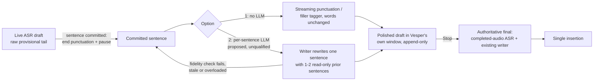

# Live rewriting while the user speaks — research, 17 October 2026

Question ([#156](https://github.com/rahulsharmavishwakarma/vesper/issues/156)):
do other transcription apps polish text **while** the user is speaking, and how?
Vesper today streams raw drafts during recording ([live transcription](live-transcription.md))
and runs the writing model only after Stop. On 52 public clips, that writing
pass did not lower WER ([polishing measurement](validation/polishing-wer-2026-10-16.md)).

Evidence labels: **V** vendor claim, **D** documented behavior in official help
or docs, **P** paper result, **I** open-source implementation (pinned commit),
**H** hypothesis. Nothing here was measured locally. Vendor latency figures
measure different things and are not comparable with each other or with Vesper.

## What products do

| Product | During speech | Rewrite | Where it runs |
| --- | --- | --- | --- |
| Windows Voice Access fluid dictation | Text inline at the cursor | **Live:** "corrects grammar, punctuation, and filler words as you speak"; "Revert" / "Undo that" restores the original (D) | On-device small language model, Copilot+ PCs (D) |
| Aqua Voice Realtime Mode | Words in Aqua's toolbar | **Live, staged:** words "resolve into clean, punctuated text a beat behind you"; spoken edits such as "change Thursday to Friday" update the live text; nothing reaches the target app until you finish (V/D) | The Realtime page says it "runs on your Mac or PC"; the vendor's `llms.txt` describes a third-party realtime recognizer. Conflicting, so unresolved |
| Apple Dictation (macOS) | Inline | Punctuation only, inserted "as you dictate" (D) | On-device or server, by setting (D) |
| Gboard Assistant voice typing (Pixel) | Inline, streaming | Punctuation as you speak, plus voice editing commands; "Fix it" proofreading is a separate later step (D) | Mostly on-device; Fix it uses a server (D) |
| Wispr Flow, Willow, Gboard Rambler | No text until release (D) | After release: filler removal, self-corrections ("5 pm, actually 6"), formatting (D/V) | Cloud LLM (V/D) |
| Superwhisper, VoiceInk, Spokenly | Optional raw live text in the app's own window (D) | After recording ends (D); VoiceInk says partials "may change" | Local or cloud per mode; a local recognizer does not imply a local rewrite (D) |
| Open source: VoiceInk, Handy, OpenWhispr | Raw or none | After stop: the cleanup call runs on the finished transcript (I) | Local or cloud |

Sources:
- [Microsoft fluid dictation](https://support.microsoft.com/en-us/accessibility/windows/voice-access/fluid-dictation), [Windows accessibility 2025 recap](https://blogs.windows.com/windowsexperience/2025/12/03/2025-a-year-in-recap-windows-accessibility/), and a [user report of unwanted rewording](https://learn.microsoft.com/en-my/answers/questions/5839746/voice-typing-is-rewording)
- [Aqua Realtime](https://aquavoice.com/realtime), [Aqua llms.txt](https://aquavoice.com/llms.txt)
- [Apple Dictation](https://support.apple.com/guide/mac-help/mh40584/mac)
- [Gboard voice typing](https://support.google.com/gboard/answer/11197787), [Rambler](https://support.google.com/pixelphone/answer/17468539)
- [Wispr Flow first dictation](https://docs.wisprflow.ai/articles/6409258247-starting-your-first-dictation)
- [Willow help](https://help.willowvoice.com/en/articles/10876920)
- [Superwhisper realtime](https://superwhisper.com/docs/common-issues/realtime)
- [VoiceInk](https://tryvoiceink.com/llms.txt)
- [Spokenly](https://spokenly.app/llms-full.txt)
- Pinned code: [VoiceInk pipeline](https://github.com/Beingpax/VoiceInk/blob/9ce98ec/VoiceInk/Features/Recording/Workflows/TranscriptionPipeline.swift#L195), [Handy](https://github.com/cjpais/Handy/blob/9e57a0d/src-tauri/src/actions.rs#L354), [OpenWhispr](https://github.com/OpenWhispr/openwhispr/blob/3577e5c/src/helpers/audioManager.js#L3253)

Observed patterns:

1. **Most products rewrite after Stop.** They show raw words (or nothing) while
   the user speaks, then run one LLM rewrite at release. Vesper already follows
   this pattern.
2. **Only two products document a true live rewrite.** Windows fluid dictation
   rewrites inline at the cursor and offers an undo. Aqua stages the live
   cleaned text in its own toolbar and inserts once at the end. A Microsoft Q&A
   thread shows users objecting when fluid dictation reworded their speech;
   verbatim fidelity is the main risk of live rewriting.
3. **Operating-system keyboards stream punctuation only.** Heavier rewriting
   is a separate step that the user triggers.
4. **Self-corrections are resolved before insertion.** No product documents
   rewriting text that has already been inserted into another application,
   except Windows' Revert.

## What research supports

- **Streaming punctuation, casing and disfluency tagging are mature (P/I).**
  Dynamic-window re-punctuation ([Behre et al.](https://arxiv.org/abs/2210.05756)),
  distilled streaming segmenters ([Google](https://arxiv.org/abs/2305.18419)),
  joint real-time punctuation and disfluency detection
  ([CT-Transformer](https://arxiv.org/abs/2003.01309)), and a streaming
  disfluency tagger that learns when to wait
  ([Teaching BERT to Wait](https://arxiv.org/abs/2205.00620)). A 2026
  non-generative scorer decides punctuation at each word boundary with a
  2-token lookahead and never changes the words
  ([arXiv 2606.05179](https://arxiv.org/abs/2606.05179)). sherpa-onnx, which
  Vesper already uses, ships an
  [online English punctuation model](https://k2-fsa.github.io/sherpa/onnx/punctuation/index.html).
  The Nemotron streaming model card states built-in punctuation and
  capitalization.
- **Bounding flicker (P).** Re-translation research measures how often shown
  text is erased (normalized erasure). Holding back the last *k* tokens and
  biasing toward the previous output cut erasure about 20× at similar quality
  on En–De ([Arivazhagan et al.](https://arxiv.org/abs/1912.03393),
  [re-translation](https://arxiv.org/abs/2004.03643)).
  LocalAgreement commits the stable prefix of consecutive hypotheses
  ([Whisper-Streaming](https://arxiv.org/abs/2307.14743)). Google's two-pass
  recognizers revise only once, at the endpoint
  ([two-pass](https://arxiv.org/abs/1908.10992),
  [deliberation](https://arxiv.org/abs/2003.07962)).
- **Gap.** No paper found evaluates a general LLM polishing streaming partials
  together with erasure metrics. The streaming details of LLM-based ASR such as
  [NIM4-ASR](https://arxiv.org/abs/2604.18105) are not stated in its abstract.
  The "single-pass transcription polishing" in the
  [Qwen-Audio-3.0-ASR report](https://arxiv.org/abs/2609.07549) was read from
  the abstract only.
- **Runtime constraint (H).** Qwen3.5-0.8B is a hybrid recurrent/attention
  model ([card](https://huggingface.co/Qwen/Qwen3.5-0.8B)). Its recurrent state
  cannot be truncated at arbitrary positions, so incremental prefix reuse in
  llama.cpp is limited; only a fixed system-prompt prefix should be assumed
  reusable, and that needs measuring
  ([llama.cpp #24587](https://github.com/ggml-org/llama.cpp/issues/24587)).

## Options for Vesper (proposal input, not approved)

Every option below adds model work during recording, which changes inference
ownership and streaming data flow. Implementing any of them needs an explicit
approved proposal ([#141](https://github.com/rahulsharmavishwakarma/vesper/issues/141)
already lists "incremental cleanup during recording" as approval-gated).

1. **Live formatting without an LLM (lowest risk).** Run a streaming
   punctuation, casing and filler tagger on committed text. Words stay verbatim,
   so fidelity checks are trivial and the CPU cost is small. This matches what
   Apple and Gboard do live.
2. **Per-sentence live rewrite (Aqua-style, staged).** When a sentence is
   committed, ask the writer to rewrite only that sentence, with one or two
   earlier polished sentences as read-only context. Never revise earlier
   polished text live. A single worker cancels stale requests, and when the
   worker is overloaded the committed text is shown unpolished. Production
   fidelity checks gate each sentence. Text is still inserted only at Stop.
3. **Keep after-Stop only, but make it faster** with the #141 items: prefix
   cache, token streaming into the Polishing preview, and diarization moved off
   the critical path.

Gates before any option becomes default: normalized erasure per display layer
(the polished layer must be append-only), commit-to-polished p50/p95 latency,
Stop-to-final no worse than today, ASR real-time factor with and without the
live work, WER and meaning preservation on held-out sets (#151 shows rewriting
can drop words), and rejection rate. Record hardware and thermal state.
