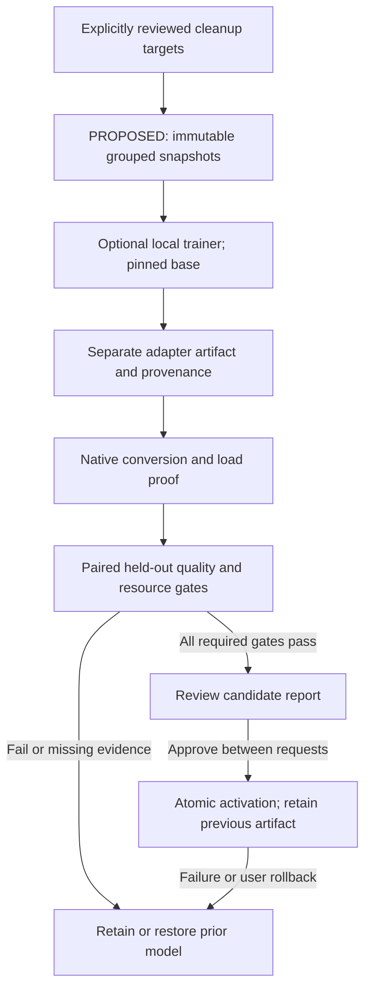

# Continuous improvement contract

The application has two local improvement paths: **ordinary edit → eligible automatic spelling memory → later scoped use**, and **explicit review → confirm memory → later scoped use**. Automatic local learning is core desktop behavior for new and existing profiles. Eligible edits and usage/retry observations run on the existing background workers without an enable switch or per-word confirmation. This product requirement does not establish that every update improves accuracy; admission guards and outcome evaluation remain necessary. Memory belongs to the application rather than a model and uses no cloud inference or learning API.

[ADR-0016](adrs/0016-automatic-local-spelling-learning.md) records the approved automatic extension. The [implementation guide](personalization/README.md) documents editable drafts, vocabulary admission, context/in-context selection, intent, retry evidence, storage/privacy and testing individually. The [research synthesis](research-automatic-personalization.md) preserves the evidence and proposed later semantic work. The owner has requested resuming the training direction; the cleanup-first design below has explicit approval, with its exact compatibility and quality proof still required. The separate [semantic shadow path](personalization/semantic-shadow.md) now analyzes bounded in-app edits with the already-resident local writer. Its proposals cannot change active memory or preferences; installed-model qualification currently fails the semantic quality gate.

The [local memory decision](adrs/0015-model-independent-local-memory.md) defines the implemented correction suggestions, scoped vocabulary/aliases, optional output-form suggestions, pronunciation-confusion labels, useful review queue and bounded learning report. Raw speech, machine cleanup, extra personalized output and human targets remain separate. Undo restores the machine result, including with collection off. Remembered pronunciation confusions are text-level adaptation, not accent detection or acoustic weight learning.

The learning report separates actual uses/undos from text replay against later verbatim reviews. Replay excludes teaching examples, duplicate audio and memories created after a recording, groups stored model/provenance/settings, and retains regressions. It is not a prospective holdout, acoustic benchmark or proof of personal benefit. The [personal dictation research](research-personal-dictation.md) documents recent 2025–2026 evidence and qualification limits. Progress and acceptance criteria remain in [#34](https://github.com/rahulsharmavishwakarma/vesper/issues/34).

The dataset/export and future training contract below preserves separate speech and cleanup supervision. There is no training runner or model promotion service; choosing an improvement mode does not start training. The approved extension is tracked in [#5](https://github.com/rahulsharmavishwakarma/vesper/issues/5). Existing local capture, reviews and exports support that work without making it a dependency of current personalization.

The [personalization phase roadmap](personalization/roadmap.md) explains the intervening work: qualify ordinary spelling learning and evaluate local semantic preferences/intent/repair. The application now also persists bounded six-policy comparisons of explicit edits; active learning rules remain fixed. These application-memory extensions can improve without retraining. The own-model phase remains optional and uses the training contract below.

## User configuration

The desktop does not expose the inactive **Improvement policy** selector. Its
serialized `improvementMode` field remains compatible with existing settings but
has no runtime consumer for training, review or promotion. The automatic choice
does not enable recursive improvement or approve machine predictions. Settings
instead explains the active in-app spelling loop and explicit History reviews.

| Setting | Default | Intended behavior |
| --- | --- | --- |
| `collectTrainingData` | `true` | Retain source audio, predictions, and subsequent user corrections for later review and export. Turning it off stops collection for new sessions. |
| `improvementMode` | `review_required` | Require an explicit promotion decision after a candidate passes evaluation. |
| `improvementMode = automatic` | Optional | Permit a future improvement service to promote a candidate only after all configured dataset, quality, performance, and compatibility gates pass. |

The collection preference should remain visible in settings and recording flows. Store recordings in the application's data directory; use the configured model directory for weights. Resetting settings must not delete recordings. Turning collection off must not silently delete existing examples.

Retention duration, storage limits, deletion of individual sessions, deletion of all collected data, and exports should be user controls. Retention and deletion scheduling are separate implementation work. Audio remains on device. An explicit export creates files in a user-selected destination; the application does not upload them or invoke an external training service.

## Capture the evidence for each session

Preserve the original source file and its content hash. For microphone sessions, persist the captured audio with its actual sample rate and channel count. For imported audio, preserve the input file before decoding. Store the resampled mono inference audio as a derivative with its own metadata when needed; it must remain traceable to its source.

Each retained session needs the following provenance:

| Evidence | Required information |
| --- | --- |
| Source | Stable session ID, capture/import time, original filename where applicable, sample rate, channels, duration, content hash, and relative artifact path |
| Recognition | Raw ASR transcript, speech model ID and revision, weight hash/quantization, runtime version, requested/detected language, decoding settings, and timing |
| Cleanup | Cleaned prediction, cleanup model revision and weight hash/quantization, effective preset/custom instruction, decoding settings, and timing |
| Correction | User-edited text, correction revision/time, target type, review status, and explicit acceptance or rejection |
| Processing | Application/configuration version, success/cancellation/error status, and derivative relationships |

Original audio and recorded predictions are immutable within a retained session. Corrections are additional records, with a revision history; editing the final text must not replace the raw ASR output or the model's cleanup prediction. Explicit deletion removes retained artifacts according to the user's request.

Only completed, internally consistent sessions enter export selection. Interrupted writes need recovery or a clear incomplete status. Write records and artifacts atomically, validate referenced files, and avoid exposing the audio content through routine diagnostic logs.

## Review two different learning targets

Speech recognition and text cleanup require different supervision:

| Task | Input | Approved target |
| --- | --- | --- |
| ASR adaptation | Audio | A reviewed transcript of the words actually spoken, following the dataset's documented transcription convention |
| Cleanup adaptation | Raw ASR transcript and effective cleanup instruction | A reviewed readable version that preserves the speaker's meaning |

For example, if the audio says “um Friday, sorry Monday,” the ASR reference should preserve the spoken correction according to its transcription convention. The cleanup target may be “Monday.” A polished final sentence is not automatically an accurate acoustic training label.

Provide separate approval for each target type. Approval should be explicit; merely displaying, copying, or leaving a prediction unchanged does not verify its accuracy. The user may approve an unchanged output after review. Unapproved predictions can remain in the local collection as evidence, but only reviewed targets enter supervised training exports.

Corrections that add information absent from the audio need a clear target classification. Incomplete or ambiguous speech can be marked unsuitable for training. Model-generated guesses must retain their prediction status until a person reviews them; feeding guesses back as authoritative labels would reinforce mistakes.

## Build reproducible exports

An export should contain a versioned manifest, approved examples, referenced audio, and enough provenance to reproduce selection. Include stable example/session IDs, source hashes, target type and approval revision, model/runtime/prompt versions, language labels, and the export's selection rules. Use relative paths inside a self-contained export so it can be moved to another machine.

Keep ASR and cleanup training views separate even when they share a session. Reject dangling audio paths, missing targets, incompatible sample metadata, and unapproved target revisions. Record excluded-example counts and reasons. A general archival export may include unreviewed predictions, but it must be distinguishable from a training export.

Assign train, development, and held-out evaluation groups before fitting a candidate. Group by original recording/session and related derivatives. Deduplicate by source content hash, and treat copies or overlapping segments of the same audio as one group. Corrected variants and reprocessed versions stay in that group: the same underlying audio must never appear across training and held-out evaluation sets.

Where possible, group related recording sessions by speaker and environment to measure generalization. For a single-user personalized model, reserve later sessions or separately recorded prompts as an additional temporal evaluation set. Keep the held-out set out of training and tuning, and version every split. Repeated candidate selection can overfit an evaluation set, so periodically add fresh, separately reviewed examples.

Deleting a source session should remove it from future dataset snapshots. Already exported copies or previously trained weights require their own lifecycle decisions; keep export and candidate manifests so affected artifacts can be identified. The application must distinguish local deletion from deletion of external copies it cannot control.

## Proposed cleanup-first implementation

This is a proposed sequence, not an executable feature. Keep application memory
and feedback portable across models, while binding trained adapters to their
exact base checkpoint. Start with the normal full-cleanup pass of the built-in
Qwen3.5-0.8B writer. Preserve the existing fidelity checks and raw fallback.
The earlier technical-tail pass was retired on 14 October 2026 (ADR-0008); an
ordinary custom-writer profile still uses its own single-pass route.

Reuse reviewed exports, adding per-target withdrawal, immutable source/review
hashes, grouped and temporal holdouts, and candidate dependency tracking. Add a
cleanup-only candidate mode to `vesper-eval`, then compare the complete native
pipeline with identical memory on both arms. Freeze quality, language coverage,
meaning, latency and memory gates before fitting. Insufficient evidence blocks
promotion; a small smoke test is not a personal-benefit result.

The optional `training/cleanup/pyproject.toml` and `uv.lock` isolate compatibility
probes from desktop inference. First prove zero and deterministic nonzero
adapter conversion, tensor naming/scaling, and native parity. The inspected
[MLX-LM v0.31.3 exporter](https://github.com/ml-explore/mlx-lm/blob/ed1fca4cef15a824c5f1702c80f70b4cffc8e4dd/mlx_lm/fuse.py#L88-L95)
does not support Qwen3.5 GGUF export. Its [LoRA tooling](https://github.com/ml-explore/mlx-lm/blob/ed1fca4cef15a824c5f1702c80f70b4cffc8e4dd/mlx_lm/LORA.md)
does not by itself prove compatibility with the pinned native converter's
[PEFT adapter input](https://github.com/ggml-org/llama.cpp/blob/e79e4bf660e19f2ad851e06c6913f7a8c5852621/convert_lora_to_gguf.py).
Reject unsupported mappings instead of changing the production writer runtime.

The [implemented compatibility probes](cleanup-adapter-qualification.md) pass
synthetic native adapter controls on Q4 CPU/Metal and F32 CPU, but fail the fixed
MLX/native baseline-logit parity gate, including targeted normalization diagnostics.
Training and promotion integration therefore remains blocked; converter success
alone does not qualify a candidate. No learned model is active.

The proposed training source is
`Qwen/Qwen3.5-0.8B@2fc06364715b967f1860aea9cf38778875588b17`; native qualification
uses the currently pinned Q4/Q8 artifacts and `llama-cpp-2 0.1.156` /
`llama.cpp e79e4bf660e19f2ad851e06c6913f7a8c5852621`. These identify the experiment,
not a verified export path. [LoRA](https://arxiv.org/abs/2106.09685) supports the
adaptation method; it supplies no measured quality or speedup for this app.

After conversion proof, use bounded, cancellable jobs from a fresh pinned base
and cumulative reviewed data. A local candidate registry would record artifact,
dataset, toolchain, evaluation and predecessor hashes. Activation must preserve
request isolation and invalidate cached state by candidate identity. Qualify
load failure, cancellation, restart and rollback on the actual CPU/Metal path.
Training shares unified memory with inference; a later opt-in idle scheduler
must yield to dictation and respect power, thermal and memory budgets.
Automatic training and automatic promotion are separate capabilities. Start
with reviewed activation; autonomous promotion requires a separately qualified
gate policy and later-session evidence. Acoustic training is a separate target.

## Train a candidate without replacing the working model

The proposed training job consumes a fixed dataset snapshot and produces a new candidate artifact. The approved first target is local cleanup adaptation using the restricted LoRA recipe above; compatibility and deployable quality must pass before activation. Speech-recognition mistakes need a separate acoustic/transcription target. No hosted training destination or acoustic-training implementation is approved by this cleanup stage.

Record the base checkpoint, dataset/split hashes, training configuration, effective instructions, random seed, environment, output hashes, and evaluation report. Save the candidate separately from the active model. The first compatibility probe targets Apple silicon with MLX; training resource budgets and efficiency still need measurement. Desktop inference support does not establish that the same device can train the model efficiently.

Run jobs on a user-configured schedule or explicit request, with resource limits and cancellation. Restarting the application or capturing another recording must not accidentally launch training. Collection can continue while a fixed snapshot is evaluated, but new records belong to a later snapshot.

## Evaluate before promotion

Compare the candidate against the currently active model on identical held-out recordings, target conventions, runtime, and supported devices. Evaluate both each stage and the complete speech-to-cleaned-text pipeline. Include silence, noisy audio, accents, technical names, amounts, negation, uncertainty, explicit corrections, and mixed-language speech when those are supported product cases.

| Gate | Evaluation requirement |
| --- | --- |
| Recognition | Word/character error by language and audio condition; track insertions and unsupported speech on silence |
| Meaning | Names, numbers, dates, amounts, units, negation, uncertainty, and code identifiers preserved |
| Cleanup | Unsupported additions, meaning-changing deletions, damage to already-correct input, and human acceptance |
| Latency | Cold-load time, warm inference time, and stop-to-final-text latency distributions |
| Resources | Peak memory, sustained responsiveness, and configured device/resource budgets |
| Runtime | Artifact loading, selected quantization, language coverage, repeated sessions, cancellation, and compatibility with the packaged runtime |
| Dataset | Approved labels, leakage checks, adequate evaluation coverage, and reproducible snapshot/split manifests |

Define the pass/fail thresholds before evaluating candidates. A lower average word error rate must not hide regressions in names, numbers, negation, or a supported language. Evaluate the actual quantized artifact intended for the app; success on training weights alone is insufficient. Small samples or missing coverage cannot establish that a candidate passed an automatic gate.

## Promotion and rollback

With `review_required`, present the candidate's comparison report and representative changed outputs, then let the user choose whether to activate it. With `automatic`, a future service may activate a candidate only when every previously configured gate passes; missing results, failures, and uncertainty retain the current model. Automatic promotion still uses reviewed training targets.

Promote through an atomic update of the active-model reference after verifying artifact integrity and a successful load. Record the decision, candidate/version, dataset snapshot, evaluation report, and previous active model. Keep the previous working artifact available for rollback. A runtime failure or a user rejection should restore that version without deleting the collected evidence.

This loop becomes operational only after capture, inference, review/export selection, a training runner, evaluation gates, and promotion/rollback are connected and tested. Current app-owned memory uses explicitly confirmed corrections and eligible ordinary spelling edits automatically in future dictation. The separate training/promotion loop remains inactive; the application does not continuously retrain itself.
